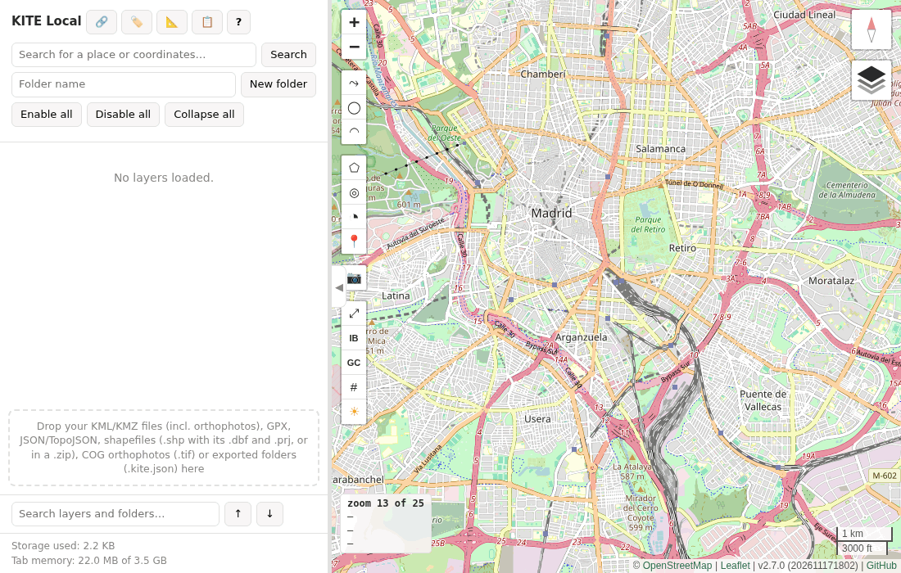

# KITE Local

**Open any KML. Keep every folder. Nothing leaves your browser.**

*KML Interactive Tree Explorer* is a free, open-source viewer and organizer for **KML, KMZ, GeoJSON, shapefile and GPX** files. It turns the folder structure of your file into a layer tree you can switch on and off, style, filter, measure and export — all in **one HTML file**: no installation, no account, no server, no upload.

[](https://github.com/ifsnop/kite/actions/workflows/tests.yml)
[](https://github.com/ifsnop/kite/releases/latest)
[](LICENSE)

> **Looking for an alternative to Google Earth Pro for desktop?** As of 25 June 2027 Google stops offering it for download ([Google Earth Help](https://support.google.com/earth/answer/168344?hl=en)). KITE Local is built for the everyday KML workflow, in a browser: open your files, keep their folders, compare, style and measure. [Why this project exists →](#why-this-project-exists)

## ▶ [Try it now — ifsnop.github.io/kite](https://ifsnop.github.io/kite/)

Open the link and drop a KML or KMZ onto the left panel. No file of your own at hand? Download the [sample KMZ](https://ifsnop.github.io/kite/docs/ejemplos/operacion-sierra.kmz) (right-click → *Save link as…*) and drop that.



The demo is the application itself, not a hosted service: the page is served from GitHub Pages and everything then runs in your browser. Files you drop onto it are **not uploaded anywhere** — the same guarantee as opening the downloaded file locally.

## Why KITE Local

- **Your folders stay folders.** The nested `Document` and `Folder` structure of a KML becomes a browsable tree instead of being flattened into geometry layers. One checkbox switches a whole file, a folder, a subtree or a single layer.
- **Private by design.** Files are read and processed in your browser and the workspace is kept in its local storage. Nothing is sent to an application server. (It does contact third parties when *you* ask it to — map tiles, place search, the optional elevation, Wikipedia and itinerary services — and the [full list](#internet-access-and-privacy) says exactly what and when.)
- **Nothing to install.** The complete application is one HTML file: download it, double-click it. Served over https it even reloads without a network connection.
- **No import quotas.** KITE Local sets no limit on file size, feature count or vertex count. A 309 MB KML with 62 000 hidden polygons loads in about 13 seconds and reopens in about 5.
- **Pick up where you left off.** The tree, its styles, the saved view and your measurements are stored locally, so closing the tab does not mean starting over.
- **Take your work out again.** Export any folder, file or layer as KML, GeoJSON or a portable `.kite.json`; the current view as a PNG image or a link; a route profile as a PNG image or a CSV file.

## What you can do

| | |
|---|---|
| **Bring data in** | KML · KMZ (with its ground overlays) · GeoJSON and TopoJSON · GPX · shapefiles (`.shp` or a `.zip`) · Cloud Optimized GeoTIFF orthophotos and elevation models · ArcGIS map services · files from a web address (when the server allows it) |
| **Organize** | Layer tree with multi-selection, drag and drop, cut/copy/paste, undo/redo, keyboard navigation like a file explorer, and a live filter that keeps only what matches — several words, along the folder path |
| **Style and edit** | Marker icons, colours and labels; polygon and line styling; drag a vertex, add or delete one; attribute table with sorting, filtering and CSV export; colour layers by attribute |
| **Measure and analyze** | Geodesic routes and circles, range rings and sectors, a geodesic calculator, terrain and surface elevation queries from public services, route profiles with line of sight, Fresnel zone and obstacles, itineraries between two points (with your own openrouteservice key) |
| **See it your way** | Several base maps at once with their own opacity, a map you can rotate, graticule and day/night overlay, a light and a dark theme, English and Spanish, and links that share a view |
| **Spain-specific extras** | IGN and PNOA maps and elevation models, cadastral parcels from the Cadastre, nearby Wikipedia articles |

The [full feature list](#full-feature-list) has every detail.

## Quick start

**Online — nothing to download:** open **[ifsnop.github.io/kite](https://ifsnop.github.io/kite/)** and drag your files onto the left panel. They never leave the browser.

**Your own copy:**

1. Download `kitelocal.html` from the [latest release](https://github.com/ifsnop/kite/releases/latest), or clone this repository:

   ```bash
   git clone https://github.com/ifsnop/kite.git
   cd kite
   ```

2. Open `kitelocal.html` in a modern desktop browser — double-clicking the file is enough.
3. Drag KML, KMZ, GeoJSON, shapefile, GPX or `.kite.json` files onto the left navigation panel.
4. Use the retained folder tree to organize, compare, show, hide and style the imported content.

No package manager, web server or build process is required to *use* the viewer. Developing it is another matter: the sources live in `src/` and are concatenated into that file by `build.js` (see [DEVELOPMENT.md](DEVELOPMENT.md)), but nobody running the viewer ever needs that step.

Two copies of that file are published, and they are the same application:

- **`kitelocal.html`** — the readable build, with the source and its comments intact. This is the one to download, read or debug.
- **`kitelocal.min.html`** — a minified derivative, and what the demo link serves: roughly 55 % smaller over the wire (gzip) than the readable build.

When it is served over https (the demo link, or your own server), a third file, **`sw.js`**, lets the page reload **without a network connection**: a small service worker that keeps the app and its pinned, integrity-checked libraries, so a tab the browser discarded comes back with your saved tree. Map tiles, place search and elevation services still need a network; the app says so instead of failing obscurely. Opened by double click (`file://`) no worker is registered and nothing changes. `sw.js` is generated from `src/sw.js` like the other two.

### Self-hosting on your own server

Copy `kitelocal.min.html` — renamed to `index.html` if you want it at the folder's address — and `sw.js` into the same folder of any static web server (Nginx, Caddy, Apache…) or static host such as GitHub Pages. No backend or Node.js runtime is needed. Serve it over HTTPS (or from `localhost`) to get the offline reload; everything else works over plain HTTP.

The page still loads Leaflet, JSZip and a few other libraries from public CDNs (`unpkg.com`, `cdnjs.cloudflare.com`) and map tiles from their providers, so an air-gapped intranet needs those vendored first: see [Internet access and privacy](#internet-access-and-privacy).

**Found it useful?** A ⭐ on the [repository](https://github.com/ifsnop/kite) helps other people find it, and an [issue](https://github.com/ifsnop/kite/issues) telling us what is missing helps it get better.

## Where it fits

KITE Local does the simple but very common job: **open, organize, compare and measure structured KML content quickly, while keeping it under your control.**

- **Reach for QGIS** for advanced geoprocessing, coordinate reference systems, data editing and cartographic production. General-purpose GIS importers commonly translate KML folders into separate geometry layers or keep the original path only as an attribute; KITE Local keeps the structure visible and directly usable.
- **Reach for Google Earth** (desktop or web) for a 3D globe, terrain and imagery. KITE Local adds direct file-, folder- and subtree-level visibility controls, needs no application-side upload, and keeps the working tree on your machine.
- It is a 2D Leaflet viewer. 3D models, tours, screen overlays and network links are outside the current scope (georeferenced ground overlays are supported): see the [supported KML subset](#supported-kml-subset) and the [known limitations](#known-limitations).

## Why this project exists

Google has announced that **as of 25 June 2027 Google Earth Pro for desktop will no longer be available for download** ([Google Earth Help](https://support.google.com/earth/answer/168344?hl=en)).

Many people use that desktop client mainly to open local KML/KMZ files, keep their organization, compare layers, adjust simple styles, add locations and make quick measurements — without installing a full GIS package or uploading data to an application server. KITE Local focuses deliberately on that workflow: if a KML is used as a conventional collection of folders, placemarks, lines and polygons, it is designed to open it directly while retaining its folder hierarchy.

It is an independent AGPL-3.0 project and is **not affiliated with or endorsed by Google, Google Earth, QGIS, OpenStreetMap, Esri, Leaflet, Iconify or Instituto Geográfico Nacional de España**.

## Documentation

The documents live in [`docs/`](docs/) and are written in Spanish:

- [**User manual**](docs/manual-usuario-kite-local.md) — every panel, dialog, menu and shortcut, with screenshots, and step-by-step recipes for the usual tasks.
- [**Security study**](docs/estudio-seguridad-kite-local.md) — where each layer and service comes from, why the application does not alter the data it shows, and which automated tests back that up.
- [**Pending work and proposals**](docs/pendientes-y-propuestas-kite-local.md) — what is known to be missing and the ideas for developing it further, in a single list.

For contributors, in English: [**CONTRIBUTING.md**](CONTRIBUTING.md) — reporting a problem, setting up, preparing and testing a change, and translations — and [**DEVELOPMENT.md**](DEVELOPMENT.md) — the development roadmap, how a release is cut, and how to diagnose a freeze with the `debug` branch.

## Full feature list

### File support

- KML files, preserving nested `Document` and `Folder` structures
- KMZ archives, including the images referenced by their ground overlays
- GeoJSON, TopoJSON and plain JSON
- GPX: waypoints, routes and tracks (with elevation and times), named from the
  file's own `<name>`
- Shapefiles: drop the `.shp` together with its `.dbf`, `.prj` and `.cpg`,
  or the `.zip` that holds them (one folder per layer). Coordinates are
  reprojected from the `.prj` with proj4 (ETRS89 UTM, the usual case in
  Spain; ED50 with the standard peninsular parameters, flagged in the
  summary). Without a `.prj`, only coordinates already in degrees are
  accepted. Text encoding comes from the `.cpg`, or is detected (UTF-8,
  else Windows-1252). Z values are not imported
- Cloud Optimized GeoTIFF orthophotos (`.tif`, 8-bit RGB or grey) and
  single-band elevation models (16/32-bit integer or float, drawn with a
  colour ramp and relief shading, altitude under the cursor): dropped
  onto the panel, validated, then copied as a Blob into the browser's own
  IndexedDB store so they survive a reload. Drawn by a custom
  `L.GridLayer` that reads only the window and overview level each tile
  needs (geotiff.js `fromBlob`), reprojected per tile through a 16×16
  proj4 grid (WGS84 UTM any zone north or south, ETRS89 UTM 28–38 (EPSG:258xx and 3040–3050), ED50 UTM
  28–31, REGCAN95, WGS84, ETRS89, Web Mercator). Not included in `.kite.json` exports or the system
  clipboard; a deleted one is purged from storage on the next start
- KITE Local folder exports (`.kite.json`)
- ArcGIS map services (`MapServer`): see [ArcGIS map services](#arcgis-map-services)
- drag-and-drop import; dropping onto a folder imports inside it
- tolerant XML parsing: a namespace prefix that a file uses but never
  declares — accepted by Google Earth, rejected by any XML parser — is
  repaired once and reported, instead of losing the whole file
- per-entity error isolation: one broken geometry cannot abort an import,
  and every load ends with a summary of what came in, what was skipped
  and why
- KML `ExtendedData` (`<Data>` and `<SchemaData>`) are kept as layer attributes
- optional removal of HTML-like tags left in names by some exporters
- optional merging of duplicate placemarks (same name and position)
- for a GeoJSON whose features carry no `name` or `title`, a prompt to
  choose which property to use as the name, remembered for future files
  with the same property structure
- progress indication and batched layer construction for larger files
- layers a file brings switched off are not drawn until you switch them on: a 309 MB KML with 62 000 hidden polygons loads in about 13 seconds and reopens in about 5, instead of rebuilding every layer on each start

### Layer workspace

- hierarchical tree of files, folders and layers
- global, file, folder, subtree and individual visibility controls
- rename, delete, reorder and alphabetically sort nodes
- drag layers and folders within the tree
- multi-selection, including Shift ranges and single-node toggles; on a row
  that belongs to the selection, the visibility checkbox, the 🔍 magnifier, delete
  and properties act on the whole selection (the magnifier frames the set)
- cut, copy and paste; undo and redo
- keyboard navigation modelled on a file-explorer tree, with a shortcut
  cheat sheet built in
- collapse and expand folders; deep collapse of a whole branch
- live filter of the tree by name as you type (from the third letter, or Enter):
  case-, accent- and in-word-insensitive, only the matching rows and the folders
  that hold them stay visible; folders you have never opened are counted without
  being built (a 20,000-layer folder filters instantly, "(37)" next to its name);
  several words match along the path («madrid parcela» finds «Parcela 3» inside
  «Madrid»), a folder that matches shows what it holds, and the typed words are
  marked in the names; the × or Esc clears it, Enter and the ↑ ↓ buttons jump
  between matches
- pan to a node, zoom to a node (a fixed level for a marker; a
  margin-framed fit-to-bounds for a polygon, line or measurement), and fit
  the map to loaded content
- an information panel per layer: the original KML `description`
  (sanitized against an allow-list) or a table of the GeoJSON
  `properties` (a pin, shape or measurement without attributes shows its
  name, kind and position or measures); sweeping the mouse across the map only changes it where the
  pointer rests, and every layer rested on stays as a tab in one strip under
  the card's title (click a tab to see its card, one at a time, and outline
  the layer on the map; the small pin on each tab, or F over a layer, keeps
  it, and a pinned card on screen no longer follows the mouse;
  selecting text to copy it never changes the card)
- right-click menu on the map, which resolves overlapping layers into a
  submenu instead of guessing one
- export any folder, file or layer as KML, GeoJSON or a portable `.kite.json`
  package (the 💾 button on its row)
- sections that the application creates itself (Markers, Elevations,
  Downloads, Measurements…) are tinted pastel blue, so they are not mistaken
  for an imported file or a row under the mouse
- local storage usage indicator, and a session log of every notice shown
- a Properties panel. *Preferences*: theme, language, the distance and
  altitude units, coordinate format, the interactive-vertex-edit cap, arc
  segments, the longest profile and the largest size a KMZ may take once
  uncompressed (500 MB by default) — previewed live where it can be, and only
  saved on Accept. An *Advanced preferences* box shows, with their names in
  red, the values that used to be fixed in the code, each bounded and back to
  its default with *Restore*: *Interface*
  (notices, tree search, undo depth), *Cards* (hover delays and how many recent
  and pinned cards), *Map and keyboard* (zoom levels, arrow-key and wheel
  speeds, click tolerance), *Files* (the limits against hostile files),
  *Network* (timeouts and retries of every external service) and some rows of
  *Elevation and profile*, a tab always shown for the Fresnel frequency.
  *Data sources*:
  which service supplies the terrain and surface models. *GeoJSON indexes*:
  remembers which property names each GeoJSON structure. *Restore*: deletes
  everything the application has saved in the browser, after a second
  confirmation
- windows, and the info card that remembers where it was left, always open
  whole inside the browser window, even when it is now smaller
- a light/dark interface theme that follows the system or is forced, and
  English and Spanish interfaces that follow the browser or are forced
- the interface follows the system's accessibility preferences (reduced motion,
  reduced transparency, increased contrast); buttons respond the moment they are
  pressed, menus and dialogs enter with a short animation (closing is instant),
  and the panel splitter works with a mouse, a pen or a finger
- a phone notice («better from a computer») and a full-screen panel layout on
  small touch screens
- a «What's new» window at startup with a short, plain summary of what each
  release brought since the version last opened (the first time, since 2.0);
  «Don't show again until the next version» keeps it closed until a new one

### Loading

- drag KML, KMZ, GeoJSON, TopoJSON, shapefiles and exported `.kite.json` folders onto
  the panel, or drop them straight into a folder
- **open a URL**: paste an address, download it, see what actually
  arrived — the format is recognised from the content, not the
  extension — and only then add it to the tree. Downloads collect under a
  «Descargas» section, one numbered folder each, so where something came
  from stays visible whatever the format. A download in progress can be cancelled without waiting
  for the timeout.

### Styling and editing

- Leaflet and Material Design marker icons, embedded in the file
- marker size, colour, label size and label colour
- optional permanent marker labels
- marker renaming and coordinate editing in decimal degrees or DMS
- marker repositioning by dragging
- polygon and line outline width and colour
- polygon fill colour and opacity, with an outline/fill/both selector
- optional permanent polygon and line labels, like the marker ones
- read-only perimeter (or length) and area, in metres, kilometres, feet,
  statute miles or nautical miles
- interactive vertex editing on the map for an already-created polygon,
  line or route, while its style dialog is open: drag a vertex to move it,
  right-click to delete it, Shift+click or the Insert key to add one — with
  a minimum per ring and an adjustable cap (500 by default) on how many
  vertices get on-map handles before it falls back to the text editor
- the properties dialog has the tree row's 🔍 and × (centre on the layer and
  delete it): with several layers in the dialog, the magnifier frames them all
  and delete asks for confirmation; Ctrl+Z brings back the original style
- a point-list editor: one vertex per line, tab-separated, so a geometry
  can be copied into a spreadsheet and pasted back
- ground-overlay image opacity
- batch style changes for selected compatible layers, including renaming.
  A value that differs across the selection is shown as such and is left
  alone unless it is edited, so accepting the dialog never quietly
  levels the settings that were only being looked at
- every dialog edits a draft: nothing reaches the map until Accept

### Base maps

Several can be enabled at once, each with its own opacity, and their
stacking order can be changed:

- OpenStreetMap
- Esri World Terrain and Esri hillshade
- IGN Base and MTN topographic maps (Spain)
- PNOA orthophotography, current and historical (Spain)
- Madrid city orthophotography (Ayuntamiento de Madrid WMS)
- IGN terrain WMS (Spain)
- SRTM30 relief (terrestris, 56°S–60°N)
- Copernicus DEM through Sentinel Hub, which needs the user's own
  instance ID; it is stored in that browser only and never travels with
  an export
- optional blank base map
- **base layers of your own**: the «+» button at the bottom of the list adds
  a tile server (a base address, or a full template with `{z}`, `{x}`, `{y}`
  in any order and format, rows counted from the top or from the bottom) or a
  WMS server (its layers are read from its `GetCapabilities` and chosen in the
  row), up to twenty. Each one can be renamed, pointed elsewhere or deleted
  (after a confirmation); they are kept in that browser only and never travel
  with an export or a view link
- **the whole configuration to a file**: 💾 next to «+» saves the order, which
  layers are on, their opacity, your own servers and the background colour
  (never the Copernicus credential) to a `.kite.json`; dropping it on the
  navigation panel applies it without deleting anything, and a server new to
  that browser arrives switched off

A base layer whose service stops answering is flagged in the panel, and
the flag clears by itself when the tiles come back.

### Attributes

- the ▦ button of a folder or file opens an attribute table: one row per layer
  and one column per attribute (GeoJSON and shapefile properties, KML
  `ExtendedData`). Sort by column (numbers as numbers, empty cells last),
  filter, jump to a layer and export what is shown as CSV (commas and a decimal point in English, semicolons and a decimal comma in Spanish), with the standard
  defence against spreadsheet formulas hidden in a foreign file. A folder of
  5 000 layers keeps about twenty rows in the DOM
- «Estilo por atributo» colours all the layers of that table once, by category
  (the most frequent values, plus «Otros» and «sin valor») or graduated over a
  numeric column (equal intervals or quantiles), with colour-blind-safe
  palettes, a live preview and Cancel. The result is ordinary layer styles,
  not a stored rule

### Range rings and sectors

- right-click → «Crear» › «Anillos de alcance…» / «Sector…»: concentric
  geodesic rings (every radius you list, optional radials) or a sector between
  two azimuths, optionally an annulus, centred on the point you clicked, with
  a live preview. They become ordinary layers of the tree, so they can be
  styled, edited and exported like any other
- the ◎ and ◔ buttons of the drawing toolbar are one-click tools: press one,
  click on the map where the centre goes, and the same dialog opens centred
  there (it can still be moved before saving). The pin (📍) works the same way.
  The toolbar lists polygon or line, rings, sector and pin in that order — the
  same order as the «Crear» menu

### ArcGIS map services

- paste the address of an ArcGIS REST `MapServer` into the 🔗 dialog: the
  service becomes one node of the tree with a row per server layer, drawn by
  the server itself as image tiles (so its symbols and labels are intact),
  and the checkboxes choose which layers it is asked for
- a layer that offers data can be brought in as real features («Traer como
  datos»), paged, capped, cancellable and imported like any downloaded GeoJSON
- no credentials are ever stored or exported (a `token` in the address is
  dropped), and a service that arrives inside someone else's `.kite.json`
  arrives switched off, with a notice naming the server

### Cadastral parcel, Wikipedia articles and orthophotos

- right-click → «Consultas» › «Parcela catastral» asks the Spanish Cadastre
  which parcel lies under the click and adds it as a polygon, with its
  cadastral reference
- right-click → «Consultas» › «Artículos de Wikipedia en la vista» asks Wikipedia
  for the geotagged articles within the reach of the current view from the click
  (up to the service's 10 km maximum; the 100 nearest) and adds
  them as «W» markers in a new folder; each marker's card holds the article's
  summary, a link to the full article and its distance, and the CC BY-SA credit
  is added to the map's attribution
- right-click → «Consultas» › «Ruta desde aquí» / «Ruta hasta aquí», or
  «Itinerario» over a marker, opens «Calcular itinerario»: an itinerary between
  two points by car, bicycle or on foot from openrouteservice (HeiGIT), with
  your own API key entered in Properties → Data sources; the line goes to an
  «Itinerarios» section with its distance and duration (no turn-by-turn
  instructions)
- Cloud Optimized GeoTIFF orthophotos and elevation models (see
  [File support](#file-support)) stay in the browser's own store and are never
  part of an export

### Map tools

- while drawing a polygon, line or route the map can still be panned by
  dragging it (the click that ends a drag adds no vertex); removing the second
  point of a route being created undoes the route and leaves its first point
  as the preview
- the layers list of the base maps closes when you act anywhere else
- map rotation: drag the compass (or hold the middle button) to turn the map
  freely, with a click or the R key to put north back up; layers and the
  graticule rotate with it and the labels stay horizontal
- share a view as a link: right-click → «Copiar» › «Enlace a esta vista» keeps
  centre, zoom, rotation and active base maps in the `#map=…` part of the
  address, and opening such a link restores them
- place search through Nominatim; coordinates typed in the same box (decimal, decimal comma, or degrees-minutes-seconds with hemisphere letters) create a marker in "Places" and take the map there at zoom 17 without any request
- pointer coordinates in decimal degrees, degrees/minutes/seconds and UTM
- scale bar
- latitude/longitude graticule
- shortcuts for the Iberian Peninsula/Balearic Islands and Canary Islands
- drop a marker where you click (the 📍 tool; its properties open first and Cancel discards it)
- draw polygons and open lines vertex by vertex
- a day/night overlay and the sun and twilight times of a marker
- a geodesic calculator (📐): elevation angle with cone of silence and
  atmospheric-pressure correction, and the vector between two GPS positions
- export the current view as a PNG image

### Elevation

- right-click on the map → «Consultas» › «Elevación»: terrain (MDT) and
  surface (MDS) elevation of a ~40 m square around the point, drawn as a
  readable grid of cells with the difference between them — the visible
  sign of buildings or vegetation
- A− / A+ buttons above the scale make the numbers in the cells smaller or
  bigger (remembered); when the numbers no longer fit inside a cell it falls
  back to the plain red/white fill used at low zoom
- each query becomes an ordinary layer of the tree, inside one folder per
  session under «Elevaciones»: persistent, toggleable and deletable like
  any other; hovering a cell shows its values in the coordinates box
- the data sources are chosen in Properties → «Fuentes de datos», from a
  list built into the application (or none, to skip that model): the
  IGN's WCS services by default — MDT05 (5 m), MDT25 or MDT200 for the
  terrain, MDS (5 m) for the surface; Spain only — and Digital Earth
  Africa's Copernicus DEM as an alternative surface model (Africa, the
  Canary Islands and the Iberian Peninsula up to 39° N, ~30 m cells);
  each layer is named after the dataset and provider it came from
  («Elevación 3 — MDT25 + MDS (IGN)»)
- the first query to each service in a session reads its capabilities
  once, picks the finest grid of the chosen dataset and the ASCII format
  when offered (GeoTIFF otherwise), and notes the choice in the message
  log
- transient failures (timeout, network, 429, 5xx) are retried up to three
  times with a growing pause; Digital Earth Africa gets a longer timeout,
  since its first answer for an area takes 17–33 s (measured)
- heights follow their own unit of altitude, independent of the unit of
  distance (Properties → Preferencias)
- each query costs a request to a third party, so nothing is requested
  until you ask

### Route profile

- right-click on a route (or its properties dialog) → «Obtener perfil»:
  the chosen terrain (MDT) and surface (MDS) models are downloaded along
  the route in bounded chunks, with a progress bar and a scrollable debug
  log of every request sent and what came back, and drawn as an
  elevation profile — distance from the start across, height up, MDT in
  blue and MDS in green, leg vertices in bold
- hovering the chart moves a red line across it and a red arrow along the
  route on the map, pointing the way of travel; the readout gives the
  distance, both heights and their MDS−MDT difference (red above 1 m)
- the mouse wheel zooms the chart's distance around the pointer (from the
  whole route down to 0.1 m per pixel) and dragging pans it; Shift+wheel,
  or the wheel over the height axis, zooms the heights on their own
- heights rescale to what is shown unless the Y axis is locked; a toolbar
  has −/+ for each axis, «Bloquear eje Y» and «Ver todo»; the curves are
  straight segments between cell values
- only the cells the route actually crosses are kept, as a layer of the
  «Perfiles de ruta» root folder that also stores the curves: from then on
  the option reads «Mostrar perfil» and shows them without downloading
  again; editing the route's waypoints asks for a new profile
- routes longer than a configurable limit (10 NM by default) get no
  profile, so a long route cannot fill the browser storage with cells
- polygons with altitude as obstacles: the visible polygons of a KML or a GeoJSON that cross the route are drawn as blocks from the terrain up to their roof, in red where the start–end line passes below it, with a sentence saying which ones block the line and the clearance of each under the cursor. The KML altitude mode of each polygon (`absolute`, `relativeToGround`, `clampToGround`; sea-floor modes are left out with one warning per file) is kept, shown and editable in the polygon's list of points; altitude without a mode, and GeoJSON altitude, count as above sea level. Above-ground heights are added to the terrain the profile has just downloaded, with no extra request. Obstacles and the tower heights and vertices are saved with the profile; «Actualizar obstáculos» collects the visible polygons again
- the chart exports as a PNG image and its numbers as a CSV file; with the line of sight or the Fresnel ellipsoid on, the file also carries the tower positions (1 for the start tower, 2 for the end tower, 0 elsewhere), the altitude of the line of sight, the lower and upper altitude of the 60 % Fresnel zone and, with obstacles shown, their names and the highest roof at each distance, in the format of the interface language: commas and a decimal point in English, semicolons and a decimal comma in Spanish (what Excel expects there)

### Measurements

- geodesic route measurement: click each waypoint, double-click to finish —
  distance and initial bearing per leg, plus the running total; a
  two-waypoint route is the old straight-line measurement
- geodesic circle radius and area
- drag a waypoint, or a circle's centre or edge, to move it — no modifier
  key needed; insert and delete route waypoints the same way as polygon
  vertices (right-click, Shift+click, Insert, Delete)
- while its dialog is open, a measurement's figures refresh live as it is
  dragged, with no need to close and reopen the dialog, and the 🔍 action
  fits the map to its full geometry with a margin instead of a fixed zoom
  level
- stroke and fill styling, and values shown in metres, kilometres, feet,
  statute miles or nautical miles — the same unit the map labels use
- persistent measurements stored with the workspace

## Supported KML subset

The viewer handles the core structures used by many conventional KML files:

- `Document` and `Folder` hierarchy
- `Placemark`
- `Point`
- `LineString`
- `Polygon`, including inner rings
- `MultiGeometry`
- node `visibility` and folder/document `open`
- shared and inline `Style` for basic line and polygon appearance
- resolvable `StyleMap` normal-style references
- `GroundOverlay` georeferenced images, including those bundled in a KMZ
  (axis-aligned `LatLonBox` only: a `rotation` is read and reported, but
  not applied)

KML is a broad specification. The following are not fully supported or are intentionally simplified:

- Google Earth icon styles and arbitrary remote/local icon resources
- altitude rendering and altitude modes
- extrusions and 3D geometry
- screen overlays
- network links and refresh behavior
- tracks, tours, models and time primitives (GPX tracks, on the other hand, are
  imported)
- balloon templates and rich KML descriptions
- highlight styles in `StyleMap`
- all KML namespaces and extensions
- exact Google Earth rendering parity

Imported marker icons are replaced by the viewer's default marker unless the user selects another icon.

## GeoJSON styling

The viewer recognizes a subset of Mapbox simplestyle properties:

- `stroke`
- `stroke-width`
- `fill`
- `fill-opacity`

Other properties remain part of the GeoJSON data but may not affect rendering.

## Browser compatibility

A recent desktop browser is recommended. The application relies on IndexedDB, Fetch, File and Blob APIs, async/await, pointer events, CSS custom properties and `:scope` selectors.

The interface is primarily designed for mouse and keyboard use. On a phone it shows a notice recommending a computer and offers a map-only layout; touch support and accessibility otherwise remain areas for improvement.

## Known limitations

- The application is a 2D Leaflet viewer, not a 3D virtual globe.
- The simple compatibility statement applies to conventional folder/placemark/line/polygon KML, not every feature in the full KML specification.
- `DOMParser` and `JSON.parse` are synchronous and can briefly block the interface on large inputs (reading the XML of a 309 MB KML is one task of about 4 seconds).
- The application sets no explicit KML-size or feature-count limit, but the browser, RAM, IndexedDB quota and rendering performance impose practical limits. A KMZ (or shapefile `.zip`) is checked before anything is unpacked: at most 2000 entries, a 200× compression ratio and an uncompressed size of 500 MB by default; the uncompressed size can be changed in Properties → Preferences, and the other import limits, within bounds, in Properties → Files (an advanced tab).
- Altitude is carried through import, storage and export, but it is not drawn on the map: this is a 2D viewer (the one place it is used is a route profile, where a polygon with altitude counts as an obstacle; `<extrude>` is not read, so such a polygon is always a block from the terrain up). Two placemarks at the same latitude and longitude but different altitudes are still treated as duplicates.
- KML style handling is partial: shared and inline styles for basic line and polygon appearance, and `StyleMap` normal-style references. (Namespaces are not a limitation — elements are matched by local name, so prefixed, default-namespaced and namespace-less KML all work.)
- External services can change, rate-limit requests or become unavailable.
- Opening a URL only works if that server allows other pages to read it (CORS headers). Most static hosts do; many portals do not, and the browser gives the page no detail about why. For those, download the file and drop it in — the dialog says so when it happens.
- `.kite.json` is application-specific and currently requires a matching tree schema version.
- The interface is available in Spanish and English; right-to-left languages are not supported.

## Local persistence and backups

The complete tree is serialized to GeoJSON and saved in the browser using IndexedDB. Imported source files are not required after a successful import. The application also requests persistent browser storage when the browser supports it.

Browser storage is convenient, but it is **not a backup**. It may be cleared by the user, browser policy or storage pressure. Export important folders to `.kite.json` and keep copies outside the browser profile.

To start over, Properties → **Restore** deletes everything the application has saved in the browser (the tree, the copied orthophotos and every setting). A button alone does nothing: it opens a second confirmation, and the page reloads when it is done. The interface language is kept.

## Internet access and privacy

Imported KML/KMZ/GeoJSON content is parsed locally and is **not uploaded to an application server**. The imported geometries and workspace remain in the user's browser.

The current build is not fully offline and makes external requests:

- Leaflet CSS, JavaScript and default marker images, topojson-client and
  shapefile are loaded from `unpkg.com`, and JSZip from
  `cdnjs.cloudflare.com`, when the page opens;
- html2canvas and geotiff.js (`unpkg.com`) and proj4js
  (`cdnjs.cloudflare.com`) are loaded only the first time they are needed
  (PNG export, GeoTIFF/COG reading, reprojecting a shapefile `.prj`), with
  the same pinned version and integrity hash as before;
- place searches are sent to the public Nominatim service (coordinates typed in the search box are resolved locally and never sent);
- base-map tiles and WMS images are requested from their respective providers;
- elevation queries and route profiles are requested from the chosen WCS
  services (IGN by default, or Digital Earth Africa), and only when you ask
  for one; a profile is a handful of sequential requests along the route,
  under the same per-second cap. Digital Earth Africa currently answers
  Chromium-based browsers (Chrome, Edge…) with 403 Forbidden; it works
  from Firefox and Safari;
- the Copernicus DEM base layer, if enabled, is requested from Sentinel Hub
  with the user's own instance ID;
- a cadastral parcel is requested from the Spanish Cadastre (INSPIRE WFS), only
  when you ask for one from the context menu;
- the Wikipedia articles near a point are requested from the MediaWiki API of
  `es.wikipedia.org` or `en.wikipedia.org` (the language of the interface),
  only when you ask for them from the context menu: the coordinates of the
  click and the radius of the current view (10 m to 10 km), then the ids of the
  articles found;
- an itinerary is requested from `api.openrouteservice.org` (HeiGIT) only when
  you press «Calcular»: your own API key (kept only in your browser, never in
  an export), the mode and the coordinates of the origin and the destination;
- an ArcGIS map service you add is asked for its layer list once, and then for
  the images of the layers you tick, from the address you pasted;
- a base layer of your own requests its tiles (and, for a WMS, its layer list)
  from the address you typed. These two are the only servers in this list that
  the user names.

Material Design marker icons are **embedded in the file** and cost no request at all. They used to be fetched one by one from `api.iconify.design`, which meant 79 simultaneous requests every time the icon picker was opened; past the service's rate limit the icons silently went blank. They are now baked in at build time.

These providers receive ordinary request metadata, and text entered in the place search is sent to Nominatim. The imported KML geometry itself is not sent by the application to these services.

For controlled or offline deployments, vendor the JavaScript, CSS, image and icon dependencies locally, disable or replace the geocoder, and configure approved tile/WMS services.

Opening a URL downloads exactly the address you paste, with no credentials attached, and the content is then processed locally like any dropped file. Nothing is sent anywhere: the download is the only request, and it goes to the server you named.

## Security notes

`connect-src` accepts any https origin, which is the one directive that had to be opened: the address a URL import downloads from is chosen by the user, so enumerating origins is impossible by definition. Nothing else was relaxed — `default-src 'none'` stands, and `script-src`, `style-src` and `img-src` keep their closed lists, so a remote origin can supply data but never code or styles. `http:` is deliberately excluded.

Treat imported files as untrusted input. The viewer uses text insertion and explicit HTML escaping for marker labels, sanitizes KML `description` HTML against an allow-list, ships a restrictive `Content-Security-Policy` (`default-src 'none'` plus the specific origins it needs), and pins its CDN dependencies with Subresource Integrity. Marker icons are embedded rather than fetched, so no remote SVG is executed.

Do not use public tile, geocoding or CDN services for sensitive work without an appropriate security and privacy review.

## Contributing

Issues and pull requests are welcome. **Read [CONTRIBUTING.md](CONTRIBUTING.md) first**: how to report a problem (and what not to attach to a public issue), the one-time setup of the pre-commit hook after cloning, how to prepare and test a change, the language rules, and how to add a translation.

If what you hit is a freeze or a slowdown rather than a wrong result, the [`debug` branch](https://github.com/ifsnop/kite/tree/debug) carries an instrumented build: see [Diagnosing a freeze or a slowdown](DEVELOPMENT.md#diagnosing-a-freeze-or-a-slowdown-debug-branch).

Everything else for people who work on the code is in **[DEVELOPMENT.md](DEVELOPMENT.md)**: the [development roadmap](DEVELOPMENT.md#development-roadmap) (what is done, what is still open and what is deliberately not planned) and [how a release is cut](DEVELOPMENT.md#releasing).

## License

This project is licensed under the **GNU Affero General Public License v3.0 (AGPL-3.0)**.

See the repository's `LICENSE` file for the complete license text. Redistribution and modification are subject to the AGPL-3.0 terms.

The map rotation code (`src/js/08-map-rotation.js`) is derived from [leaflet-rotate](https://github.com/Raruto/leaflet-rotate) 0.2.8 by Raruto and contributors (IvanSanchez, Fnicollet, Hyperknot), released under the GPL-3.0. It has been incorporated, cut down and modified, and is distributed as part of KITE Local under the AGPL-3.0, as section 13 of the GPLv3 allows; its authorship notice is kept in the file.

## Third-party services and libraries

This application currently uses or accesses:

- [Leaflet](https://leafletjs.com/)
- [JSZip](https://stuk.github.io/jszip/)
- [topojson-client](https://github.com/topojson/topojson-client)
- [html2canvas](https://html2canvas.hertzen.com/)
- [geotiff.js](https://geotiffjs.github.io/) (MIT) — reads elevation grids from services that only offer GeoTIFF, and COG orthophotos
- [shapefile](https://github.com/mbostock/shapefile) (BSD-3-Clause) — reads `.shp` and `.dbf` into GeoJSON
- [proj4js](https://proj4js.org/) (MIT) — reprojects shapefile coordinates from their `.prj`, and COG orthophotos per tile
- [leaflet-rotate](https://github.com/Raruto/leaflet-rotate) (GPL-3.0) — incorporated into the source (see License); not requested at runtime
- [Material Design Icons](https://pictogrammers.com/library/mdi/) (Pictogrammers, Apache-2.0) — embedded at build time through [Iconify](https://iconify.design/); not requested at runtime
- [OpenStreetMap](https://www.openstreetmap.org/)
- [Nominatim](https://nominatim.org/)
- Esri World Terrain and hillshade
- Spanish PNOA, IGN WMTS, WMS and WCS services
- [Dirección General del Catastro](https://www.sedecatastro.gob.es/) — cadastral reference and INSPIRE parcel service, only when you ask for a parcel
- [Wikipedia](https://www.wikipedia.org/) (MediaWiki API, Wikimedia Foundation) — geotagged articles and their summaries, only when you ask for them; the text is under CC BY-SA 4.0
- [openrouteservice](https://openrouteservice.org/) (HeiGIT) — itineraries between two points, only when you ask for one and with your own API key; route data © OpenStreetMap contributors
- [Ayuntamiento de Madrid orthophoto WMS](https://geoportal.madrid.es/) (data source: Ayuntamiento de Madrid)
- [SRTM30 tiles from terrestris](https://ows.terrestris.de/) (SRTM data © NASA LP DAAC)
- [Copernicus DEM through Sentinel Hub](https://dataspace.copernicus.eu/)
- [Digital Earth Africa](https://www.digitalearthafrica.org/) WCS — Copernicus DEM GLO-30 (© DLR e.V. 2010-2014 and © Airbus Defence and Space GmbH 2014-2018, provided under COPERNICUS by the European Union and ESA)

Their licenses, attribution requirements, acceptable-use policies and service limits apply independently.

## Google Earth desktop transition references

- [Google Earth Help — Update Google Earth Pro](https://support.google.com/earth/answer/168344?hl=en) — Google's own announcement that, as of 25 June 2027, Google Earth Pro for desktop will no longer be available for download
- [PCWorld coverage of the 25 June 2027 download cutoff](https://www.pcworld.com/article/3186820/you-have-until-2027-to-download-google-earth-pro-do-it-now.html)
- [Geopera analysis of the desktop transition](https://geopera.com/blog/google-earth-pro-desktop-discontinued)

Google Earth and Google Earth Pro are trademarks of Google LLC.
