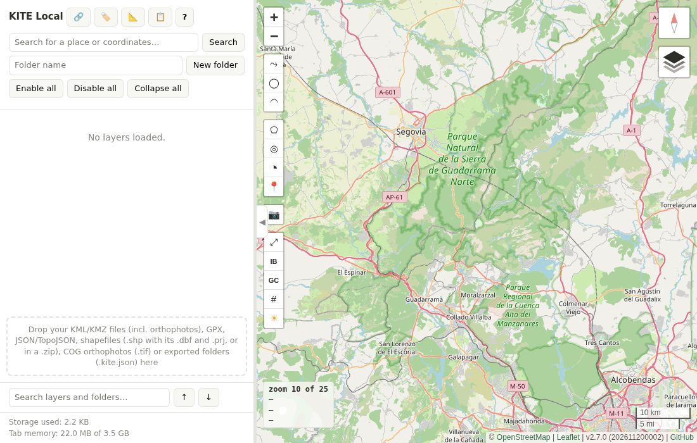
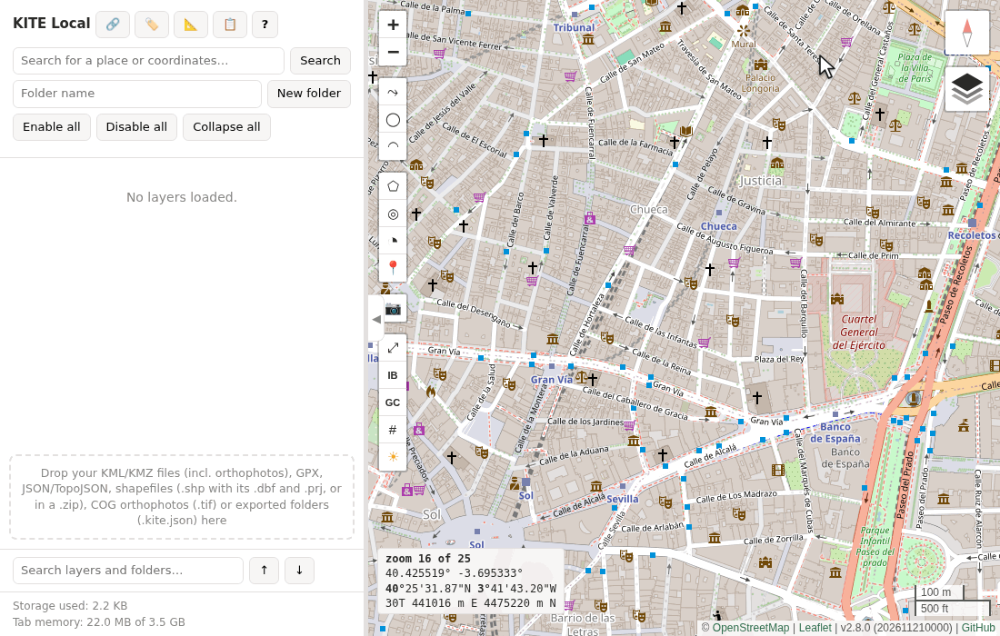

# KITE Local

**Open any KML. Keep every folder. Nothing leaves your browser.**

*KML Interactive Tree Explorer* is a free, open-source viewer and organizer for **KML, KMZ, GeoJSON, shapefile and GPX** files. It turns the folder structure of your file into a layer tree you can switch on and off, style, filter, measure and export — all in **one HTML file**: no installation, no account, no server, no upload.

[](https://github.com/ifsnop/kite/actions/workflows/tests.yml)
[](https://github.com/ifsnop/kite/releases/latest)
[](LICENSE)

> **Looking for an alternative to Google Earth Pro for desktop?** As of 25 June 2027 Google stops offering it for download ([Google Earth Help](https://support.google.com/earth/answer/168344?hl=en)). KITE Local is built for the everyday KML workflow, in a browser: open your files, keep their folders, compare, style and measure. [Why this project exists →](#why-this-project-exists)

## ▶ [Try it now — ifsnop.github.io/kite](https://ifsnop.github.io/kite/)

Open the link and drop a KML or KMZ onto the left panel. No file of your own at hand? Download the [sample KMZ](https://ifsnop.github.io/kite/docs/ejemplos/operacion-sierra.kmz) (right-click → *Save link as…*) and drop that.


The demo is the application itself, not a hosted service: the page is served from GitHub Pages and everything then runs in your browser. Files you drop onto it are **not uploaded anywhere** — the same guarantee as opening the downloaded file locally.

## Why KITE Local

- **Your folders stay folders.** The nested `Document` and `Folder` structure of a KML becomes a browsable tree instead of being flattened into geometry layers. One checkbox switches a whole file, a folder, a subtree or a single layer.
- **Private by design.** Files are read and processed in your browser and the workspace is kept in its local storage. Nothing is sent to an application server. (It does contact third parties when *you* ask it to — map tiles, place search, the optional elevation, Wikipedia and itinerary services — and the [full list](#internet-access-and-privacy) says exactly what and when.)
- **Nothing to install.** The complete application is one HTML file: download it, double-click it. Served over https it even reloads without a network connection.
- **No import quotas.** KITE Local sets no limit on file size, feature count or vertex count. A 309 MB KML with 62 000 hidden polygons loads in about 13 seconds and reopens in about 5.
- **Pick up where you left off.** The tree, its styles, the saved view and your measurements are stored locally, so closing the tab does not mean starting over.
- **Take your work out again.** Export any folder, file or layer as KML, GeoJSON or a portable `.kite.json`; the current view as a PNG image or a link; a route profile as a PNG image or a CSV file.

## See it in action

### Line of sight and Fresnel zone over real terrain


Draw a route and ask for its profile: KITE Local downloads the terrain and the surface model along it from public services (the IGN's, or Digital Earth Africa's for a surface model) and draws them. Put a tower at each end, switch on the start–end line and the Fresnel ellipsoid, and read, at any point of the route, how much clearance there is or which obstacle blocks it (polygons with altitude count as obstacles). Hover the chart and a red arrow follows on the map; the chart exports as a PNG image and its numbers as a CSV file.

*In the clip, the profile is downloaded live from the IGN (MDT05 terrain, MDS surface); a 10 m tower blocks the line at 3 km, a 60 m one clears it and the Fresnel zone still touches the ridge. Manual: [§7.9](docs/manual-usuario-kite-local.md#79-obtener-el-perfil-de-una-ruta)*

### Any GeoTIFF as a map layer



Drop a Cloud Optimized GeoTIFF onto the panel: an 8-bit orthophoto, or an elevation model drawn with a colour ramp and relief shading, with the altitude under the pointer read from the file. It is copied into your browser's own storage, so it survives a reload and never leaves it, and only the tiles in view are read and reprojected, so files of hundreds of MB stay usable.

*The clip drops the IGN's MDT25 of the Sierra de Guadarrama (© Instituto Geográfico Nacional de España, CC BY 4.0), downloaded when the clip is made and rebuilt as a COG. Manual: [§7.10](docs/manual-usuario-kite-local.md#710-ver-una-ortofoto-en-cog)*

### Wikipedia articles and itineraries



Right-click the map and the Wikipedia articles around that point appear as markers, each with its summary and a link to the full article. From any marker, or any point, ask for an itinerary by car, by bicycle or on foot, with its distance and duration (openrouteservice, with your own key).

*The articles are asked live from Wikipedia (text under CC BY-SA 4.0). The itinerary in the clip is answered by a stand-in for the openrouteservice response, because a clip cannot use anyone's key; with a key, KITE Local asks the real service. Manual: [§7.17](docs/manual-usuario-kite-local.md#717-consultar-los-artículos-de-wikipedia-de-los-alrededores), [§7.18](docs/manual-usuario-kite-local.md#718-calcular-un-itinerario-entre-dos-puntos)*

## What you can do

| | |
|---|---|
| **Bring data in** | KML · KMZ (with its ground overlays) · GeoJSON and TopoJSON · GPX · shapefiles (`.shp` or a `.zip`) · Cloud Optimized GeoTIFF orthophotos and elevation models · ArcGIS map services · files from a web address (when the server allows it). Manual: [§7.1](docs/manual-usuario-kite-local.md#71-importar-un-archivo-con-un-polígono-o-cualquier-otro-formato-admitido), [§7.10](docs/manual-usuario-kite-local.md#710-ver-una-ortofoto-en-cog), [§7.16](docs/manual-usuario-kite-local.md#716-ver-un-servicio-de-mapas-arcgis-mapserver) |
| **Organize** | Layer tree with multi-selection, drag and drop, cut/copy/paste, undo/redo, keyboard navigation like a file explorer, and a live filter that keeps only what matches — several words, along the folder path. Manual: [§3](docs/manual-usuario-kite-local.md#3-el-árbol-de-capas), [§2.3](docs/manual-usuario-kite-local.md#23-buscador-del-árbol), [§7.7](docs/manual-usuario-kite-local.md#77-deshacer-y-rehacer) |
| **Style and edit** | Marker icons, colours and labels; polygon and line styling; drag a vertex, add or delete one; attribute table with sorting, filtering and CSV export; colour layers by attribute. Manual: [§6](docs/manual-usuario-kite-local.md#6-estilos-de-capa), [§7.4](docs/manual-usuario-kite-local.md#74-personalizar-un-marcador), [§7.15](docs/manual-usuario-kite-local.md#715-ver-los-atributos-de-una-carpeta-y-exportarlos) |
| **Measure and analyze** | Geodesic routes and circles, range rings and sectors, a geodesic calculator, terrain and surface elevation queries from public services, route profiles with line of sight, Fresnel zone and obstacles, itineraries between two points (with your own openrouteservice key). Manual: [§7.2](docs/manual-usuario-kite-local.md#72-medir-una-distancia-y-un-rumbo), [§7.3](docs/manual-usuario-kite-local.md#73-medir-una-superficie-o-dibujar-una-figura-propia), [§7.13](docs/manual-usuario-kite-local.md#713-dibujar-anillos-de-alcance-y-sectores), [§7.8](docs/manual-usuario-kite-local.md#78-consultar-la-altitud-del-terreno), [§7.9](docs/manual-usuario-kite-local.md#79-obtener-el-perfil-de-una-ruta), [§7.18](docs/manual-usuario-kite-local.md#718-calcular-un-itinerario-entre-dos-puntos) |
| **See it your way** | Several base maps at once with their own opacity, a map you can rotate, graticule and day/night overlay, a light and a dark theme, English and Spanish, links that share a view, and a page that reloads offline. Manual: [§4.1](docs/manual-usuario-kite-local.md#41-mapas-base), [§4.4](docs/manual-usuario-kite-local.md#44-girar-el-mapa-brújula), [§7.14](docs/manual-usuario-kite-local.md#714-compartir-una-vista-con-un-enlace), [§7.11](docs/manual-usuario-kite-local.md#711-usar-kite-local-sin-conexión) |
| **Public-data extras (mostly Spain)** | IGN and PNOA maps and elevation models, cadastral parcels from the Spanish Cadastre, nearby Wikipedia articles. Manual: [§7.12](docs/manual-usuario-kite-local.md#712-consultar-una-parcela-catastral), [§7.17](docs/manual-usuario-kite-local.md#717-consultar-los-artículos-de-wikipedia-de-los-alrededores) |

The **[user manual](docs/manual-usuario-kite-local.md)** (in Spanish) documents every panel, dialog, menu and shortcut ([§8](docs/manual-usuario-kite-local.md#8-atajos-de-teclado)) with screenshots, plus step-by-step recipes for the usual tasks, so this page does not repeat it.

## Quick start

**Online — nothing to download:** open **[ifsnop.github.io/kite](https://ifsnop.github.io/kite/)** and drag your files onto the left panel. They never leave the browser.

**Your own copy:**

1. Download `kitelocal.html` from the [latest release](https://github.com/ifsnop/kite/releases/latest), or clone this repository:

   ```bash
   git clone https://github.com/ifsnop/kite.git
   cd kite
   ```

2. Open `kitelocal.html` in a modern desktop browser — double-clicking the file is enough.
3. Drag KML, KMZ, GeoJSON, shapefile, GPX or `.kite.json` files onto the left navigation panel.
4. Use the retained folder tree to organize, compare, show, hide and style the imported content.

No package manager, web server or build process is required to *use* the viewer. Developing it is another matter: the sources live in `src/` and are concatenated into that file by `build.js` (see [DEVELOPMENT.md](DEVELOPMENT.md)), but nobody running the viewer ever needs that step.

Two copies of that file are published, and they are the same application:

- **`kitelocal.html`** — the readable build, with the source and its comments intact. This is the one to download, read or debug.
- **`kitelocal.min.html`** — a minified derivative, and what the demo link serves: roughly 55 % smaller over the wire (gzip) than the readable build.

When it is served over https (the demo link, or your own server), a third file, **`sw.js`**, lets the page reload **without a network connection**: a small service worker that keeps the app and its pinned, integrity-checked libraries, so a tab the browser discarded comes back with your saved tree. Map tiles, place search and elevation services still need a network; the app says so instead of failing obscurely. Opened by double click (`file://`) no worker is registered and nothing changes. `sw.js` is generated from `src/sw.js` like the other two.

### Self-hosting on your own server

Copy `kitelocal.min.html` — renamed to `index.html` if you want it at the folder's address — and `sw.js` into the same folder of any static web server (Nginx, Caddy, Apache…) or static host such as GitHub Pages. No backend or Node.js runtime is needed. Serve it over HTTPS (or from `localhost`) to get the offline reload; everything else works over plain HTTP.

The page still loads Leaflet, JSZip and a few other libraries from public CDNs (`unpkg.com`, `cdnjs.cloudflare.com`) and map tiles from their providers, so an air-gapped intranet needs those vendored first: see [Internet access and privacy](#internet-access-and-privacy).

**Found it useful?** A ⭐ on the [repository](https://github.com/ifsnop/kite) helps other people find it, and an [issue](https://github.com/ifsnop/kite/issues) telling us what is missing helps it get better.

## Where it fits

KITE Local does the simple but very common job: **open, organize, compare and measure structured KML content quickly, while keeping it under your control.**

- **Reach for QGIS** for advanced geoprocessing, coordinate reference systems, data editing and cartographic production. General-purpose GIS importers commonly translate KML folders into separate geometry layers or keep the original path only as an attribute; KITE Local keeps the structure visible and directly usable.
- **Reach for Google Earth** (desktop or web) for a 3D globe, terrain and imagery. KITE Local adds direct file-, folder- and subtree-level visibility controls, needs no application-side upload, and keeps the working tree on your machine.
- It is a 2D Leaflet viewer. 3D models, tours, screen overlays and network links are outside the current scope (georeferenced ground overlays are supported): see the [supported KML subset](#supported-kml-subset) and the [known limitations](#known-limitations).

## Why this project exists

Google has announced that **as of 25 June 2027 Google Earth Pro for desktop will no longer be available for download** ([Google Earth Help](https://support.google.com/earth/answer/168344?hl=en)).

Many people use that desktop client mainly to open local KML/KMZ files, keep their organization, compare layers, adjust simple styles, add locations and make quick measurements — without installing a full GIS package or uploading data to an application server. KITE Local focuses deliberately on that workflow: if a KML is used as a conventional collection of folders, placemarks, lines and polygons, it is designed to open it directly while retaining its folder hierarchy.

It is an independent AGPL-3.0 project and is **not affiliated with or endorsed by Google, Google Earth, QGIS, OpenStreetMap, Esri, Leaflet, Iconify or Instituto Geográfico Nacional de España**.

## Documentation

The documents live in [`docs/`](docs/) and are written in Spanish:

- [**User manual**](docs/manual-usuario-kite-local.md) — every panel, dialog, menu and shortcut, with screenshots, and step-by-step recipes for the usual tasks.
- [**Security study**](docs/estudio-seguridad-kite-local.md) — where each layer and service comes from, why the application does not alter the data it shows, and which automated tests back that up.
- [**Pending work and proposals**](docs/pendientes-y-propuestas-kite-local.md) — what is known to be missing and the ideas for developing it further, in a single list.

For contributors, in English: [**CONTRIBUTING.md**](CONTRIBUTING.md) — reporting a problem, setting up, preparing and testing a change, and translations — and [**DEVELOPMENT.md**](DEVELOPMENT.md) — the development roadmap, how a release is cut, and how to diagnose a freeze with the `debug` branch.

## Supported KML subset

The viewer handles the core structures used by many conventional KML files:

- `Document` and `Folder` hierarchy
- `Placemark`
- `Point`
- `LineString`
- `Polygon`, including inner rings
- `MultiGeometry`
- node `visibility` and folder/document `open`
- shared and inline `Style` for basic line and polygon appearance
- resolvable `StyleMap` normal-style references
- `GroundOverlay` georeferenced images, including those bundled in a KMZ
  (axis-aligned `LatLonBox` only: a `rotation` is read and reported, but
  not applied)

KML is a broad specification. The following are not fully supported or are intentionally simplified:

- Google Earth icon styles and arbitrary remote/local icon resources
- altitude rendering and altitude modes
- extrusions and 3D geometry
- screen overlays
- network links and refresh behavior
- tracks, tours, models and time primitives (GPX tracks, on the other hand, are
  imported)
- balloon templates and rich KML descriptions
- highlight styles in `StyleMap`
- all KML namespaces and extensions
- exact Google Earth rendering parity

Imported marker icons are replaced by the viewer's default marker unless the user selects another icon.

## GeoJSON styling

The viewer recognizes a subset of Mapbox simplestyle properties:

- `stroke`
- `stroke-width`
- `fill`
- `fill-opacity`

Other properties remain part of the GeoJSON data but may not affect rendering.

## Browser compatibility

A recent desktop browser is recommended. The application relies on IndexedDB, Fetch, File and Blob APIs, async/await, pointer events, CSS custom properties and `:scope` selectors.

The interface is primarily designed for mouse and keyboard use. On a phone it shows a notice recommending a computer and offers a map-only layout; touch support and accessibility otherwise remain areas for improvement.

## Known limitations

- The application is a 2D Leaflet viewer, not a 3D virtual globe.
- The simple compatibility statement applies to conventional folder/placemark/line/polygon KML, not every feature in the full KML specification.
- `DOMParser` and `JSON.parse` are synchronous and can briefly block the interface on large inputs (reading the XML of a 309 MB KML is one task of about 4 seconds).
- The application sets no explicit KML-size or feature-count limit, but the browser, RAM, IndexedDB quota and rendering performance impose practical limits. A KMZ (or shapefile `.zip`) is checked before anything is unpacked: at most 2000 entries, a 200× compression ratio and an uncompressed size of 500 MB by default; the uncompressed size can be changed in Properties → Preferences, and the other import limits, within bounds, in Properties → Files (an advanced tab).
- Altitude is carried through import, storage and export, but it is not drawn on the map: this is a 2D viewer (the one place it is used is a route profile, where a polygon with altitude counts as an obstacle; `<extrude>` is not read, so such a polygon is always a block from the terrain up). Two placemarks at the same latitude and longitude but different altitudes are still treated as duplicates.
- KML style handling is partial: shared and inline styles for basic line and polygon appearance, and `StyleMap` normal-style references. (Namespaces are not a limitation — elements are matched by local name, so prefixed, default-namespaced and namespace-less KML all work.)
- External services can change, rate-limit requests or become unavailable.
- Opening a URL only works if that server allows other pages to read it (CORS headers). Most static hosts do; many portals do not, and the browser gives the page no detail about why. For those, download the file and drop it in — the dialog says so when it happens.
- `.kite.json` is application-specific and currently requires a matching tree schema version.
- The interface is available in Spanish and English; right-to-left languages are not supported.

## Local persistence and backups

The complete tree is serialized to GeoJSON and saved in the browser using IndexedDB. Imported source files are not required after a successful import. The application also requests persistent browser storage when the browser supports it.

Browser storage is convenient, but it is **not a backup**. It may be cleared by the user, browser policy or storage pressure. Export important folders to `.kite.json` and keep copies outside the browser profile.

To start over, Properties → **Restore** deletes everything the application has saved in the browser (the tree, the copied orthophotos and every setting). A button alone does nothing: it opens a second confirmation, and the page reloads when it is done. The interface language is kept.

## Internet access and privacy

Imported KML/KMZ/GeoJSON content is parsed locally and is **not uploaded to an application server**. The imported geometries and workspace remain in the user's browser.

The current build is not fully offline and makes external requests:

- Leaflet CSS, JavaScript and default marker images, topojson-client and
  shapefile are loaded from `unpkg.com`, and JSZip from
  `cdnjs.cloudflare.com`, when the page opens;
- html2canvas and geotiff.js (`unpkg.com`) and proj4js
  (`cdnjs.cloudflare.com`) are loaded only the first time they are needed
  (PNG export, GeoTIFF/COG reading, reprojecting a shapefile `.prj`), with
  the same pinned version and integrity hash as before;
- place searches are sent to the public Nominatim service (coordinates typed in the search box are resolved locally and never sent);
- base-map tiles and WMS images are requested from their respective providers;
- elevation queries and route profiles are requested from the chosen WCS
  services (IGN by default, or Digital Earth Africa), and only when you ask
  for one; a profile is a handful of sequential requests along the route,
  under the same per-second cap. Digital Earth Africa currently answers
  Chromium-based browsers (Chrome, Edge…) with 403 Forbidden; it works
  from Firefox and Safari;
- the Copernicus DEM base layer, if enabled, is requested from Sentinel Hub
  with the user's own instance ID;
- a cadastral parcel is requested from the Spanish Cadastre (INSPIRE WFS), only
  when you ask for one from the context menu;
- the Wikipedia articles near a point are requested from the MediaWiki API of
  `es.wikipedia.org` or `en.wikipedia.org` (the language of the interface),
  only when you ask for them from the context menu: the coordinates of the
  click and the radius of the current view (10 m to 10 km), then the ids of the
  articles found;
- an itinerary is requested from `api.heigit.org` (HeiGIT) only when
  you press «Calcular»: your own API key (kept only in your browser, never in
  an export), the mode and the coordinates of the origin and the destination;
- an ArcGIS map service you add is asked for its layer list once, and then for
  the images of the layers you tick, from the address you pasted;
- a base layer of your own requests its tiles (and, for a WMS, its layer list)
  from the address you typed. These two are the only servers in this list that
  the user names.

Material Design marker icons are **embedded in the file** and cost no request at all. They used to be fetched one by one from `api.iconify.design`, which meant 79 simultaneous requests every time the icon picker was opened; past the service's rate limit the icons silently went blank. They are now baked in at build time.

These providers receive ordinary request metadata, and text entered in the place search is sent to Nominatim. The imported KML geometry itself is not sent by the application to these services.

For controlled or offline deployments, vendor the JavaScript, CSS, image and icon dependencies locally, disable or replace the geocoder, and configure approved tile/WMS services.

Opening a URL downloads exactly the address you paste, with no credentials attached, and the content is then processed locally like any dropped file. Nothing is sent anywhere: the download is the only request, and it goes to the server you named.

## Security notes

`connect-src` accepts any https origin, which is the one directive that had to be opened: the address a URL import downloads from is chosen by the user, so enumerating origins is impossible by definition. Nothing else was relaxed — `default-src 'none'` stands, and `script-src`, `style-src` and `img-src` keep their closed lists, so a remote origin can supply data but never code or styles. `http:` is deliberately excluded.

Treat imported files as untrusted input. The viewer uses text insertion and explicit HTML escaping for marker labels, sanitizes KML `description` HTML against an allow-list, ships a restrictive `Content-Security-Policy` (`default-src 'none'` plus the specific origins it needs), and pins its CDN dependencies with Subresource Integrity. Marker icons are embedded rather than fetched, so no remote SVG is executed.

Do not use public tile, geocoding or CDN services for sensitive work without an appropriate security and privacy review.

## Contributing

Issues and pull requests are welcome. **Read [CONTRIBUTING.md](CONTRIBUTING.md) first**: how to report a problem (and what not to attach to a public issue), the one-time setup of the pre-commit hook after cloning, how to prepare and test a change, the language rules, and how to add a translation.

If what you hit is a freeze or a slowdown rather than a wrong result, the [`debug` branch](https://github.com/ifsnop/kite/tree/debug) carries an instrumented build: see [Diagnosing a freeze or a slowdown](DEVELOPMENT.md#diagnosing-a-freeze-or-a-slowdown-debug-branch).

Everything else for people who work on the code is in **[DEVELOPMENT.md](DEVELOPMENT.md)**: the [development roadmap](DEVELOPMENT.md#development-roadmap) (what is done, what is still open and what is deliberately not planned) and [how a release is cut](DEVELOPMENT.md#releasing).

## License

This project is licensed under the **GNU Affero General Public License v3.0 (AGPL-3.0)**.

See the repository's `LICENSE` file for the complete license text. Redistribution and modification are subject to the AGPL-3.0 terms.

The map rotation code (`src/js/08-map-rotation.js`) is derived from [leaflet-rotate](https://github.com/Raruto/leaflet-rotate) 0.2.8 by Raruto and contributors (IvanSanchez, Fnicollet, Hyperknot), released under the GPL-3.0. It has been incorporated, cut down and modified, and is distributed as part of KITE Local under the AGPL-3.0, as section 13 of the GPLv3 allows; its authorship notice is kept in the file.

## Third-party services and libraries

This application currently uses or accesses:

- [Leaflet](https://leafletjs.com/)
- [JSZip](https://stuk.github.io/jszip/)
- [topojson-client](https://github.com/topojson/topojson-client)
- [html2canvas](https://html2canvas.hertzen.com/)
- [geotiff.js](https://geotiffjs.github.io/) (MIT) — reads elevation grids from services that only offer GeoTIFF, and COG orthophotos
- [shapefile](https://github.com/mbostock/shapefile) (BSD-3-Clause) — reads `.shp` and `.dbf` into GeoJSON
- [proj4js](https://proj4js.org/) (MIT) — reprojects shapefile coordinates from their `.prj`, and COG orthophotos per tile
- [leaflet-rotate](https://github.com/Raruto/leaflet-rotate) (GPL-3.0) — incorporated into the source (see License); not requested at runtime
- [Material Design Icons](https://pictogrammers.com/library/mdi/) (Pictogrammers, Apache-2.0) — embedded at build time through [Iconify](https://iconify.design/); not requested at runtime
- [OpenStreetMap](https://www.openstreetmap.org/)
- [Nominatim](https://nominatim.org/)
- Esri World Terrain and hillshade
- Spanish PNOA, IGN WMTS, WMS and WCS services
- [Dirección General del Catastro](https://www.sedecatastro.gob.es/) — cadastral reference and INSPIRE parcel service, only when you ask for a parcel
- [Wikipedia](https://www.wikipedia.org/) (MediaWiki API, Wikimedia Foundation) — geotagged articles and their summaries, only when you ask for them; the text is under CC BY-SA 4.0
- [openrouteservice](https://openrouteservice.org/) (HeiGIT) — itineraries between two points, only when you ask for one and with your own API key; route data © OpenStreetMap contributors
- [Ayuntamiento de Madrid orthophoto WMS](https://geoportal.madrid.es/) (data source: Ayuntamiento de Madrid)
- [SRTM30 tiles from terrestris](https://ows.terrestris.de/) (SRTM data © NASA LP DAAC)
- [Copernicus DEM through Sentinel Hub](https://dataspace.copernicus.eu/)
- [Digital Earth Africa](https://www.digitalearthafrica.org/) WCS — Copernicus DEM GLO-30 (© DLR e.V. 2010-2014 and © Airbus Defence and Space GmbH 2014-2018, provided under COPERNICUS by the European Union and ESA)

Their licenses, attribution requirements, acceptable-use policies and service limits apply independently.

## Google Earth desktop transition references

- [Google Earth Help — Update Google Earth Pro](https://support.google.com/earth/answer/168344?hl=en) — Google's own announcement that, as of 25 June 2027, Google Earth Pro for desktop will no longer be available for download
- [PCWorld coverage of the 25 June 2027 download cutoff](https://www.pcworld.com/article/3186820/you-have-until-2027-to-download-google-earth-pro-do-it-now.html)
- [Geopera analysis of the desktop transition](https://geopera.com/blog/google-earth-pro-desktop-discontinued)

Google Earth and Google Earth Pro are trademarks of Google LLC.
