# Manual de usuario de KITE Local

### KML Interactive Tree Explorer — versión v1.11.0 (202610300021)

Este manual da por hecho que KITE Local ya está desplegado y abierto en el navegador (como archivo local con doble clic, o servido desde una dirección web): no trata la instalación, sino el manejo diario de la aplicación. Todas las capturas de este documento corresponden a una sesión de ejemplo con datos ficticios (una zona de operación y unos sensores cerca de Madrid), usada solo para ilustrar cada función. Los archivos de ejemplo están en la carpeta `docs/ejemplos` del repositorio, y las capturas se regeneran con `npm run capturas`.

---

## Índice

1. [Idea general y estructura de la ventana](#1-idea-general-y-estructura-de-la-ventana)
2. [El panel de navegación](#2-el-panel-de-navegación)
3. [El árbol de capas](#3-el-árbol-de-capas)
4. [El panel del visor (el mapa)](#4-el-panel-del-visor-el-mapa)
5. [El menú contextual del visor](#5-el-menú-contextual-del-visor)
6. [Estilos de capa](#6-estilos-de-capa)
7. [Cómo hacer las tareas más habituales](#7-cómo-hacer-las-tareas-más-habituales)
8. [Atajos de teclado](#8-atajos-de-teclado)
9. [Qué se guarda y dónde](#9-qué-se-guarda-y-dónde)

---

## 1. Idea general y estructura de la ventana

KITE Local reparte la pantalla en dos zonas, separadas por una barra que se puede arrastrar para darle más sitio a una u otra:

- **El panel de navegación**, a la izquierda: el árbol de capas cargadas, con sus carpetas, y todos los controles para buscar, importar, ordenar y organizar esa información.
- **El panel del visor**, a la derecha: el mapa, con la cartografía de fondo y todas las capas que estén activas.

Un botón con una flecha (◀ / ▶), en el borde entre ambos, oculta o vuelve a mostrar el panel de navegación por completo, para quien quiera ver el mapa a pantalla completa un momento sin perder lo cargado.

*Figura 1. Vista general: panel de navegación (árbol con dos zonas, dos puntos de interés, una línea y una capa de sensores) y visor con la cartografía de fondo. En el visor, a la izquierda las barras de herramientas, y a la derecha la brújula y el botón de mapas base.*

**Desde un móvil.** KITE Local está pensado para pantallas de escritorio: en la de un teléfono no hay espacio para el panel de navegación y el mapa a la vez. Al abrirlo desde un móvil (pantalla táctil con el lado corto por debajo de 600 píxeles, en vertical o en horizontal; una tableta o una ventana estrecha de ordenador no cuentan) aparece un aviso, «Mejor desde un ordenador», que lo recomienda y ofrece dos salidas. «Continuar de todos modos» oculta el panel de navegación y deja solo el mapa. «Cerrar» (o la tecla Escape) deja el panel de navegación, que en un móvil ocupa toda la pantalla. En los dos casos la flecha del borde alterna entre el panel y el mapa, y la elección se recuerda: las siguientes veces no se vuelve a preguntar.

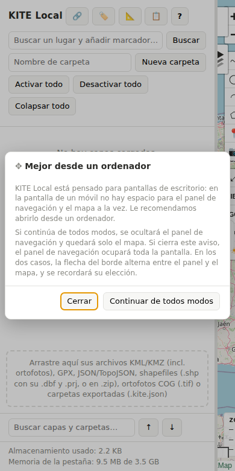
*Figura 2. El aviso «Mejor desde un ordenador» en un móvil (aquí, una pantalla de 390 píxeles de ancho): «Cerrar» deja el panel de navegación y «Continuar de todos modos» deja solo el mapa.*

Una idea recorre toda la aplicación: **la vista del mapa es del usuario y nadie la toca sin que se pida**. Cargar un archivo nuevo, por grande que sea, no mueve el encuadre ni cambia el zoom; para eso están los botones de encuadre que se describen más adelante. Del mismo modo, los diálogos enseñan el efecto de cada cambio al momento —el estilo de una capa se ve en el mapa mientras se prueban colores, iconos y tamaños— pero solo «Aceptar» lo deja hecho: «Cancelar» devuelve todo exactamente a como estaba al abrir el diálogo.

---

## 2. El panel de navegación

### 2.1 Cabecera

En la parte superior están el título de la aplicación y cinco botones de alcance general, además del buscador de lugares y los controles de carpetas.

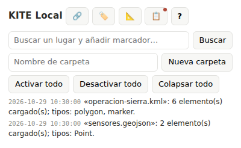
*Figura 3. Cabecera del panel: los cinco botones generales (🔗, 🏷️, 📐, 📋 y ?), el buscador de lugares, la creación de carpetas y los tres botones de activación masiva. Debajo, los avisos de las últimas cargas.*

- **🔗 Añadir desde una dirección**: descarga un archivo desde una dirección web y lo incorpora, con el mismo tratamiento que si se hubiera arrastrado desde el disco. Se explica con detalle en el apartado 7.
- **🏷️ Propiedades**: abre un panel con cuatro pestañas. La primera, «Preferencias» —la que se ve al abrir—, reúne los ajustes generales de la aplicación: el **tema** de la interfaz («Según el sistema», que sigue la configuración de modo claro u oscuro de Windows o del navegador y cambia solo con ella; «Claro»; u «Oscuro»; solo afecta a la aplicación —paneles, ventanas, menús y los controles del visor—, **no al mapa**: teselas, ortofotos, etiquetas y el color de fondo del mapa se quedan como están), el **idioma** de la interfaz («Automático», que usa el idioma del navegador si KITE Local lo tiene —hoy español e inglés— y, si no, inglés; «Español»; o «English»; a diferencia del tema, no se ve al momento: se guarda al pulsar «Aceptar» y la aplicación avisa de que cambia al recargar la página, con F5; se recuerda en este navegador), la **unidad de distancia** (metros, kilómetros, pies, millas o millas náuticas, ver apartado 6.3; de partida, millas náuticas) y, aparte e independiente de ella, la **unidad de altitud** (las mismas cinco; de partida, pies), que es la de las cifras de elevación (apartado 7.8), su lectura en el cuadro de coordenadas y el eje vertical del perfil de una ruta (7.9); el **formato de latitud/longitud** (grados decimales o grados-minutos-segundos), el tope de vértices editables interactivamente (apartado 6.2), los **segmentos de un arco** (de 2 a 720, 16 de partida; solo afecta a los arcos que se dibujen después, ver 4.2) y la **longitud máxima de un perfil** (10 millas náuticas de partida, de 100 metros a 100 millas náuticas, escrita en la unidad de distancia elegida; un valor fuera de esas cotas se ajusta a la más cercana y la aplicación lo avisa): una ruta más larga no da perfil, para no llenar el almacenamiento del navegador con celdas de elevación. **Solo cuenta si alguna de las fuentes elegidas es de malla fina** (MDT05, MDT25, MDS del IGN o Copernicus); con el MDT200 como única fuente no hay límite (apartado 7.9). La segunda, «Índices de GeoJSON», recuerda las asociaciones entre la forma de un archivo GeoJSON (qué claves trae) y las propiedades que componen el nombre de cada elemento (por ejemplo «ref / municipio», en el orden elegido), y permite revisar, cambiar (botón «Cambiar…», que abre el mismo selector que al importar) o borrar esas asociaciones; es la única manera de cambiar una elección ya guardada, porque un archivo con esa misma estructura se abre sin volver a preguntar; con un archivo que traiga muchas asociaciones guardadas, esa lista tiene su propio scroll interno en vez de agrandar la ventana. La tercera, «Fuentes de datos», elige de qué servicio se descarga cada modelo de elevación al consultar la altitud (apartado 7.8): uno para el **MDT** (terreno) y otro para el **MDS** (superficie), o «Ninguna» para no consultar ese modelo; de partida, el MDT05 y el MDS del Instituto Geográfico Nacional; como MDT se puede elegir también su MDT25 o su MDT200, de malla más gruesa. Bajo cada selector aparece la dirección del servicio elegido. La cuarta, «Frecuencias», guarda la **frecuencia para los cálculos de Fresnel** del perfil de una ruta (apartado 7.9): 1090 MHz de partida, de 1 a 300 000 MHz; un valor fuera de ese rango se ajusta al límite más cercano y se avisa, y el perfil que esté abierto se redibuja al momento con la frecuencia que se prueba. A diferencia de otras ventanas de configuración de versiones anteriores, este panel sí lleva Cancelar y Aceptar: los cambios se ven al momento en cualquier diálogo abierto (una previsualización), pero solo quedan guardados —y sobreviven a cerrar y volver a abrir la aplicación— al pulsar «Aceptar». «Cancelar» los deja exactamente como estaban.
- **📐 Cálculos geodésicos**: abre una ventana flotante —no bloquea el mapa, se puede arrastrar por el título y se cierra con la **×** de arriba a la derecha o con Escape— con una pestaña por cálculo. No hay botón de calcular: **cada pestaña se recalcula sola**, en cuanto hay datos y a cada cambio (un valor, una unidad, un desplegable), así que el resultado sigue lo que se escribe. Mientras falte algún dato el resultado queda vacío, sin avisos; el aviso, y el campo en rojo, solo salen cuando los datos están completos y no valen. El resultado (o el aviso) aparece en un espacio ya reservado, así que la ventana no cambia de tamaño. Cada pestaña conserva lo suyo al ir y volver. Hay dos.
  - **«Ángulo de elevación»**: se introducen la **altura de origen**, la **altura de destino**, la **presión atmosférica** y la **distancia** entre ambas, y aparecen el **ángulo de elevación**, en grados, con que se ve el destino desde el origen (0° es la horizontal, positivo hacia arriba y negativo hacia abajo) y el **cono de silencio**, que es 90° menos ese ángulo. Cada altura y la distancia tienen su propio selector de unidad, con las mismas unidades y en el mismo orden que en Propiedades (metros, kilómetros, pies, millas y millas náuticas), y se pueden cambiar de forma independiente: por ejemplo, las alturas en pies y la distancia en millas náuticas. Al cambiar la unidad de un campo, **su valor se convierte** a la nueva unidad (1000 pies pasan a ser 304,8 metros) en lugar de reinterpretarse, y los otros campos no se tocan. La primera vez, la distancia usa la unidad de distancia elegida en Propiedades y las alturas, la de altitud.
    - **Distancia**: puede ser **oblicua** (la línea recta desde el punto inicial, a la altura de origen, hasta el final, a la de destino; la opción de partida, y la que miden los radares) o **sobre la superficie** (el arco a nivel del mar). El desplegable «Tipo de distancia» elige una u otra, sin tocar el valor escrito. Con la misma cifra dan elevaciones muy distintas (24,21 m, 45000 pies y 12,2 millas náuticas: 37,2° como oblicua y 31,1° sobre la superficie), así que conviene tener claro cuál es la que se maneja. Como distancia oblicua, una cifra menor que la diferencia de alturas es imposible y se avisa.
    - **Presión atmosférica (QNH)**: en hectopascales (hPa, lo mismo que milibares); parte en la **presión estándar al nivel del mar, 1013,25 hPa**. La altura de destino se toma como la **altitud que marca un altímetro con el reglaje estándar** (la de una aeronave) y se **corrige con esta presión** según la atmósfera estándar internacional: con QNH mayor la aeronave está más alta de lo que marca, y con menor, más baja. Con 1013,25 hPa no cambia nada. La altura de origen no se corrige (una cota de antena es geométrica). Si la presión no es la estándar, el resultado añade la **altura de destino corregida** y su diferencia. El efecto no es una cantidad fija por hectopascal: cerca del nivel del mar son 27,3 pies por hPa (no los 30 de la regla práctica) y baja al subir (unos 20,5 pies por hPa a 45000 pies). La corrección vale para alturas de destino de −5 a 20 km y presiones de 800 a 1100 hPa, y supone temperatura estándar: no modela la desviación real de temperatura.
    - **Modelo de Tierra**: **Plano** (sin curvatura, solo válido a distancias cortas), **Esfera** o **Esfera + refracción (4/3·R)**, la opción de partida, que corrige además la refracción atmosférica estándar, como en radar y radioenlaces. A distancias cortas apenas cambia el resultado.
  - **«Vector GPS»**: dadas dos posiciones, A y B, cada una con **latitud, longitud y altitud**, da la **distancia** entre ellas (en línea recta, teniendo en cuenta las altitudes), la **distancia horizontal** (sobre la superficie, a nivel del mar) y la **orientación** de A hacia B en grados con decimales (0° norte, sentido horario). La latitud y la longitud de cada punto van en la misma línea y pueden escribirse en grados, minutos y segundos (`40°25'0.5"N`) o en grados decimales (`40.4168`), indistintamente; el desplegable «Latitud/longitud» elige cómo se muestran —parte en grados, minutos y segundos, con independencia del formato elegido en Propiedades— y al cambiarlo **se convierten los valores ya escritos** al nuevo formato (lo que no se pueda leer se deja como está). La pestaña se abre con **Madrid en A y Barcelona en B** como valores de partida y con su resultado ya calculado. Las altitudes parten en metros y la distancia del resultado en millas náuticas (kilómetros, millas, etc. se eligen en el desplegable «Distancia (resultado en)», y el resultado se repinta al momento en la nueva unidad). Cambiar la unidad de una altitud convierte su valor. Si A y B tienen la misma latitud y longitud la orientación no existe y se indica así, en lugar de dar un 0° falso. Todos los cálculos usan la misma esfera terrestre que las mediciones del mapa.
- **📋 Registro de avisos**: abre el historial completo de avisos de la sesión en curso —cargas, advertencias, confirmaciones—, incluidos los que ya han desaparecido solos del panel. Un punto sobre el botón indica que hay avisos nuevos sin leer.
- **? Ayuda**: abre la chuleta de atajos de teclado (apartado 8), la misma que se abre con la tecla `?`.
- **Buscar un lugar y añadir marcador…**: un buscador de topónimos apoyado en el servicio Nominatim de OpenStreetMap. Se consulta solo al pulsar «Buscar» o la tecla Intro, nunca mientras se escribe. Los resultados aparecen debajo, dentro de la propia cabecera —empujando el árbol hacia abajo, no flotando encima— y se cierran con su «×»; elegir uno crea un marcador en una carpeta «Lugares» y centra la vista sobre él.
- **Nombre de carpeta / Nueva carpeta**: crea una carpeta vacía en el árbol, lista para arrastrar capas dentro o para servir de destino de una importación.
- **Activar todo / Desactivar todo / Colapsar todo**: actúan sobre el árbol completo. Activar y desactivar cambian de golpe la visibilidad de todas las capas; colapsar cierra todas las carpetas.

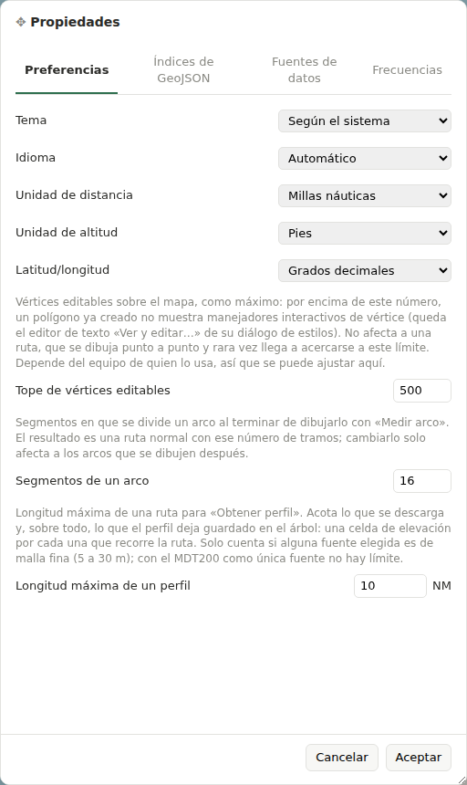
*Figura 4. Propiedades, pestaña «Preferencias»: tema, idioma, unidades de distancia y de altitud, formato de coordenadas, tope de vértices editables, segmentos de un arco y longitud máxima de un perfil. Las otras tres pestañas son «Índices de GeoJSON», «Fuentes de datos» y «Frecuencias».*

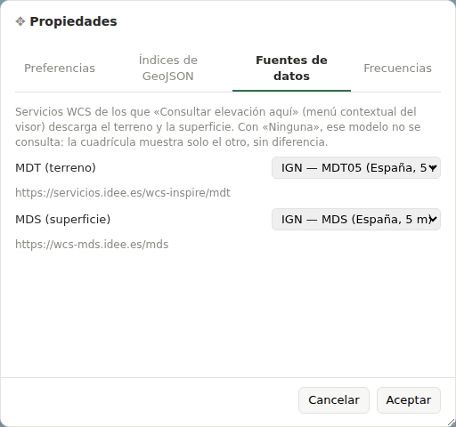
*Figura 5. Propiedades, pestaña «Fuentes de datos»: de qué servicio sale el terreno (MDT) y la superficie (MDS) en las consultas de elevación, con la dirección del servicio elegido debajo de cada selector.*

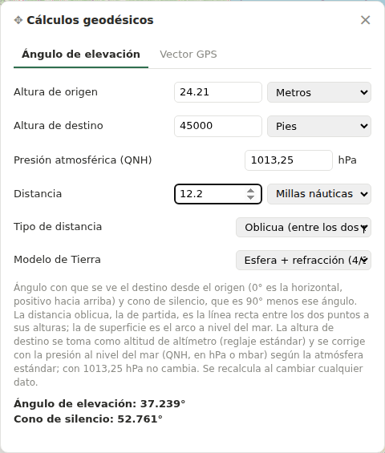
*Figura 6. Cálculos geodésicos, pestaña «Ángulo de elevación», con el ejemplo del texto: origen a 24,21 m, destino a 45000 pies y 12,2 millas náuticas de distancia oblicua dan un ángulo de 37,239° y un cono de silencio de 52,761°.*

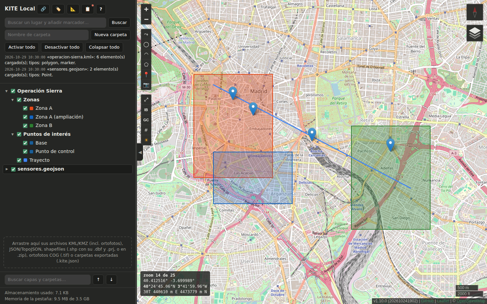
*Figura 7. Tema oscuro («Según el sistema», con un sistema en modo oscuro): cambian el panel, los controles del visor y los diálogos; el mapa, no.*

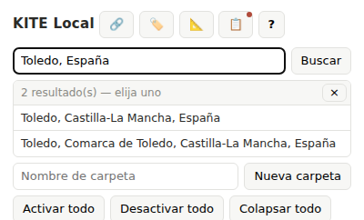
*Figura 8. El buscador de lugares, con sus resultados desplegados dentro de la propia cabecera.*

Justo debajo aparecen los avisos de la sesión (en el color normal del texto si son solo información, en rojo si señalan un problema), con fecha y hora completas; uno que se repite no añade una línea nueva, funde con la anterior y la marca con un contador (×N). Un resumen de importación se queda fijo en pantalla hasta que se pulsa «Aceptar», precisamente para dar tiempo a leer qué se cargó y qué no. El botón 📋 de la cabecera abre el mismo historial completo, con todo lo ocurrido en la sesión aunque ya haya desaparecido del panel.

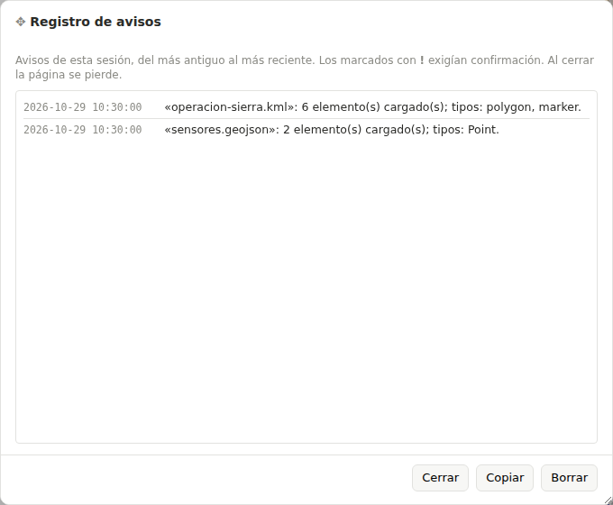
*Figura 9. Registro de avisos: todo lo ocurrido en la sesión, del más antiguo al más reciente, con los que exigían confirmación marcados con «!».*

### 2.2 Zona para soltar archivos

Debajo del árbol hay una franja que indica qué se puede soltar ahí: archivos KML y KMZ (incluidas las ortofotos que traiga incrustadas), GPX, JSON, GeoJSON y TopoJSON, shapefiles (el .shp con sus piezas, o el .zip que las contiene), ortofotos en COG (.tif), o una carpeta previamente exportada por la propia aplicación (extensión «.kite.json»). Arrastrar cualquiera de esos archivos desde el escritorio y soltarlo sobre el panel —o sobre una carpeta concreta del árbol, para importar dentro de ella— es la vía más directa de cargar información.

### 2.3 Buscador del árbol

Al pie del panel hay un segundo buscador, distinto del de lugares: busca por nombre entre las capas y carpetas ya cargadas, en vivo mientras se escribe (a partir de tres letras, para no recorrer árboles grandes en cada pulsación). Las flechas ↑ / ↓ de su lado saltan a la ocurrencia anterior o siguiente, y un contador indica cuántas hay.

### 2.4 Pie del panel

Al final del todo, dos cifras: cuánto ocupa en disco lo guardado por la aplicación y cuánta memoria está usando la pestaña del navegador. Cualquiera de las dos desaparece sola cuando no hay un dato fiable que mostrar (por ejemplo, la memoria no puede medirse al abrir la aplicación con doble clic desde el disco, solo cuando se sirve desde una dirección web).

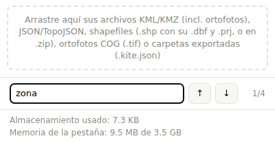
*Figura 10. Pie del panel: la zona para soltar archivos, el buscador del árbol (aquí, «zona», con la primera de sus cuatro ocurrencias) y las cifras de almacenamiento y de memoria.*

---

## 3. El árbol de capas

El árbol es el inventario de todo lo cargado: cada archivo, carpeta, capa, medición o cuadrícula de elevación es una fila. Refleja fielmente la estructura del archivo de origen: un KML vuelca sus carpetas tal cual las traía, y un GeoJSON —que no tiene jerarquía propia— se agrupa dentro de una carpeta con el nombre del archivo.

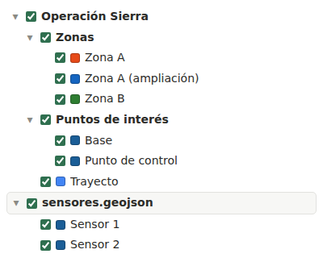
*Figura 11. Estructura del árbol: dos carpetas del KML importado («Zonas» y «Puntos de interés»), una capa de línea suelta y, más abajo, la carpeta que agrupa un GeoJSON importado.*

### 3.1 Qué lleva cada fila

- Una flecha (▾ / ▸) para desplegar o colapsar, solo en carpetas y archivos.
- Una casilla que activa o desactiva la capa en el mapa. Es la única que decide la visibilidad: la casilla de una carpeta es un interruptor masivo para todo lo de dentro, nunca un filtro por sí sola.
- Un cuadradito de color, en las capas que lo tienen, con el color con el que se dibuja.
- El nombre. Un clic sobre el nombre selecciona la fila; para renombrar hace falta `F2` o el diálogo de propiedades (apartados 6 y 8), no un doble clic sobre el texto.
- Unos botones de acción, que solo aparecen al pasar el ratón por encima de la fila (para no ocupar sitio permanentemente) y cambian según el tipo de nodo.

### 3.2 Los tres estados de una casilla

La casilla de una carpeta o un archivo puede estar marcada, sin marcar o **indeterminada** —un guion, no un cuadrado— cuando parte de lo que contiene está activo y parte no. Es el mismo indicador que usa cualquier gestor de archivos para una selección mixta.

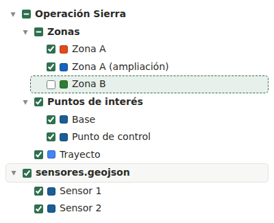
*Figura 12. La carpeta «Zonas» y la carpeta raíz quedan en su tercer estado (guion) al haber desactivado solo «Zona B».*

Al activar o desactivar una carpeta con muchas capas dentro, la casilla se sustituye brevemente por un pequeño indicador giratorio y el nombre parpadea mientras el cambio se aplica a todas; sobre el visor aparece además un aviso «Actualizando capas…», junto al control de zoom. Es solo para que quede claro que el cambio está en marcha —con una carpeta pequeña ni se llega a notar— y evita tener que pulsar otra vez pensando que no ha pasado nada.

### 3.3 Botones de acción por tipo de fila

Al pasar el ratón por una fila aparecen, según lo que sea:

- **En una carpeta o un archivo**: seleccionar todas sus capas (☑) o quitar la selección (☐), ordenar alfabéticamente (AZ, que alterna ascendente y descendente), colapsar la carpeta y todas las de dentro, guardarla o exportarla a un archivo (💾; también lo llevan las capas sueltas) y abrir la tabla de atributos de sus capas (▦, apartado 7.15).
- **En una capa**: centrar la vista y acercar el zoom a un nivel fijo, el 14, a escala de calle (🔍), y abrir su diálogo de propiedades (🎨 «Editar propiedades»), con las pestañas «Estilos» y «Atributos». Sobre un polígono, una medición o una capa de elevaciones, en vez de un zoom fijo, la lupa encuadra toda su geometría con un margen alrededor —más útil para una figura o una ruta que puede ser mucho más grande, o más alargada, que lo que cabría en un solo nivel de zoom centrado, y para una cuadrícula de elevaciones, que a ese zoom ni se vería—. Una capa de elevaciones lleva la lupa pero no 🎨: no tiene estilos que editar.
- **Si la capa tiene una ficha o propiedades que enseñar**: un botón adicional (ℹ) para verlas.
- **En cualquier fila**: subir (↑) y bajar (↓) un puesto entre sus hermanas, y borrar (×).

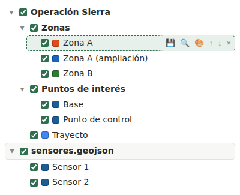
*Figura 13. La fila «Zona A», seleccionada (borde discontinuo) y con el ratón encima: aparecen sus botones de guardar o exportar (💾), enfoque, estilo, subir/bajar y borrar. No tiene botón ℹ porque este polígono no trae ninguna ficha.*

### 3.4 Selección múltiple

Además del clic normal (que selecciona una única fila y mueve el cursor del teclado hasta ella), `Mayús + clic` extiende la selección a todo lo que hay entre la fila donde estaba el cursor y la que se pulsa —igual que en un explorador de archivos de escritorio—, y `Ctrl + Mayús + clic` añade o quita una sola fila suelta sin arrastrar las intermedias.

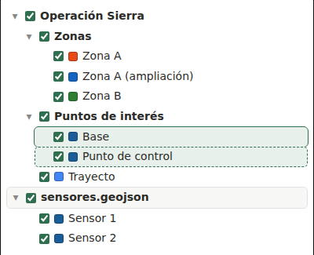
*Figura 14. «Base» y «Punto de control» seleccionadas juntas con `Mayús + clic`. Los cambios de estilo, el borrado o el arrastre se aplican después a las dos a la vez.*

Con una selección múltiple, borrar, arrastrar y cambiar el estilo actúan sobre todas las filas a la vez. Solo la posición de un marcador queda fuera de la edición conjunta, por ser un dato propio de cada uno.

Al quedar seleccionados varios nodos —con `Mayús + clic`, `Ctrl + Mayús + clic` o el botón ☑ de una carpeta— aparece en la ventana de avisos cuántos son en total. Es solo informativo (no es ningún error) y sirve, por ejemplo, para saber de un vistazo cuántas capas hay dentro de una carpeta al marcarla entera con ☑.

### 3.5 Mover capas de sitio

Arrastrar una fila con el ratón la mueve de carpeta o cambia su orden entre hermanas; una franja de seis píxeles arriba o abajo de cada fila reordena, y soltar sobre el resto de una carpeta mete dentro. `Escape` cancela un arrastre en marcha. También puede recolocarse tecleando: seleccionar la fila, pulsar `Ctrl + X` para cortarla (queda marcada en gris hasta que se pega o se cancela con `Escape`), poner el cursor en el destino y pulsar `Ctrl + V`.

---

## 4. El panel del visor (el mapa)

### 4.1 Mapas base

Un icono de capas, en la esquina superior derecha del mapa, despliega el panel de cartografías de fondo: OpenStreetMap, varias capas del Instituto Geográfico Nacional (mapa base, topográfico, ortofoto PNOA actual e histórica, modelo digital del terreno), la ortofoto municipal de Madrid del Ayuntamiento, un par de opciones de relieve sombreado, bajo credencial propia del usuario el modelo de superficie de Copernicus, y dos capas «Custom» que piden su cartografía a un servidor propio del usuario: «Custom Tile Map Service» (teselas) y «Custom Web Map Service» (WMS). Se pueden combinar varias a la vez, cada una con su propio control de opacidad, y reordenarse con las flechas de cada fila (el orden de la lista es el orden de apilado en el mapa).

La primera fila del panel no es un mapa, sino el color de fondo del propio visor: el que se ve detrás de las teselas, en un hueco sin cobertura o en el borde del mundo. Por defecto es el mismo azul claro de siempre; su muestra de color abre el mismo selector integrado que los colores de una capa (apartado 6.1) y el cambio se recuerda entre sesiones.

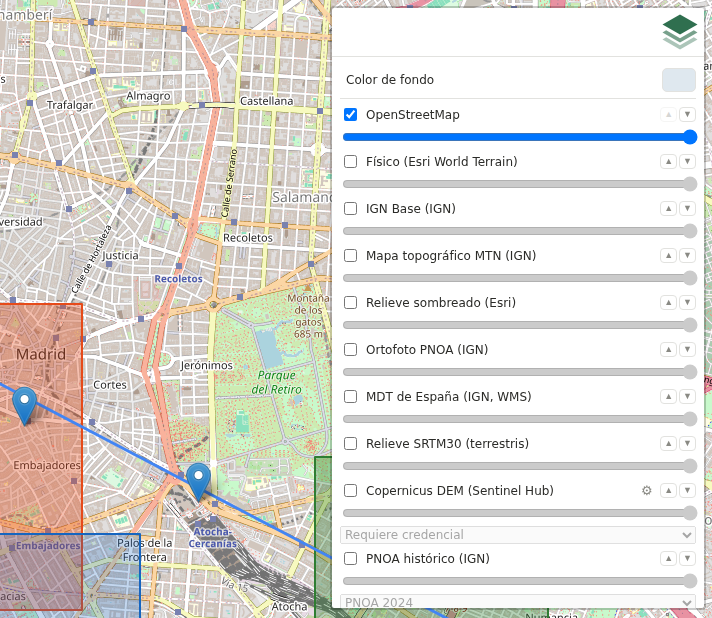
*Figura 15. Panel de mapas base: primera fila para el color de fondo, y debajo cada mapa con su casilla de activación, control de opacidad y flechas de orden. La rueda dentada junto a Copernicus DEM abre su configuración de credencial.*

**Custom Tile Map Service**, casi al final de la lista, sirve para apuntar a un servidor de teselas propio —típicamente una caché o proxy delante de OpenStreetMap u otro servicio, para no descargar de golpe el servicio público de otra persona—. Solo admite servidores de teselas (*Tile Map Service*, TMS); para un servidor WMS está la capa siguiente. La rueda dentada de su fila abre un diálogo donde se escribe solo la dirección base (por ejemplo `https://mi-cache.ejemplo.org/tiles/`); la aplicación añade siempre `{z}/{x}/{y}.png` al final por su cuenta. El servidor debe admitir esas peticiones en `https` (nunca `http`) y responder con imágenes PNG —con canal alfa si se quiere transparencia— y cabeceras CORS abiertas, o el navegador bloqueará las teselas aunque el servidor responda bien; el propio diálogo explica el formato. La dirección se guarda solo en ese navegador y nunca viaja en un `.kite.json` exportado.

**Custom Web Map Service**, la última de la lista, apunta a un servidor WMS propio. La rueda dentada de su fila abre un diálogo donde se escribe la dirección del servicio (por ejemplo `https://mi-servidor.ejemplo.org/wms`); el servidor debe responder, en `https` y con CORS abierto, a una consulta `GetCapabilities`, que la aplicación hace por su cuenta —si se pega una petición completa, se descartan sus parámetros de OGC y se conservan los propios del servidor, como el `map=` de MapServer—. De esa respuesta salen las capas que el servidor publica, que aparecen en un selector en la propia fila (agrupadas como las agrupe el servidor) y se activan y desactivan con su casilla, con su opacidad y su posición en el apilado como cualquier otro mapa base. Las teselas se piden en Web Mercator (`EPSG:3857`), con la versión de WMS que anuncie el servidor (1.1.0, 1.1.1 o 1.3.0) y en el formato que anuncie su operación `GetMap`: `image/png` (con transparencia) si lo sirve y, si no, `image/jpeg`, para los servidores que solo exportan JPEG (que se dibujan opacos; la opacidad de la fila sigue valiendo). Sin dirección, el selector aparece bloqueado («Requiere URL»); si el servidor no contesta, el selector muestra el motivo. Igual que la anterior, la dirección se guarda solo en ese navegador y nunca viaja en un `.kite.json` exportado.

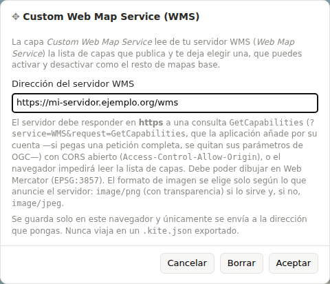
*Figura 16. Configuración de «Custom Web Map Service»: se escribe la dirección del servidor WMS (aquí, un ejemplo) y el propio diálogo recuerda lo que debe cumplir.*

En las dos capas «Custom», una tesela que el servidor no entrega —por ejemplo, un WMS que contesta con un error en lugar de la imagen— se marca en el mapa con un **contorno rojo**, en vez de dejarse en blanco sin más. La primera de cada capa se vuelve a pedir una vez para leer qué dijo el servidor, y se avisa en el panel con ese texto (por ejemplo, «Creating maps using image/png is not allowed»); si el servidor no permite leer su respuesta desde el navegador (CORS), el aviso lo dice y el contorno rojo sigue marcando las teselas fallidas. Las capas de servicios conocidos (OpenStreetMap, IGN…) no se marcan: allí es normal que no haya teselas fuera de su cobertura.

### 4.2 Barra de herramientas de dibujo y medición

En la esquina superior izquierda del mapa hay dos barras verticales.

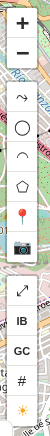
*Figura 17. Los botones de zoom y las dos barras del visor: la de dibujo y medición (ruta, círculo, arco, polígono o línea, pin y PNG) y la de vista (autoescalar, IB, GC, retícula e iluminación real).*

La primera reúne las herramientas que dibujan sobre el mapa:

- **Medir ruta** (⤳): un clic por cada waypoint, doble clic para terminar — como varias líneas encadenadas, con la distancia y el rumbo de cada tramo por separado y el total. Una ruta de solo 2 waypoints es una línea recta de toda la vida; con más, sirve para planificar un trayecto con varias escalas.
- **Medir círculo** (◯): arrastrar del centro al borde calcula el radio, el perímetro, la superficie y la orientación (el rumbo del centro al borde).
- **Medir arco** (◠): tres gestos. Primero el **centro**; después el **inicio del arco**, que fija a la vez el radio y la orientación (los dos primeros valen como un arrastre del centro al inicio, o como dos clics); por último se **recorre el perímetro** desde el inicio con el ratón y un clic marca dónde acaba. El sentido (horario o antihorario) lo decide hacia dónde se mueve el ratón, y se pueden hacer arcos de más de media vuelta. Escape cancela. Al terminar, el arco **se convierte en una ruta normal** («Arco 1», «Arco 2»…) de tantos tramos como indique la preferencia «Segmentos de un arco» (16 de partida, ver 🏷️ Propiedades): la ruta ya no recuerda centro, radio ni apertura y se edita como cualquier otra. Sus etiquetas de tramo salen apagadas para no tapar el arco; se encienden con la casilla «Mostrar las etiquetas…» de su diálogo.
- **Dibujar polígono o línea** (⬠): un clic por cada vértice; un doble clic sobre el último vértice cierra la figura, y un doble clic fuera de un vértice la deja como una línea abierta. Mientras se dibuja, un vértice ya puesto se puede arrastrar a otra posición antes de cerrar la figura, y quitar con el botón derecho. Está también en el menú contextual, «Crear» › «Polígono o línea».
- **Crear un pin** (📍): añade un marcador en el centro de la vista actual y abre directamente su diálogo de estilo (también desde el menú contextual, «Crear» › «Pin»).
- **Exportar PNG** (📷): guarda una imagen del mapa tal como se ve, sin los controles superpuestos, pero con el cuadro de coordenadas, la escala y la atribución (que la licencia de la cartografía exige conservar).

La segunda barra reúne los controles de la propia vista:

- **Autoescalar** (⤢): ajusta el zoom para encuadrar todo lo cargado. Como los demás encuadres, la retícula y la exportación a PNG, solo está en las barras de herramientas: el menú contextual no los repite.
- **IB / GC**: centran la vista en la península y Baleares, o en las islas Canarias.
- **Paralelos y meridianos** (#): muestra u oculta la retícula geográfica.
- **Iluminación real** (☀, en color): sombrea la parte del mundo visible en el mapa según sea de día, de noche o esté en penumbra de crepúsculo en ese momento, calculado a partir de la posición real del sol y la hora del propio dispositivo. Con el efecto activo se dibuja también, con línea discontinua, la trayectoria del sol y de la luna, con un icono en su posición actual (☀ y ☽) que se va moviendo junto con la sombra. Es un efecto puramente visual (no se usa para ninguna medición) y no aparece en el PNG exportado. Además, mientras está activo, la ficha de un marcador (botón ℹ de su fila o «Mostrar atributos» del menú contextual) añade la sección «Sol y crepúsculos» con las horas de inicio del crepúsculo astronómico, náutico y civil, la salida del sol, el mediodía solar (con su elevación) y, en orden inverso, la puesta y el fin de cada crepúsculo, para la posición de ese marcador y el día solar en curso. Las horas son las locales del navegador, con su desfase UTC indicado (y «(+1 d)»/«(−1 d)» si caen en otro día); cerca de los polos, una fila puede decir que el evento no ocurre porque el sol no baja de esa elevación o no llega a ella. Aparece también en marcadores que no tienen descripción ni propiedades propias (a los que el botón ℹ se les muestra al activar la iluminación y se les quita al apagarla), y detrás de su ficha propia si la tienen; una capa con varios marcadores no la muestra, porque no hay un único punto del que hablar. Pasar el ratón por encima de un marcador sin ficha propia no abre nada.

### 4.3 Cuadro de coordenadas, escala y atribución

En la esquina inferior izquierda, un cuadro de texto sigue al cursor mostrando la posición en tres notaciones a la vez (grados decimales, grados/minutos/segundos y coordenada UTM con su huso) y el nivel de zoom actual. Con el cursor sobre una celda de elevación ya descargada (apartado 7.8) y visible, se le añaden sus lecturas de terreno y de superficie, junto con la diferencia entre ambas, en la unidad de altitud de Propiedades; fuera de las celdas esas líneas desaparecen. No se consulta nada al mover el ratón: se lee lo ya descargado.

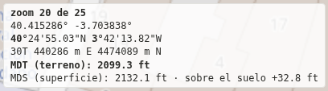
*Figura 18. Cuadro de coordenadas sobre una celda de elevación descargada: zoom, las tres notaciones de posición y, al final, las lecturas de terreno (MDT) y superficie (MDS), con la diferencia entre ambas.*

En la esquina inferior derecha están la escala gráfica y, debajo, la línea de atribución (versión de la aplicación, enlace al repositorio y crédito de la cartografía activa).

### 4.4 Girar el mapa (brújula)

Encima del icono de capas, en la esquina superior derecha, hay una **brújula**. Arrastrándola en círculo se gira el mapa libremente, en el sentido del arrastre; su aguja roja señala en todo momento hacia dónde queda el norte. Un **clic** en la brújula —o la tecla **R** con el foco en el mapa— vuelve a poner el norte arriba. Con el norte arriba la brújula se ve atenuada; con el mapa girado, resaltada.

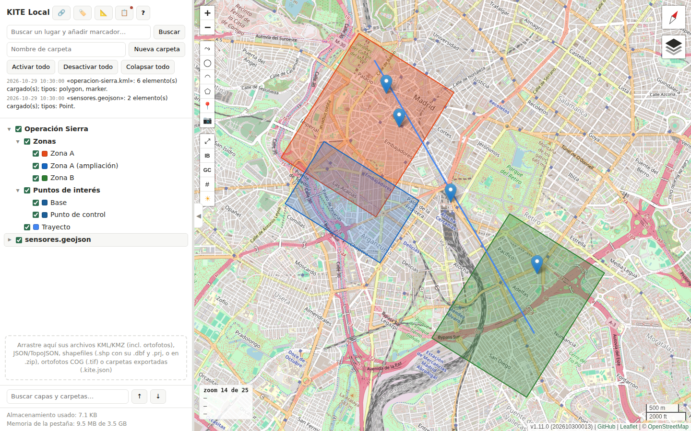
*Figura 19. El mapa girado 32°: la aguja roja de la brújula (arriba a la derecha) señala el norte; las capas y la retícula giran con el mapa y sus etiquetas se quedan horizontales.*

También se puede girar con el ratón: manteniendo pulsado el **botón central** (la rueda) y moviendo el ratón a la derecha, el mapa gira en el sentido de las agujas del reloj; a la izquierda, al revés (medio grado por píxel). El giro es **alrededor del punto donde se pulsó**, que se queda quieto bajo el cursor. Mientras dura, el cursor es una rosa de los vientos cuya punta roja señala el norte. El botón izquierdo sigue sirviendo para desplazar el mapa.

Con el mapa girado giran también los mapas base, las capas, la retícula de paralelos y meridianos y la iluminación real; las etiquetas (nombres, medidas, cifras de las cuadrículas de elevación) se quedan **horizontales**, para poder leerlas. Los rumbos de las mediciones siguen siendo geográficos (0° = norte), no relativos a la pantalla. Dibujar, medir, editar vértices, el menú contextual y el zoom de caja (Mayús + arrastrar) funcionan igual que con el norte arriba. Exportar a PNG guarda la imagen girada tal como se ve, y en ese caso incluye la brújula, para que la imagen diga dónde está el norte.

La orientación no se guarda: al volver a abrir la aplicación, el mapa arranca con el norte arriba, salvo que se abra un enlace a una vista que lleve giro (apartado 7.14). **Limitación actual:** la consulta de elevación no está disponible con el mapa girado: su entrada del menú contextual («Consultas» › «Elevación») aparece deshabilitada hasta poner el norte arriba. Las cuadrículas de elevación ya descargadas sí se ven giradas.

### 4.5 Moverse con el teclado y la rueda

Con el foco en el mapa (basta con haber hecho clic en él, también sobre una capa o un marcador: el foco no se va al árbol aunque este salte al nodo pulsado, ni al diálogo de una ruta que se está creando), las **flechas** lo desplazan y **Re Pág / Av Pág** acercan y alejan. Un toque desplaza un paso corto o cambia exactamente un nivel de zoom. Si la tecla se **mantiene pulsada**, el movimiento empieza en el acto, sin la pausa de repetición del teclado, y sigue de forma continua hasta soltarla: el desplazamiento acelera al cabo de medio segundo (con Mayús, el triple de rápido) y dos flechas a la vez desplazan en diagonal. El zoom continuo es suave y se hace hacia el puntero; al soltar, se ajusta al nivel entero siguiente para que los mapas se vean nítidos. Las flechas van siempre en el sentido de la pantalla, también con el mapa girado. Mientras el mapa se mueve con el teclado, las coordenadas y lo que se esté dibujando siguen al puntero aunque el ratón no se mueva. Con el foco en un campo de texto o en el árbol, estas teclas no tocan el mapa.

La **rueda del ratón** hace el mismo zoom suave hacia el puntero, sin necesidad de foco: cada muesca acerca o aleja un nivel, pasando por los intermedios en lugar de saltar, y varias muescas seguidas se encadenan sin pausas. Al parar la rueda, el zoom se ajusta al nivel entero siguiente en la dirección del último giro; en un panel táctil, donde el desplazamiento llega en pasos pequeños, ocurre lo mismo. Sobre los controles del mapa (panel de mapas base, cuadro de coordenadas) la rueda no hace zoom.

---

## 5. El menú contextual del visor

Un clic derecho sobre el mapa abre un menú con las acciones más habituales, agrupadas por tema. Sobre una zona sin ninguna capa debajo, tiene cuatro entradas:

- **«Copiar»**: un submenú con lo que se puede llevar al portapapeles.
  - **«Coordenadas»**: la posición del punto pulsado, en grados decimales.
  - **«Enlace a esta vista»**: una dirección que, al abrirla, deja el mapa donde está ahora (apartado 7.14).
- **«Consultas»**: un submenú con las dos consultas a un servicio sobre el punto pulsado, cada una por su cuenta.
  - **«Elevación»**: descarga el terreno y la superficie de la zona alrededor del punto (apartado 7.8). Sale deshabilitada, con el motivo al pasar el ratón, si el mapa está girado o si las dos fuentes de elevación están en «Ninguna».
  - **«Parcela catastral»**: trae la parcela que hay en el punto pulsado como una capa del árbol (apartado 7.12).
- **«Medir»**: un submenú con las tres herramientas de medición, **«Ruta»**, **«Círculo»** y **«Arco»** (apartado 4.2). Elegir una activa la herramienta; elegirla otra vez, la desactiva.
- **«Crear»**: un submenú para dibujar o colocar algo nuevo.
  - **«Polígono o línea»**: activa o desactiva la herramienta de dibujo (apartados 4.2 y 7.3).
  - **«Pin»**: añade un marcador en el centro de la vista y abre su diálogo de estilo.
  - **«Anillos de alcance…»** y **«Sector…»**: abren el diálogo del apartado 7.13 con el punto pulsado como centro.

Los encuadres (autoescalar, península y Baleares, islas Canarias), la retícula de paralelos y meridianos y la exportación a PNG no están en este menú: tienen su botón en las barras de herramientas del visor (apartado 4.2).

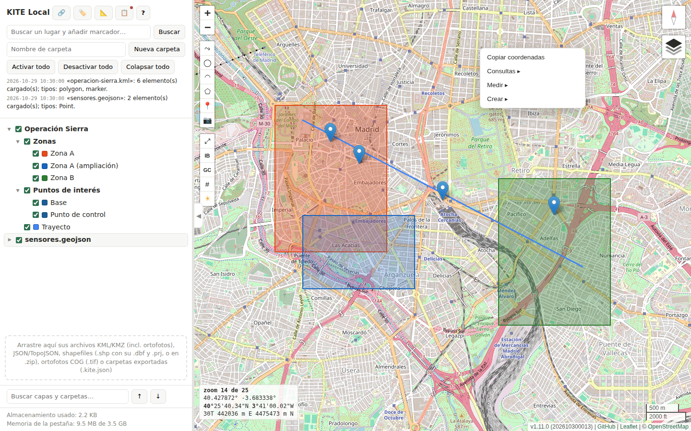
*Figura 20. Menú contextual sobre una zona vacía del mapa: cuatro entradas, tres de ellas con submenú.*

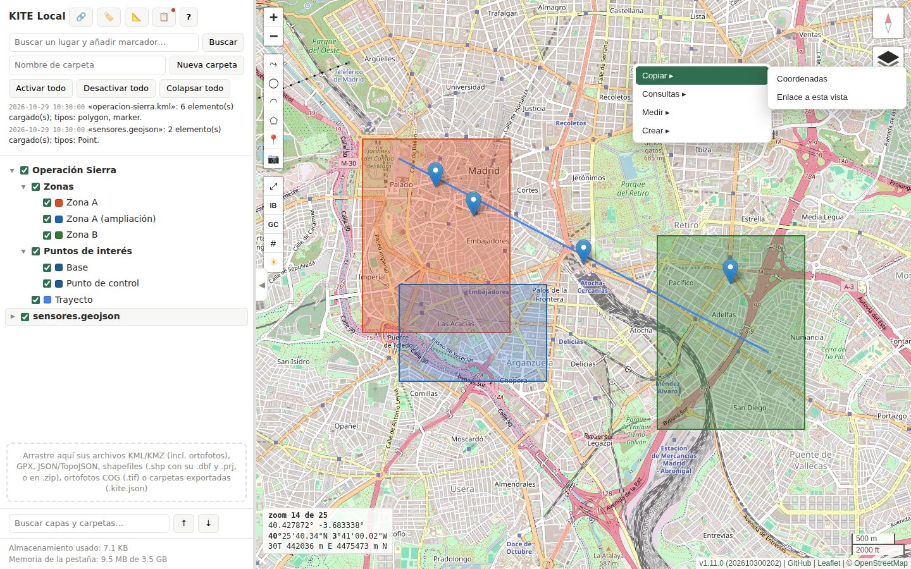
*Figura 21. El submenú «Copiar»: «Coordenadas» y «Enlace a esta vista».*

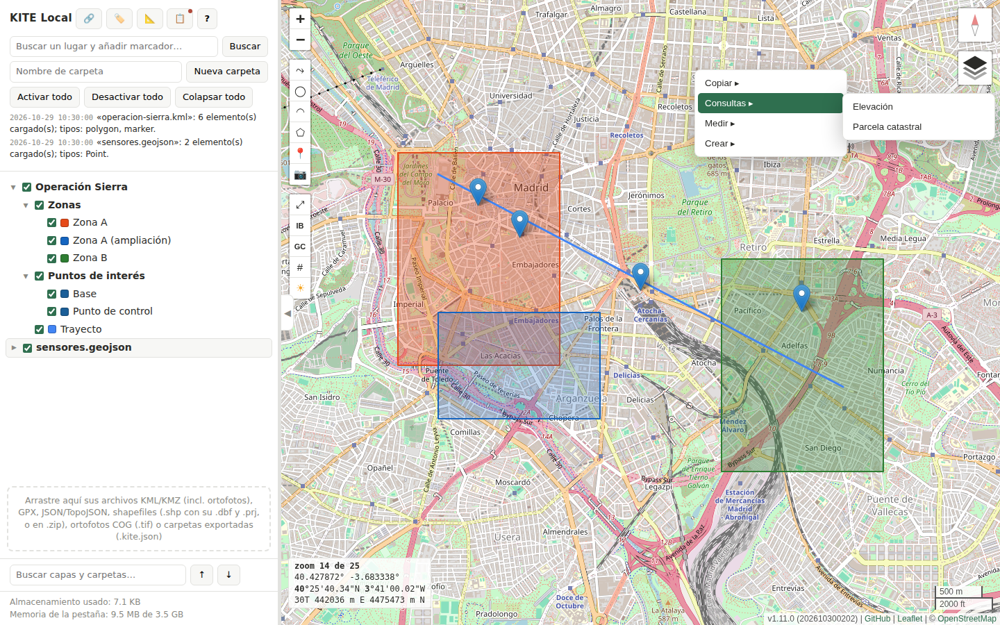
*Figura 22. El submenú «Consultas», que se abre al pasar el ratón por encima o con un clic: «Elevación» y «Parcela catastral», cada una por su cuenta.*

Si el clic derecho cae sobre una capa, el menú antepone «Ir al nodo en el panel» (que despliega el árbol hasta esa fila, la selecciona y la hace parpadear en el mapa para identificarla), «Mostrar atributos» si la capa tiene algo que mostrar (la ficha KML o la tabla de propiedades de un GeoJSON, la misma que el botón ℹ) y, si su tipo admite el diálogo de propiedades, **«Editar propiedades»**, que lo abre directamente —el mismo diálogo, con sus pestañas «Estilos» y «Atributos», que el botón 🎨 o Alt+Intro, sin tener que ir antes al árbol—. Sobre una ruta (también un arco) añade **«Obtener perfil»** (apartado 7.9), o **«Mostrar perfil»** si ya lo tiene; «Obtener» sale deshabilitada —con el motivo al pasar el ratón— si no hay ninguna fuente de elevación elegida o si la ruta es más larga que el límite de Preferencias. Cuando hay varias capas superpuestas exactamente bajo el cursor, estas opciones se convierten en un submenú con una entrada por capa, para elegir sobre cuál de todas se quiere actuar; la del perfil sigue estando aunque bajo la ruta haya una cuadrícula de elevación (por ejemplo, las celdas de su propio perfil), y con varias rutas debajo es un submenú «Perfil de ruta» con una entrada por ruta.

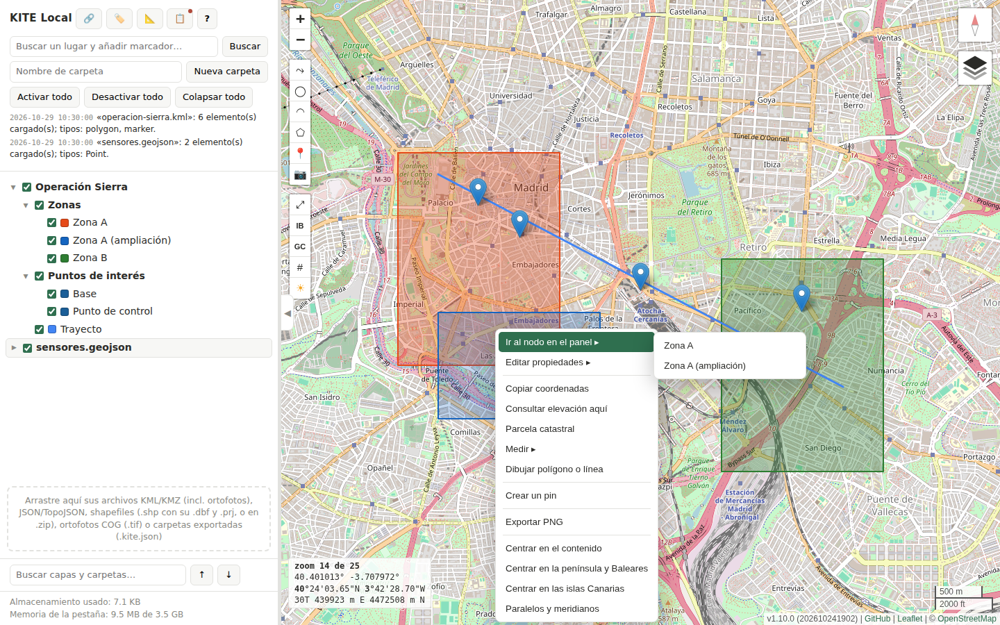
*Figura 23. Con «Zona A» y «Zona A (ampliación)» superpuestas en ese punto, «Ir al nodo en el panel» se convierte en un submenú con una entrada por cada una.*

---

## 6. Estilos de capa

El botón 🎨 de una fila (o de cualquiera de una selección múltiple) abre («Editar propiedades») un diálogo flotante con dos pestañas: **Estilos**, la que se abre siempre, y **Atributos**. Encima de las pestañas queda el nombre de la capa, que vale para las dos. «Atributos» muestra, de solo lectura, la misma ficha que «Mostrar atributos» (el texto de un KML o la tabla de propiedades de un GeoJSON), para poder consultarla mientras se edita el estilo; es de una sola capa, así que con varias seleccionadas la pestaña avisa de que hay que dejar una sola, y una capa sin nada que mostrar lo dice. Los cambios de color, icono, tamaño, grosor, relleno y texto se ven en el mapa AL MOMENTO, mientras el diálogo sigue abierto, para poder juzgar el resultado; «Aceptar» los deja y «Cancelar» los revierte todos, incluido un icono distinto, dejando la capa como estaba al abrir. El diálogo se puede arrastrar por su título para apartarlo de la zona del mapa que interese, y no bloquea el resto de la interfaz: se puede seguir trabajando en el mapa mientras está abierto.

Cada muestra de color del diálogo (marcador, texto, contorno, relleno…) abre, justo debajo de sí misma, un selector con el espectro, una paleta de colores habituales y sus propios botones «Cancelar»/«Aceptar». Sobre el cuadrado se elige tono y saturación con el cursor en forma de cruz; sobre la rampa horizontal de matiz, con el cursor en forma de mano, porque ahí solo se desliza en una dirección. Mover el espectro, tocar una muestra o escribir un valor previsualiza el color al momento sobre el elemento editado (el marcador y su icono, o el fondo del mapa en el panel de mapas base), y también sobre la capa en el mapa, pero no lo confirma: solo «Aceptar» lo deja hecho, y «Cancelar» —igual que repetir la muestra que abrió el selector, un clic fuera o Escape— lo devuelve al color que tenía al abrirlo. Los valores se escriben en cuatro notaciones intercambiables con las flechas ‹ › junto a su nombre: hexadecimal (un campo), RGB o HSV (tres campos, uno por componente) y CMYK (cuatro), cada uno con su propio control numérico de subida/bajada.

### 6.1 Estilo de un marcador

Icono, color y tamaño del marcador; tamaño y color del texto; si el nombre se muestra siempre o solo al pulsar sobre el marcador; y, cuando la capa es un único marcador, su posición exacta, en el formato elegido en el panel 🏷️ Propiedades (apartado 2.1) — grados decimales o grados/minutos/segundos, el mismo ajuste global que usa el centro de un círculo de medición. Mientras el diálogo está abierto, el propio marcador puede arrastrarse por el mapa para ajustar su posición a mano.

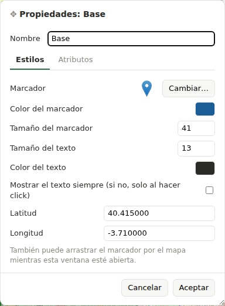
*Figura 24. Estilo de la capa «Base»: icono, color y tamaño del marcador, tamaño y color del texto, y sus coordenadas.*

El botón «Cambiar…» junto al icono abre el catálogo completo de iconos disponibles (banderas, estrellas, círculos numerados, aviación, barco, transporte, figuras geométricas y más), con la gota clásica de Leaflet siempre la primera.

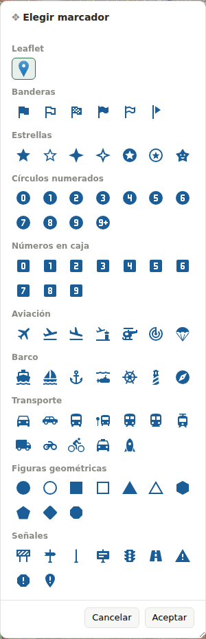
*Figura 25. Catálogo de iconos: la gota clásica al frente y, debajo, las categorías temáticas.*

### 6.2 Estilo de un polígono o una línea

Ancho, color y opacidad del contorno; un selector de tres opciones —contorno y relleno, solo contorno o solo relleno— en vez de dos casillas sueltas, porque «ni una cosa ni la otra» no es una combinación que tenga sentido ofrecer; color y opacidad del relleno; si el nombre se muestra siempre; y, en modo de solo lectura, el perímetro y el área en la unidad elegida. Un botón «Ver y editar…» abre además la lista completa de vértices como texto (uno por línea, con latitud, longitud y altitud separadas por tabulador), pensada para poder copiarla y pegarla directamente en una hoja de cálculo.

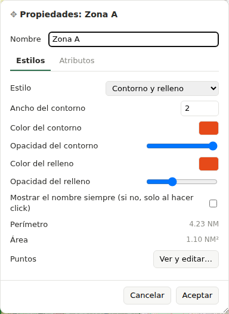
*Figura 26. Estilo de «Zona A»: modo de contorno/relleno, colores, medidas de solo lectura y acceso al editor de vértices.*

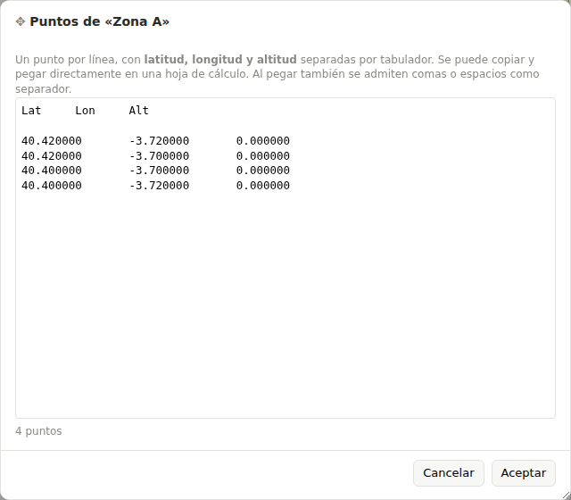
*Figura 27. Lista de vértices de «Zona A», lista para copiarse a una hoja de cálculo.*

Una figura abierta (una línea, no un polígono cerrado) no tiene superficie que rellenar: sus controles de relleno aparecen entonces deshabilitados en vez de ocultos, para que se note que existen pero no aplican a ese caso.

Además del editor de texto, sus vértices se pueden mover, borrar, seleccionar e insertar directamente sobre el mapa — **con este diálogo abierto para ese polígono, y solo entonces**: sin él, ni un clic, ni arrastrar, ni el botón derecho hacen nada sobre ningún vértice, y un vértice sin diálogo abierto se ve como un círculo blanco pequeño que no cambia el cursor al pasar por encima (con el diálogo abierto, crece y el cursor pasa a una cruz de mover). Con el diálogo abierto: un clic sobre un vértice lo selecciona, arrastrarlo lo mueve (no hace falta ninguna tecla), el botón derecho lo quita (sin poder bajar de 3 vértices en un contorno cerrado, o de 2 en una línea abierta) y `Mayús` + clic en cualquier otro punto del mapa —o la tecla `Insertar`, sin necesitar hacer clic, pero en la posición ACTUAL del ratón sobre el mapa— inserta uno nuevo justo después del seleccionado —o al final, si no hay ninguno—, con el cursor cambiando a una flecha con un signo de más mientras se mantiene `Mayús` pulsado. Con el ÚLTIMO vértice seleccionado, `Mayús` + clic sobre el manejador del PRIMERO cierra una línea abierta (sin añadir ningún vértice nuevo); y borrar el vértice que dejaría un contorno cerrado por debajo de 3 lo abre en línea en vez de bloquear el borrado —un contorno cerrado con más de 3 vértices nunca se abre borrando, sea cual sea el vértice que se borre—. La tecla `Supr` borra el vértice seleccionado con prioridad sobre borrar la capa entera. Cada cambio se aplica al momento sobre el mapa, y las medidas de solo lectura de este mismo diálogo se actualizan en vivo, pero **«Cancelar» revierte todos los cambios de vértice hechos mientras el diálogo estuvo abierto** —mover, insertar, borrar, cerrar o abrir la forma—, igual que el resto de campos del diálogo; solo «Aceptar» los deja. Cerrar el diálogo apaga además la edición: los vértices dejan de responder a nada.

Las dos formas de editar los vértices —el texto y el mapa— muestran la misma lista de puntos, así que no conviven: mientras «Ver y editar…» esté abierto, la edición sobre el mapa se desactiva (para no dejar el texto ya escrito desactualizado si se moviera un vértice por debajo), y vuelve sola al cerrar esa ventana.

Con una figura de muchísimos vértices esta edición interactiva no se activa, y solo queda disponible el editor de texto: un aviso explica cuántos vértices tiene la capa y cuál es el tope vigente. Ese tope (500 de partida) depende del equipo de quien lo usa, así que es ajustable: botón 🏷️ de la cabecera → pestaña «Preferencias» → «Tope de vértices editables».

Mientras el diálogo de un polígono está abierto, el doble clic sobre el mapa no hace zoom —de lo contrario, insertar dos vértices seguidos con `Mayús` + clic podría dispararlo sin querer—; vuelve a funcionar con normalidad al cerrar el diálogo.

### 6.3 Estilo de una medición

Igual que un polígono en cuanto a trazo y relleno, pero con sus medidas propias en modo de solo lectura: un círculo muestra **radio, perímetro, área, orientación (el rumbo del centro al borde) y las coordenadas de su centro**; una ruta, la distancia total y la de cada uno de sus tramos por separado, numerados «Tramo 1», «Tramo 2»… (una ruta de solo 2 waypoints muestra un único tramo, con su distancia y su rumbo — el equivalente de la antigua «línea»). Una casilla «Mostrar las etiquetas de distancia y rumbo» permite ocultar esas etiquetas sobre el mapa sin borrar la medición, para despejar la vista cuando hay varias mediciones juntas o se va a exportar una imagen del mapa; se muestran por defecto. Un botón «Ver y editar…», igual que en un polígono (apartado 6.2), abre la lista de waypoints como texto tabulado: un círculo siempre con dos (centro y borde), una ruta con los que tenga (mínimo 2). **También aquí manda la misma regla que en 6.2, con «Cancelar» incluido**: mover el centro o el borde de un círculo, o un waypoint de una ruta —los tres, arrastrando sin más, ya no hace falta ninguna tecla— y, en una ruta, seleccionar, borrar e insertar waypoints igual que los vértices de un polígono, `Insertar` incluido, solo funciona con este diálogo abierto para esa medición; sin él, sus manejadores se ven como un punto pequeño sin cursor propio (con el diálogo abierto crecen y el cursor cambia a una cruz de mover, y ese aspecto se conserva aunque se apague y encienda la visibilidad de la capa mientras tanto), y el botón derecho abre el menú contextual normal en vez de borrar. Con el diálogo abierto, arrastrar actualiza estas cifras al momento, sin necesidad de cerrarlo y volver a abrirlo, y «Cancelar» revierte cualquier cambio hecho mientras estuvo abierto. Con una sola ruta ya creada, el diálogo trae además el botón **«Obtener perfil»** (apartado 7.9), deshabilitado con el motivo en las mismas condiciones que en el menú contextual, que pasa a **«Mostrar perfil»** cuando la ruta ya tiene uno.

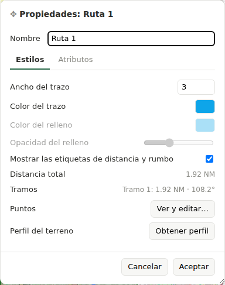
*Figura 28. Estilo de «Ruta 1»: mismo tipo de controles que un polígono, con la distancia y el rumbo de la medición debajo.*

### 6.4 Editar varias capas a la vez

Con más de una capa seleccionada, el diálogo de estilos se abre igual, pero con una regla importante: **un valor que no coincide en todas las capas seleccionadas no se aplica a menos que se toque expresamente**. La fila correspondiente se marca como «(varios)» y, al modificar ese control, deja de estarlo y pasa a aplicarse a toda la selección; lo que no se toca se queda exactamente como estaba en cada capa. Esto evita que, por ejemplo, cambiar solo el color de varias capas de golpe termine igualando también sus grosores o sus rellenos sin haberlo pedido.

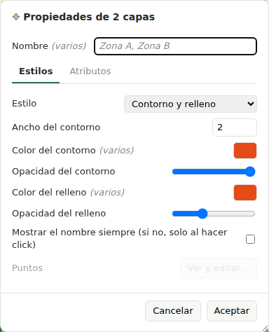
*Figura 29. Propiedades de dos capas a la vez («Zona A» y «Zona B»): lo que no coincide —aquí, los colores— lleva «(varios)» y no se cambia si no se toca; el nombre muestra los de las dos capas y el editor de puntos queda deshabilitado.*

### 6.5 Ficha de información y propiedades

Cuando una capa procede de un KML con una descripción, o de un GeoJSON con propiedades, el botón ℹ de su fila —o pasar el ratón por encima de la capa en el mapa, o «Mostrar atributos» del menú contextual— abre una ficha con esa información: el texto original en el caso de un KML (filtrado de cualquier contenido peligroso, conservando el texto) o una tabla de clave y valor en el caso de un GeoJSON. Si el tipo de capa admite edición (marcador, forma, medición…), la ficha lleva un botón «Editar propiedades» que la cierra y abre el diálogo de propiedades de esa misma capa (estilos y atributos: color, tamaño, posición, etc.).

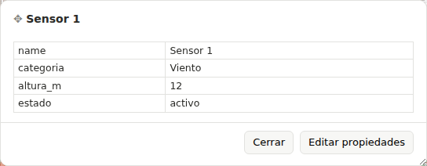
*Figura 30. Propiedades de «Sensor 1», tal como venían en el archivo GeoJSON de origen.*

---

## 7. Cómo hacer las tareas más habituales

### 7.1 Importar un archivo con un polígono (o cualquier otro formato admitido)

La vía más directa es arrastrar el archivo desde el escritorio y soltarlo sobre el panel de navegación (o sobre una carpeta concreta, para que entre dentro de ella). KITE Local reconoce KML, KMZ, GPX, GeoJSON, TopoJSON, shapefiles, ortofotos COG (apartado 7.10) y su propio formato de carpetas exportadas, mirando el contenido del archivo, no su extensión. Si el archivo contiene algún elemento con datos incorrectos, ese elemento se descarta de forma aislada y el resto se carga con normalidad; al terminar aparece siempre un resumen de lo cargado y lo omitido, con la causa.

**Nombre de los elementos de un GeoJSON.** Un GeoJSON no dice cómo se llama cada elemento: solo trae propiedades. Por eso, al abrir uno cuyas propiedades no se hayan visto antes, aparece el diálogo «Elegir nombre», sin asumir que ninguna propiedad (ni siquiera «name») sea el nombre. Se marcan una o varias propiedades; **el orden en que se marcan es el orden en que se unen, separadas por « / »** (cada casilla muestra su número, y debajo se ve el nombre que saldría para el primer elemento). Si a un elemento le falta una de las propiedades elegidas, o la tiene vacía, simplemente se omite; si le faltan todas, se llama «Elemento N». Aceptar exige marcar al menos una. **Cancelar el diálogo cancela la carga de ese archivo**: no entra nada en el árbol y el aviso lo dice.

La elección se recuerda para los archivos con la misma estructura de propiedades: la próxima vez se aplica sin preguntar y el registro de avisos (📋) deja constancia de que se usó una selección guardada. Para cambiarla, 🏷️ Propiedades → «Índices de GeoJSON».

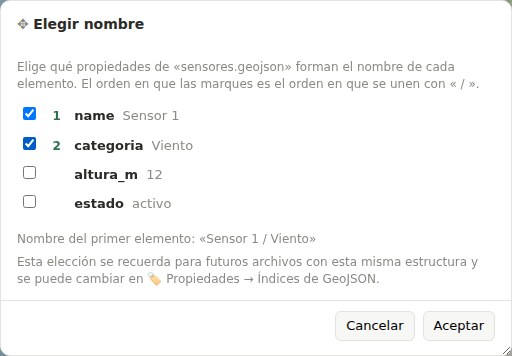
*Figura 31. El diálogo «Elegir nombre» al abrir «sensores.geojson», con «name» y «categoria» marcadas por ese orden: cada casilla lleva su número y, debajo, se ve el nombre que saldría para el primer elemento.*

**Nombres con etiquetas HTML y marcadores duplicados.** Dos preguntas más pueden salir al importar un KML o un GeoJSON, **una vez por archivo** y solo si hace falta. Si los nombres (o las propiedades de un GeoJSON) traen marcado de tipo HTML —texto entre `<` y `>`, normalmente resto de la herramienta que generó el archivo—, el aviso «Etiquetas en los nombres» pregunta si se quitan al importar («Eliminarlas») o se dejan («Dejarlas»; se conservan como texto: la aplicación nunca las interpreta como código). Si el archivo trae marcadores con el mismo nombre y la misma posición (con menos de unos 1,1 m de diferencia), el aviso «Marcadores duplicados» pregunta si se fusionan, quedándose uno de cada grupo («Fusionar»), o se mantienen todos («Mantener todos»). En un GeoJSON, el nombre que cuenta es el que se eligió en «Elegir nombre», y esta pregunta llega después. El resumen de la importación deja constancia de las etiquetas quitadas y de los duplicados fusionados.

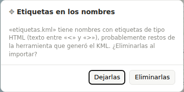
*Figura 32. El aviso «Etiquetas en los nombres» de un KML cuyos nombres traen marcado HTML.*

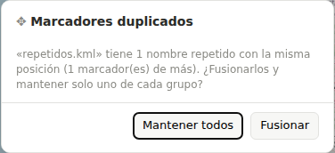
*Figura 33. El aviso «Marcadores duplicados» de un KML con un nombre repetido en la misma posición.*

**Shapefiles.** Un shapefile no es un archivo sino varios con el mismo nombre: el `.shp` (las geometrías), el `.dbf` (los atributos), el `.prj` (el sistema de coordenadas) y, a veces, el `.cpg` (la codificación de los textos) y el `.shx`. Hay que **soltarlos todos a la vez** —se seleccionan juntos en el explorador de archivos y se arrastran— o soltar el `.zip` que los contiene; un `.zip` con varias capas da una carpeta por capa. Si llega una pieza sin su `.shp`, el aviso lo dice. Cada shapefile se trata como un GeoJSON: el nombre de los elementos se elige igual (diálogo «Elegir nombre», con los campos del `.dbf`), y valen las mismas preguntas sobre etiquetas HTML y duplicados.

- **Sistema de coordenadas.** Lo más habitual en España es ETRS89 UTM (por ejemplo, EPSG:25830, huso 30): KITE Local lee el `.prj` y lo pasa a coordenadas geográficas. Si un shapefile llega **sin `.prj`**, solo se acepta si sus coordenadas ya son grados (y el resumen dice que se ha supuesto WGS84); si son metros, se rechaza, porque no hay forma de saber dónde colocarlo.
- **ED50.** La cartografía antigua en ED50 se transforma con los parámetros estándar de la España peninsular; la precisión es de unos metros y el resumen lo advierte. Un datum que no se sabe transformar se dibuja, pero el resumen avisa de que puede estar desplazado decenas o cientos de metros.
- **Textos con tildes.** Se usa la codificación que indique el `.cpg`; si no lo hay, se detecta si el `.dbf` está en UTF-8 y, si no, se lee como Windows-1252.
- **Lo que no se conserva.** La altura (Z) de los shapefiles 3D no se importa: solo la posición. Un shapefile sin `.dbf` entra sin atributos (sus elementos se llaman «Elemento N»).
- **Límites.** Hasta 300 MB entre `.shp` y `.dbf`, y hasta 100 000 elementos por shapefile; lo que pase de ahí se omite y se cuenta en el resumen.

Cuando no se tiene el archivo en el disco pero sí su dirección web, el botón 🔗 de la cabecera ofrece el mismo resultado en dos pasos: se escribe o se pega la dirección y se pulsa «Descargar» (vale también un shapefile, en un `.zip`); solo cuando la aplicación confirma qué ha llegado (tipo y tamaño) se activa «Añadir al árbol» para incorporarlo. Mientras no se pulse ese botón, nada llega al mapa.

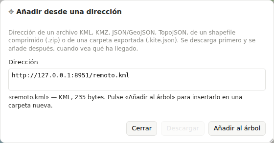
*Figura 34. Tras descargar «remoto.kml», el diálogo confirma el tipo y el tamaño y habilita «Añadir al árbol».*

Todo lo incorporado por esta vía queda dentro de una carpeta «Descargas», con una subcarpeta numerada por descarga («Descarga 1», «Descarga 2»…), para que varias descargas sucesivas no se mezclen entre sí.

**GPX.** Un archivo `.gpx` (los de los GPS de montaña y las aplicaciones de rutas, en sus versiones 1.0 y 1.1) entra en una carpeta con el nombre del archivo, con un nodo por cada **waypoint** (un marcador), **ruta** y **track** (una línea; si el track tiene varios segmentos, una línea de varias partes). Cada uno se llama como su `<name>` en el archivo, sin pasar por «Elegir nombre»; los waypoints sin nombre salen como «Elemento N». La altitud (`<ele>`) se conserva, y el resto de datos del archivo (descripción, comentario, símbolo, tipo, enlace y la hora de cada punto) queda en la pestaña «Atributos» del elemento. Un punto sin coordenadas válidas se omite y el resumen de la carga lo cuenta; si el archivo no trae ningún waypoint, ruta ni track, se rechaza con su motivo. Las extensiones propias de cada fabricante (colores, pulsaciones…) no se leen.

### 7.2 Medir una distancia y un rumbo

Se pulsa la herramienta «Medir ruta» (⤳) de la barra de dibujo: un clic marca cada waypoint y un doble clic termina la ruta (siempre queda abierta; no se puede cerrar en anillo). Para una distancia y un rumbo sueltos basta con dos waypoints —origen y destino—, exactamente como una línea de toda la vida. **Desde ese segundo waypoint, dibujar una ruta se comporta como editarla**: la medición ya cuelga de una fila del árbol, dentro de una carpeta «Mediciones», con su propio nombre autonumerado («Ruta 1», «Ruta 2»…), y su diálogo de propiedades se abre solo, mostrando distancia y rumbo ya calculados — sin esperar a terminar el dibujo. Cada waypoint que se añade después actualiza esas cifras al momento. Cancelar el diálogo a medio dibujar —con `Escape` o con su propio botón «Cancelar»— borra la ruta, igual que cancelar un marcador recién creado, y sale del modo de dibujo; pulsar «Aceptar», o terminar con doble clic (se comporta exactamente igual que «Aceptar»), en cambio la GUARDA con los waypoints que tenga hasta ese momento, cierra el diálogo —señal visual de que la edición ha terminado— y sale del modo de dibujo.

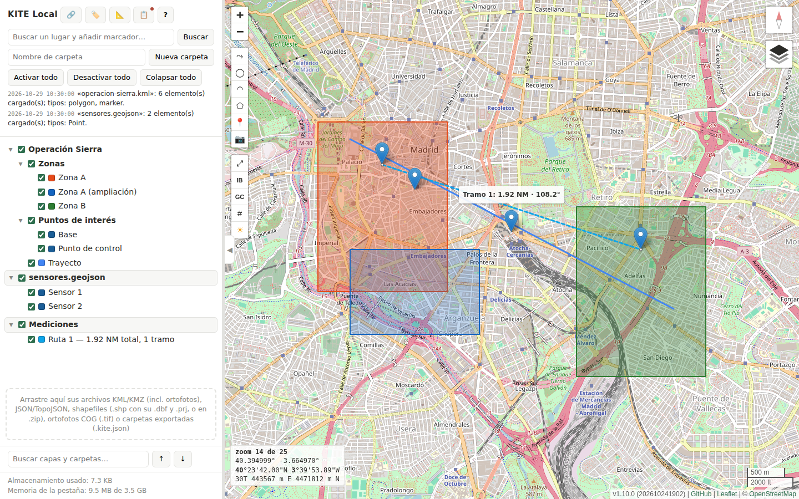
*Figura 35. Medición de ruta entre «Base» y «Punto de control»: 1,92 millas náuticas a un rumbo de 108,2°, con su fila («Ruta 1») en la carpeta «Mediciones» del árbol.*

Para editar una ruta ya creada, con su diálogo de propiedades abierto (ver 6.3), basta con arrastrar uno de sus waypoints —ya no hace falta `Ctrl`—; con el botón derecho se quita uno (sin poder bajar de 2). **Sin el diálogo abierto**, el botón derecho sobre un waypoint no borra nada: abre el menú contextual normal del mapa, con acceso directo a «Editar propiedades». La unidad de distancia (metros, kilómetros, pies, millas o millas náuticas —esta última la unidad por defecto, la habitual en navegación aérea y marítima—) y el formato de coordenadas se eligen una sola vez, en el panel 🏷️ Propiedades (apartado 2.1), y se aplican a la vez a todas las mediciones y a todos los polígonos, tanto en su diálogo de estilo como en las etiquetas que se ven sobre el mapa.

Para una ruta con varias escalas, en vez de un solo tramo, se añaden más de dos waypoints: cada tramo lleva su propia etiqueta de distancia y rumbo sobre el mapa —numerada «Tramo 1», «Tramo 2»…, para poder identificarla de un vistazo con la fila del mismo tramo en el diálogo de propiedades—, y la fila del árbol muestra la distancia total.

### 7.3 Medir una superficie, o dibujar una figura propia

La herramienta «Medir círculo» (◯) se arrastra del centro al borde y da el radio, el perímetro y la superficie. La herramienta «Dibujar polígono o línea» (⬠) es distinta: no se arrastra, se hace un clic por cada vértice; un doble clic sobre el último vértice cierra la figura como un polígono con superficie, y un doble clic en cualquier otro punto la deja como una línea abierta, sin relleno.

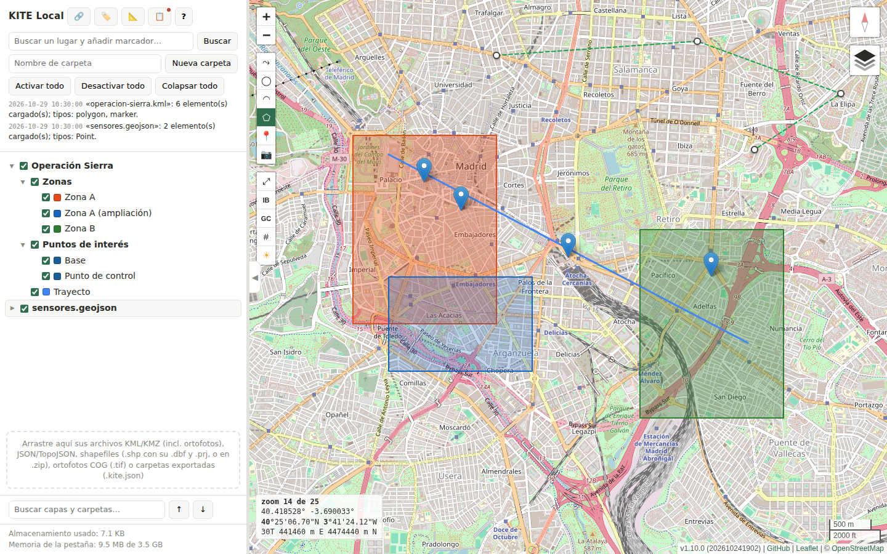
*Figura 36. Un polígono a medio dibujar con «Dibujar polígono o línea» (⬠, resaltada en la barra): cada clic pone un vértice y el trazo provisional se ve en verde discontinuo. Un doble clic sobre el último vértice lo cierra.*

### 7.4 Personalizar un marcador

Se abre su diálogo de propiedades con el botón 🎨 de su fila («Editar propiedades»). «Cambiar…» abre el catálogo de iconos; un clic sobre uno lo selecciona y ya lo muestra sobre el marcador del mapa; «Cancelar», en el selector, devuelve el icono que había, y «Aceptar» lo confirma como icono elegido para ese marcador. De vuelta en el diálogo principal, el color escogido tiñe cualquier icono del catálogo (no afecta a la gota clásica de Leaflet, que es una imagen fija). Todo se ve en el mapa mientras se edita, pero solo al pulsar «Aceptar» en el diálogo de estilo el conjunto de cambios —icono, color, tamaños, texto y posición— queda definitivo; «Cancelar» lo revierte entero.

### 7.5 Copiar capas entre dos instancias distintas de KITE Local

Al ser una aplicación que corre en el navegador, dos pestañas —o dos instalaciones en dos direcciones distintas— no comparten memoria entre sí de forma automática. Para pasar capas de una a otra:

1. En la primera instancia, se selecciona la carpeta o las capas que se quieren llevar (un clic, o `Mayús + clic` para varias) y se pulsa `Ctrl + C`. Esto no solo guarda una copia interna: también escribe la información en el portapapeles del propio sistema operativo.
2. En la segunda instancia —en otra pestaña, otra ventana o incluso otro ordenador con acceso al portapapeles compartido—, se pone el cursor donde se quiera recibir el contenido y se pulsa `Ctrl + V`. La carpeta y sus capas aparecen ahí, con su geometría y sus estilos intactos.

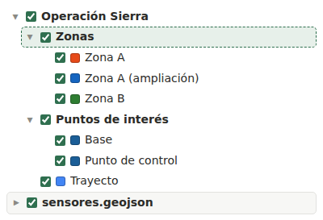
*Figura 37. Instancia de origen: la carpeta «Zonas» seleccionada justo después de `Ctrl + C`.*

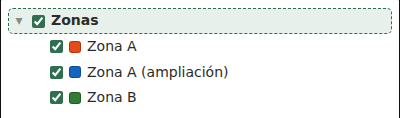
*Figura 38. Instancia de destino, antes vacía: tras `Ctrl + V`, la carpeta «Zonas» aparece con sus tres capas.*

Este mecanismo copia siempre; nunca mueve nada de la instancia de origen, aunque en esa misma instancia (no entre dos distintas) `Ctrl + X` sí corta de verdad. Pegar solo se interpreta como una importación de capas cuando el cursor está sobre el árbol: pegar en cualquier otro campo de texto de la aplicación —por ejemplo, en el editor de vértices— pega el texto tal cual, sin intentar interpretarlo.

### 7.6 Guardar una carpeta y volver a cargarla más tarde

El botón 💾 de una carpeta, un archivo o una capa abre un pequeño menú con tres formatos:

- **«Archivo de KITE (.kite.json)»**: la carpeta entera, con sus estilos y su estructura. Ese archivo puede volver a soltarse sobre el panel —en esta misma instalación o en cualquier otra— y se añade como una copia nueva, nunca sustituye ni fusiona lo que ya hubiera.
- **«KML (.kml)»**: para abrirlo en Google Earth, QGIS y programas parecidos. Conserva carpetas, nombres, fichas, colores y grosores, la visibilidad y la altitud, y las propiedades de cada elemento como datos extendidos.
- **«GeoJSON (.geojson)»**: una única lista de elementos; la carpeta de cada uno va en su propiedad `folder`, y el color y el grosor en las propiedades `stroke`, `stroke-width`, `fill`… que entienden QGIS y geojson.io.

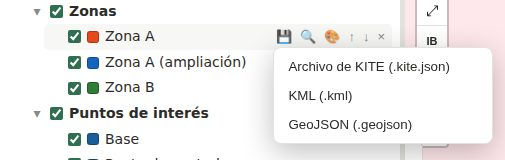
*Figura 39. El botón 💾 de la carpeta «Zona A» y su menú: «Archivo de KITE (.kite.json)», «KML (.kml)» y «GeoJSON (.geojson)». Se cierra con un clic fuera, con Escape o volviendo a pulsar 💾.*

Una medición se exporta como línea (ruta) o como un polígono de 120 lados (círculo). Lo que no cabe en KML ni en GeoJSON —las cuadrículas de elevación y las ortofotos— se deja fuera, y un aviso dice cuáles.

### 7.7 Deshacer y rehacer

`Ctrl + Z` deshace la última operación que cambió el árbol (borrar, pegar, arrastrar, ordenar, crear un marcador, una medición o una figura dibujada…), y `Ctrl + Y` la rehace. Hacer algo nuevo después de deshacer descarta lo que se pudiera haber rehecho, igual que en cualquier editor de texto.

### 7.8 Consultar la altitud del terreno

Con el botón derecho sobre el mapa, **«Consultas» › «Elevación»** descarga la altitud del terreno (MDT) y de la superficie (MDS) de una pequeña zona cuadrada alrededor del punto pulsado (unos 40 m de lado) y la dibuja como una cuadrícula: cada celda lleva el terreno, la superficie y la diferencia entre ambos —lo que hay construido o la vegetación—, en la **unidad de altitud** de Propiedades (metros, pies, kilómetros, millas o millas náuticas; cambiarla repinta las cifras; la unidad de distancia no las toca). Por debajo del zoom 19 las celdas de 5 m no llevan texto y se colorean en rojo cuando la superficie supera al terreno en más de un metro; las de malla más gruesa escriben antes, porque ya son más grandes en pantalla (las del MDT25 y de Copernicus, dos niveles de zoom antes; las del MDT200, cinco: desde el zoom 14 una línea y desde el 15 todas). Si una celda es tan grande que su centro queda fuera de la pantalla, su cifra se coloca en la parte que se ve. Cada consulta necesita conexión y es una petición expresa: mover el ratón no consulta nada. Mientras la consulta está en marcha, el cursor sobre el mapa es el de espera; no hay aviso de «consultando», ni otro al terminar: la capa nueva aparece en el árbol.

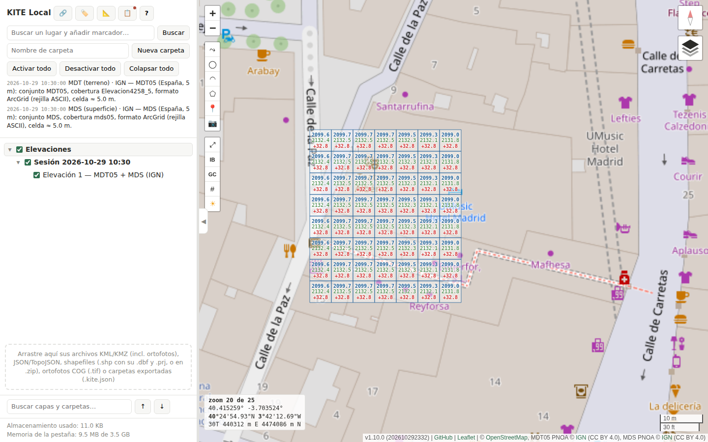
*Figura 40. Una consulta de elevación (datos de ejemplo, no de un servicio real): en el árbol, «Elevaciones › Sesión … › Elevación 1 — MDT05 + MDS (IGN)»; en el mapa, sus celdas de 5 m con el terreno, la superficie y la diferencia (en rojo, la que pasa de 1 m). Arriba, en el registro, la elección de cada servicio.*

De qué servicio sale cada modelo se elige en 🏷️ Propiedades → «Fuentes de datos» (apartado 2.1). De partida son los del **Instituto Geográfico Nacional** (cobertura solo sobre España): el MDT05 y el MDS, de celdas de 5 m; como MDT se puede elegir también el MDT25 o el MDT200 (celdas de 25 y 200 m: la zona descargada crece con la celda para que quepan al menos dos). Como MDS hay también **Digital Earth Africa** (Copernicus DEM, celdas de unos 30 m, cobertura en África, Canarias y la península hasta los 39° N: Andalucía, Murcia, el sur de Extremadura, de Castilla-La Mancha y de la Comunidad Valenciana). Este servicio tarda bastante en la primera petición a una zona (medio minuto, comprobado) y mucho menos en las siguientes; la aplicación lo espera más que a los demás y, si una petición falla por algo pasajero (el servicio no responde, error del servidor), la repite sola hasta tres veces, con una pausa creciente entre intentos. Solo si los cuatro intentos fallan aparece el aviso, que dice cuántos fueron. Desde Chrome, Edge y demás navegadores basados en Chromium, Digital Earth Africa rechaza las consultas; con Firefox o Safari funciona. Con un modelo en «Ninguna» no se le pregunta: las celdas muestran solo el otro, sin diferencia. Si las dos están en «Ninguna», la entrada del menú aparece deshabilitada. Con dos mallas de distinto tamaño (por ejemplo MDT25 y MDS), las celdas son las de la más fina y cada una lleva el valor de la gruesa que la contiene.

La primera consulta a cada servicio, en cada sesión, lee qué ofrece y elige la malla más fina y, si puede, la rejilla en texto (ASCII); el registro de avisos (📋) deja constancia una vez de lo elegido: conjunto de datos, cobertura, formato y tamaño de celda.

Las celdas de cada servicio se dibujan siempre sobre la **misma malla**: dos consultas vecinas encajan sin solaparse, y las celdas de un perfil de ruta (apartado 7.9) coinciden exactamente con las de una consulta puntual en la misma zona, con los mismos valores. Los servicios no entregan sus celdas originales, sino una rejilla recalculada para cada zona pedida; KITE les pide siempre la misma rejilla para que lo descargado en momentos distintos case.

Cada consulta queda como una capa más del árbol, «Elevación 1», «Elevación 2»…, con el conjunto de datos y el proveedor de lo descargado en el nombre («Elevación 3 — MDT25 + MDS (IGN)», o «Elevación 4 — MDT05 (IGN) + COP-DEM GLO-30 (Digital Earth Africa)» con proveedores distintos), dentro de una carpeta por sesión («Sesión» con la fecha y la hora de su primera consulta; cada vez que se abre la aplicación empieza una sesión nueva) en la sección «Elevaciones»: se pueden ocultar, borrar o deshacer por separado. Volver a consultar la misma zona con las mismas fuentes no descarga nada: señala la capa que ya la tiene. Con el cursor encima de una celda, el cuadro de coordenadas muestra sus valores (apartado 4.3). La lupa 🔍 de la fila encuadra la cuadrícula en el mapa.

### 7.9 Obtener el perfil de una ruta

Con el botón derecho sobre una ruta, **«Obtener perfil»** (o el mismo botón en su diálogo de propiedades, apartado 6.3) descarga del MDT y del MDS elegidos en «Fuentes de datos» las celdas que recorre la ruta y dibuja su perfil: la distancia desde el inicio en horizontal, en la unidad de distancia, y la altura en vertical, en la unidad de altitud, con **una curva por modelo: el terreno (MDT) en azul y la superficie (MDS) en verde**, y una leyenda arriba con el nombre de cada fuente. Si uno de los dos modelos está en «Ninguna», se dibuja solo el otro. Los vértices donde cambia de tramo se marcan con una línea discontinua y su distancia en **negrita** bajo el eje, y coinciden exactamente con la suma de las distancias de los tramos que se leen en el mapa. Cambiar cualquiera de las dos unidades en Propiedades redibuja la gráfica, y la ventana se puede mover y agrandar. No tiene botones abajo: se cierra con la **×** de arriba a la derecha (o con Escape), y todo el espacio por debajo de la barra de controles es gráfica.

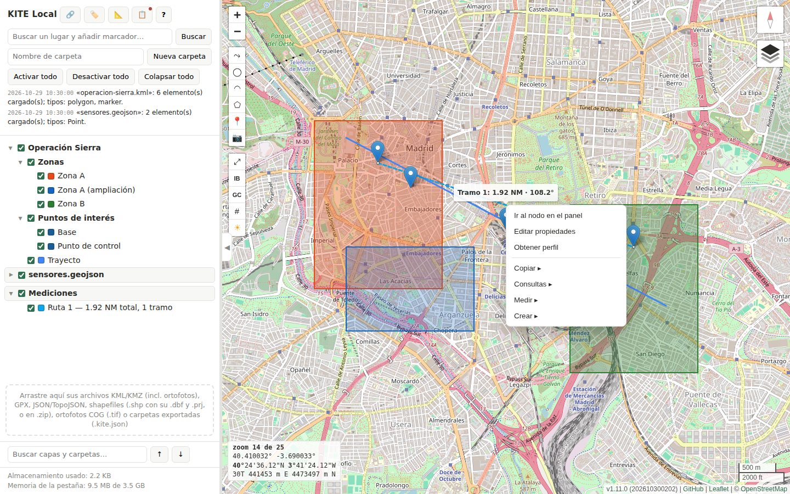
*Figura 41. El menú contextual sobre una ruta: «Obtener perfil» junto a «Ir al nodo en el panel» y «Editar propiedades».*

**La rueda del ratón sobre la gráfica acerca o aleja la distancia**, con el punto que hay bajo el ratón fijo en su sitio, para ver de cerca una zona concreta: alejar llega como mucho a la ruta entera, y acercar, a 0,1 metros de ruta por píxel (la lectura de la distancia gana decimales para distinguirlo). **Arrastrar la gráfica con el botón izquierdo la desplaza** (el cursor es una mano) para ver la zona contigua, sin cambiar el zoom; se para al principio y al final de la ruta. **También en altura**: si el arrastre se desvía unos píxeles en vertical, la escala de alturas se bloquea en lo que se veía y la gráfica sigue a la mano en las dos direcciones (arrastrar hacia abajo muestra lo que hay más arriba); un arrastre horizontal con la mano algo torcida no toca la altura. Las cifras de los vértices que caen en la parte visible siguen en negrita, con más decimales si hace falta.

La **altura** tiene su propio zoom, independiente: la rueda con **Mayús** pulsada, o la rueda con el ratón **sobre el eje de alturas** (a la izquierda), la acerca o la aleja con el punto bajo el ratón fijo. De partida la escala de alturas se ajusta sola a lo que se ve; al hacer zoom de altura queda **bloqueada**: se queda quieta aunque se desplace o se acerque la distancia, y entonces arrastrar la gráfica la mueve también en vertical. El zoom **no tiene botones**: es solo la rueda. Debajo de la gráfica, la casilla **«Bloquear eje Y»** (marcarla congela la escala de alturas que se ve; desmarcarla vuelve al ajuste automático), **«Curvatura terrestre (k = 4/3)»** (más abajo), **«Ver todo»**, que vuelve a la ruta entera con la altura automática, y una pista de los gestos.

Las curvas son **líneas rectas entre los valores de celdas consecutivas**: no se suavizan ni se inventan puntos intermedios. Con zoom se ven todos los valores; con la ruta entera, si hay más celdas que píxeles, de cada columna de píxeles se dibujan el valor más bajo y el más alto, para no perder ningún pico.

La ventana se reparte así: **arriba a la izquierda**, lo que cambia la recta («Línea inicio–fin» y «Elipsoide de Fresnel (60 %)», juntos, y debajo «Torre inicio» y «Torre final», cada una con el vértice de la ruta donde está); **arriba a la derecha**, el **rectángulo de lectura** (más abajo); **debajo de la gráfica**, «Bloquear eje Y», el desplegable «Curvatura terrestre», «Ver todo», los botones «PNG» y «CSV» (apartado siguiente) y la pista de gestos. **Ninguno de estos controles se guarda con el perfil ni con la aplicación**: valen mientras se abran perfiles en la sesión. La frecuencia del elipsoide, en cambio, es un ajuste de Propiedades.

- **Línea inicio–fin**: dibuja una **recta negra** entre la antena de la torre de inicio y la de la torre final, con la altura del terreno en cada una tomada del MDS (la superficie, que es lo que de verdad tapa una señal) y, si el MDS no está elegido, del MDT. Por defecto las torres están en el primer y el último punto de la ruta; si hay una celda sin dato en uno de ellos, se usa la más cercana que sí lo tenga. Si las torres están en vértices intermedios, la recta continua va solo entre ellas y, antes de la torre de inicio y después de la final, **sigue discontinua** hasta los extremos de la ruta (no cuenta para la escala de alturas). La leyenda dice de qué modelo sale.
- **Curvatura terrestre**: un desplegable con cuatro opciones, para representar la curvatura de la Tierra con la **refracción estándar de la atmósfera** (la señal se curva hacia el suelo, como si la Tierra tuviera un radio efectivo 4/3 mayor, unos 8 495 km) sin curvar la señal. Las tres formas de dibujarla dan **el mismo despeje**; solo cambia el dibujo. Con `c(d) = (d−dA)·(dB−d)/(2·k·R)` (lo que asoma la Tierra sobre la cuerda que une las dos torres, a `dA` y `dB` metros del inicio de la ruta; a 100 km, unos 147 m en el centro; negativa fuera de las torres, donde la Tierra cae):
  - **Ninguna**: sin curvatura (de partida).
  - **Clásica (k = 4/3)**: la Tierra es curva y su centro cae entre las torres. Cada punto del terreno se dibuja a su altura **más `c(d)`**, y el **arco de la Tierra** parte del **nivel del mar (0)** con un relleno suave por debajo; la escala de alturas se amplía para que se vea desde el 0. El eje vertical pasa a llamarse «Altura + curvatura k = 4/3».
  - **Tierra plana, rayo curvo**: el terreno queda con sus alturas reales sobre una base recta (el nivel del mar es una recta en 0) y lo que se curva, hacia arriba en los extremos, son la **línea inicio–fin y el elipsoide de Fresnel**, que se dibujan a su altura **menos `c(d)`**.
  - **Desde el inicio**: la Tierra es curva, pero apoyada en la torre de inicio (el plano tangente, o horizonte local, de esa torre): el terreno y el nivel del mar **caen** `(d−dA)²/(2·k·R)` desde ella, y la línea sigue recta. El eje pasa a llamarse «Altura − caída k = 4/3».

  La distancia se mide a lo largo de la ruta, de modo que una ruta con giros se trata como un trayecto recto.

- **Torre inicio / Torre final**: alturas de torre (o de antena) **sobre el terreno**, en la unidad de altitud de Propiedades. Suben los dos extremos de la recta negra (y del elipsoide) y se dibujan como un trazo grueso del terreno a la antena. Valen 0 de partida; un valor fuera de rango (0 a 10 000 m) se ajusta al límite y se avisa. Junto a cada una, el desplegable **«en»** elige **el vértice de la ruta** donde está (numerados desde 1 como las líneas del editor de puntos, con su distancia; el primero «Inicio» y el último «Final»; de partida, la de inicio en el primero y la final en el último). Así se puede definir un tramo **antes** de la torre de inicio y otro **después** de la final, para ver los obstáculos de detrás y de más allá: el terreno se dibuja entero, y la recta, el elipsoide y la curvatura se refieren al tramo entre las torres. La torre de inicio ha de ir antes que la final (las opciones que lo impedirían salen deshabilitadas) y, en una ruta de un solo tramo, no hay nada que elegir. Los vértices son de cada ruta: al abrir el perfil de otra vuelven a los extremos (las alturas se conservan).
- **Elipsoide de Fresnel (60 %)**: dibuja alrededor de la recta inicio–fin el **elipsoide de Fresnel** de la frecuencia elegida en Propiedades → «Frecuencias» (1090 MHz de partida): el contorno de la primera zona, discontinuo, y dentro, **rellena, la zona del 60 %**, que es la que debe quedar libre de obstáculos para no perder señal de forma apreciable. Su radio a una distancia `d` de un extremo de un trayecto de longitud `L` es `√(λ·d·(L−d)/L)`, con `λ = c/f`; a 1090 MHz, en el centro de 10 km, 26,2 m (15,7 m al 60 %). Funciona también sin marcar «Línea inicio–fin» (entonces no se pinta la recta, solo el elipsoide a su alrededor), y **con la curvatura activada** se dibuja sobre el mismo terreno elevado: el elipsoide y la recta siguen rectos y lo que sube es el terreno, así que lo que entra en la zona es lo que de verdad la invade.

Con las dos activadas se ve de un vistazo si hay **línea de vista**: si el terreno elevado (o el arco de la Tierra) sube por encima de la recta negra en algún punto, la curvatura o el relieve la impiden. Con el ratón, el rectángulo de lectura da la **«Curvatura»** (la corrección de ese modo a esa distancia, con signo) y el **«Despeje»**, la altura de la recta menos la del terreno ya corregido, que es el mismo en los tres modos: **en rojo cuando es negativo**, es decir, cuando ahí se pierde la línea de vista. Con el elipsoide, otras dos filas dan el **radio de Fresnel al 60 %** y el **margen** (el despeje menos ese radio), también en rojo cuando es negativo, es decir, cuando el terreno entra en la zona. Fuera del tramo entre las torres, el despeje es el de la prolongación de la recta (solo si está dibujada) y el radio de Fresnel y el margen salen en guiones. Las alturas de cada modelo en la lectura siguen siendo las reales, sin la corrección.

Para leerla de un vistazo, la gráfica sigue unas reglas fijas: las curvas y la recta son líneas de 2 px y los colores son los mismos con el tema claro o el oscuro (con pasos más claros en el oscuro, para que mantengan el contraste sobre el fondo); los vértices son referencia y van apagados y punteados, salvo los de las dos torres, que llevan una línea continua cuando hay recta; lo que queda **fuera del enlace** (antes de la torre de inicio y después de la final) se atenúa con un velo tenue; y cada antena es un punto con su altura sobre el terreno al lado.

Al pasar el ratón por la gráfica, una línea vertical roja lo sigue y el **rectángulo de lectura** de arriba a la derecha —siempre del mismo tamaño, con guiones cuando el ratón no está sobre la gráfica y con las filas de lo que no está activado atenuadas— da la distancia y la altura de cada modelo en ese punto (cada fila lleva un trazo del color de su curva) y, con los dos, **su diferencia «MDS−MDT»** con signo (lo que sobresale la superficie —edificios, vegetación— por encima del terreno), **en rojo cuando pasa de 1 metro**, como en las celdas de elevación; a la vez, **una flecha roja sobre la ruta en el mapa** marca ese mismo punto y apunta en el sentido de la marcha, moviéndose con la línea. La vista del mapa no se mueve: si la ruta no está a la vista, la flecha tampoco. Al sacar el ratón de la gráfica o cerrar la ventana, la flecha desaparece.

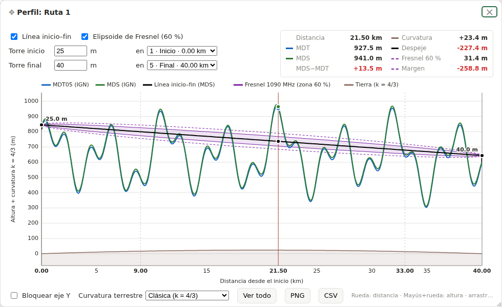
*Figura 42. Ventana del perfil de una ruta de 40 km (datos de ejemplo, no de un servicio real) con el MDT (azul) y el MDS (verde), y la línea inicio–fin, el elipsoide de Fresnel de 1090 MHz y la curvatura terrestre activados. Arriba a la izquierda, las opciones de la recta y las dos torres (25 y 40 m, con el vértice donde está cada una; sus antenas, con la altura rotulada); arriba a la derecha, el rectángulo de lectura del cursor, con la distancia, las alturas, la diferencia MDS−MDT, la curvatura, el despeje, el radio de Fresnel al 60 % y el margen (en rojo los valores negativos o por encima de 1 m); debajo de la gráfica, el bloqueo del eje Y, el desplegable de curvatura, «Ver todo» y la pista de gestos; arriba a la derecha de la ventana, la × de cerrar. Bajo el cursor, un punto sobre cada curva y sobre la recta indica de qué altura habla la lectura.*

La descarga se hace por zonas a lo largo de la ruta, una tras otra y de las dos fuentes, con una **barra de progreso** que dice qué porcentaje lleva y cuántas zonas faltan, y debajo un **registro de la descarga**, para depuración: cada petición que la aplicación lanza a cada servicio (su dirección completa y el intento), lo que recibe (estado, tipo y tamaño de la respuesta, tiempo y la rejilla de celdas leída, con sus alturas mínima y máxima) y los fallos, con la espera antes de reintentar. Tiene su propia barra de scroll, así que la ventana no crece, y sigue lo último salvo que se suba a leer; se puede seleccionar y copiar. Al terminar la descarga, el registro desaparece y su sitio es para la gráfica; mientras tanto, la **×** de la ventana la cancela sin dejar nada. Una zona que no responde ni tras sus reintentos deja un hueco en la curva de su modelo, y la ventana dice cuántas fallaron y de qué fuente. Al terminar, la misma × solo cierra.

En el árbol queda una capa «Perfil de «Ruta 1» — MDT05 + MDS (IGN)» en la carpeta raíz **«Perfiles de ruta»**, con **solo las celdas que recorre la ruta** y no todo lo descargado (las de la malla más fina, con el valor del otro modelo y su diferencia, como en una consulta puntual); se puede ocultar, encuadrar con la lupa, borrar o deshacer como cualquier otra. Esa capa guarda también las curvas: desde entonces la opción de la ruta, en el menú contextual y en su diálogo, se llama **«Mostrar perfil»** y enseña la gráfica al momento, sin descargar nada ni crear otra capa, también tras cerrar y volver a abrir la aplicación. El perfil va unido a la **forma** de la ruta: si se mueve, añade o borra un waypoint, la opción vuelve a ser «Obtener perfil» (el perfil anterior sigue en el árbol hasta que se borre); si se borra la capa del perfil, también. La longitud de la ruta tiene un límite, ajustable en Preferencias (10 millas náuticas de partida, 100 como máximo), para que una ruta muy larga no llene el almacenamiento del navegador con celdas: por encima, «Obtener perfil» aparece deshabilitada con el motivo. El límite **solo se aplica cuando alguna de las fuentes elegidas es de malla fina** (5 a 30 m); con el MDT200 (una celda cada 200 m) como única fuente, una ruta de 100 millas náuticas deja unas 900 celdas y no hay límite. Si a la vez está elegido un MDS fino, manda ese.

---

**Exportar el perfil.** Los botones **«PNG»** y **«CSV»** del pie de la ventana guardan el perfil en un archivo, con el nombre de la ruta («Ruta 1-perfil.png», «Ruta 1-perfil.csv»):

- **«PNG»** es la gráfica **tal como se ve** —con el zoom y los controles que haya puestos: las curvas, la línea inicio–fin, el elipsoide, la curvatura, la leyenda y los ejes—, con un título con el nombre de la ruta y las fuentes de datos, sobre el fondo del tema en uso, y al doble de tamaño que en pantalla para que se lea bien al ampliarla. No lleva ni el cursor ni el rectángulo de lectura.
- **«CSV»** guarda los datos de la **ruta entera** (no solo la parte que se ve), en las unidades elegidas en Propiedades: una fila por cada distancia en la que el MDT o el MDS tienen un valor, con la **distancia**, la **latitud** y la **longitud** de ese punto de la ruta y la **altura de cada serie**. Si las dos series tienen mallas distintas, cada una deja vacía su celda en las filas de la otra; un hueco del servicio (zona sin dato) también queda vacío, nunca como un 0. El archivo es UTF-8 con las columnas separadas por comas y el punto como separador decimal, y se abre bien en Excel y en QGIS (como texto delimitado, con «Latitud» y «Longitud» como coordenadas).

### 7.10 Ver una ortofoto en COG

Una ortofoto en formato **COG** (Cloud Optimized GeoTIFF, un `.tif` preparado para leerse a trozos), como las del PNOA, se añade **arrastrando el archivo `.tif`** al panel, igual que cualquier otro. KITE Local comprueba primero que se puede dibujar y, solo entonces, **copia el archivo al almacenamiento del navegador**: queda guardado con el árbol y vuelve al abrir la aplicación, sin tener que soltarlo de nuevo. El aviso dice qué ha entrado: tamaño en píxeles, sistema de coordenadas, número de vistas generales y lo que ocupa.

**¿Tengo un ECW?** Es el formato de las descargas del Centro de Descargas del CNIG, y KITE Local **no lo puede abrir** (es un formato propietario). Si lo suelta, el aviso se lo dice y le da la orden de conversión. Conviértalo a COG con GDAL (necesita soporte ECW): `gdal_translate -of COG -co COMPRESS=JPEG hoja.ecw hoja.tif`. En QGIS para Windows, que lo trae: Ráster › Conversión › Traducir, con formato de salida COG. Después suelte el `.tif`.

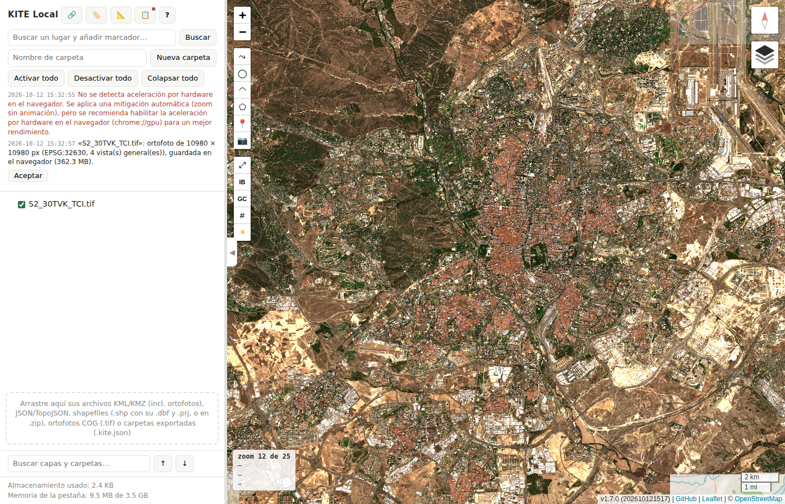
*Figura 43. Una imagen COG de 362 MB (Sentinel-2, color natural, UTM 30N) sobre Madrid. Solo se lee la parte que se ve, al detalle que pide el zoom. Contiene datos modificados de Copernicus Sentinel (2026).*

- **Solo se lee lo que se ve.** Para cada trozo del mapa se lee la parte justa de la imagen, al nivel de detalle que pide el zoom: una ortofoto de cientos de megabytes se mueve con fluidez. Si el `.tif` no está en mosaico, o no trae vistas generales, el aviso lo advierte: lo primero hace que vaya lento y lo segundo, que de lejos no se dibuje (hay que acercarse).
- **Sistema de coordenadas.** Se admiten WGS84, ETRS89, Web Mercator y UTM en WGS84 (cualquier huso, norte o sur: es lo que traen, por ejemplo, las imágenes de Sentinel-2), en ETRS89 (husos 28 a 38, tanto con los códigos EPSG:25828–25838 como con los de ejes norte-este EPSG:3040–3050, como el 3043) y en ED50 (husos 28 a 31, los de la España peninsular), además de REGCAN95 para Canarias. Una imagen en otro sistema, o sin georreferenciar, se rechaza con un aviso que lo dice. Se pasa a la proyección del mapa al dibujarla, sin alterar la imagen guardada.
- **Ortofotos de 8 bits por canal** (color o escala de grises) **y modelos de elevación** de una sola banda de 16 o más bits (un MDT del CNIG, por ejemplo). Una imagen de otro tipo, como una de 16 bits en color, se rechaza con un aviso que lo dice.
- **Modelos de elevación.** Se arrastran igual que una ortofoto. Se dibujan con una **rampa de color por altitud** (del verde de lo más bajo al blanco de lo más alto, entre el mínimo y el máximo de la propia imagen) y un **sombreado de relieve** para que se lea la forma del terreno; el aviso de la carga dice el rango de altitudes. Las celdas sin dato quedan transparentes. Con el cursor sobre el modelo, el cuadro de coordenadas de la esquina inferior izquierda añade la fila **«Altitud»** con el valor de la celda, en la unidad de altitud de Propiedades (se supone que el archivo está en metros). Si hay a la vez celdas descargadas con «Consultar elevación aquí», manda su lectura. El sombreado y el color son solo una representación: no cambian ningún valor.
- **Opacidad.** El botón 🎨 de su fila abre sus propiedades, con un deslizador de opacidad, como el de una ortofoto de KMZ. El botón 🔍 encuadra la imagen entera.
- **Espacio.** Antes de copiar se comprueba que cabe en la cuota del navegador; si no, se avisa y no se crea nada. Al borrar la ortofoto del árbol, su copia se elimina la próxima vez que se abra la aplicación (hasta entonces, deshacer la puede recuperar).
- **Lo que no viaja.** Una ortofoto COG no se incluye al exportar una carpeta (💾) ni al copiar al portapapeles del sistema para pegar en otra instancia: puede ocupar gigas, y el aviso nombra las que se quedan fuera. Copiar y pegar dentro de la misma pestaña sí funciona. Tampoco se añade desde una dirección (🔗): hay que descargarla y arrastrarla.

### 7.11 Usar KITE Local sin conexión

KITE Local puede volver a abrirse **sin red** cuando se usa **desde una dirección web** (la de GitHub Pages o la de su propio servidor): la primera vez que se abre con conexión, el navegador guarda la aplicación y las librerías que necesita, y a partir de ahí una pestaña que el navegador haya descartado para ahorrar memoria, o una que se recargue con F5, **vuelve a abrirse aunque no haya red**, con el árbol y las capas tal como estaban.

- **Qué hace falta.** Haberla abierto al menos una vez con conexión, desde una dirección `https://` (o `localhost`). El navegador la guarda en segundo plano tras el arranque, sin avisar. Abierta con doble clic como archivo local no se guarda nada: el navegador lee el archivo del disco y lo que necesita de Internet (las librerías) depende de su caché normal.
- **Qué funciona sin red.** Todo lo que no necesita servidores ajenos: el árbol y las capas guardadas, importar KML, KMZ, GeoJSON y shapefiles (también con su `.prj`), las mediciones y el dibujo, la calculadora geodésica, las ortofotos y modelos COG ya guardadas, los perfiles y cuadrículas de elevación ya descargados, exportar a PNG y exportar carpetas.
- **Qué no.** Los mapas base (las teselas se piden a sus servidores: el visor queda con el color de fondo), la búsqueda de lugares, las consultas nuevas de elevación, de perfiles y de parcela catastral, «Añadir desde una dirección» y los catálogos de PNOA histórico y Copernicus. Esas acciones avisan de que **no hay conexión** en lugar de dar un error confuso.
- **El indicador.** Mientras no haya red aparece **«Sin conexión»** bajo la cabecera del panel, y un aviso lo explica al perder la red, al recuperarla y al abrir la aplicación ya sin ella.
- **Versiones.** Con conexión se carga siempre la versión más reciente publicada, como antes. Si la red existe pero no responde, tras unos 4 segundos se abre la copia guardada.

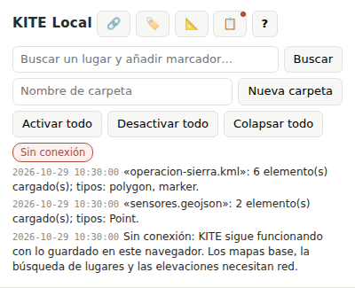
*Figura 44. Sin conexión: el indicador «Sin conexión» bajo los botones y, debajo, el aviso que lo explica. El árbol y las capas guardadas siguen disponibles.*

### 7.12 Consultar una parcela catastral

Con el botón derecho sobre el mapa, **«Consultas» › «Parcela catastral»** pregunta a la **Dirección General del Catastro** qué parcela hay exactamente en el punto pulsado y la añade al árbol como un polígono más, dentro de la sección «Catastro», con el nombre «Parcela» seguido de su referencia catastral (por ejemplo, «Parcela 0443112VK4704C»). Hay que pulsar DENTRO de la finca: sobre una calle, una plaza o un camino el Catastro no tiene parcela y lo dice con un aviso.

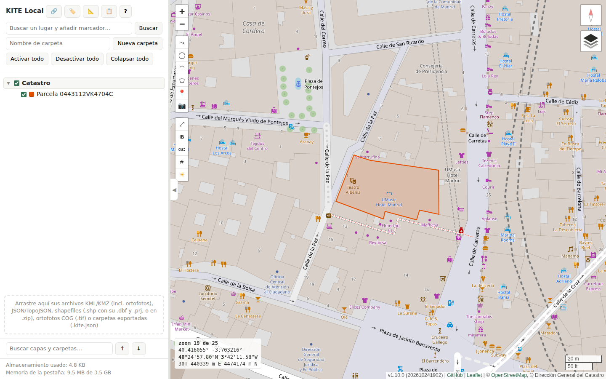
*Figura 45. La parcela de la calle de la Paz 11 (Madrid), dibujada en naranja, y su fila «Parcela 0443112VK4704C» en la sección «Catastro» del árbol. La atribución del Catastro ha pasado a la línea inferior.*

La ficha de la capa (el botón ℹ, o «Mostrar atributos» en su menú) trae la **referencia catastral**, la **dirección** de la finca tal como la da el Catastro, la **superficie catastral en m²**, la etiqueta de la parcela y su **fecha de alta**. El polígono se dibuja en naranja con un relleno suave y es una capa como las demás: se puede ocultar, renombrar, cambiar de estilo (🎨), borrar, deshacer, exportar y copiar. El polígono es el que publica el Catastro: KITE Local solo cambia el orden de las coordenadas para dibujarlo y no lo simplifica ni lo ajusta.

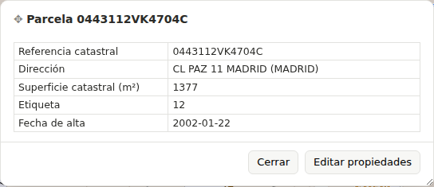
*Figura 46. La ficha de la parcela: referencia catastral, dirección, superficie en m², etiqueta y fecha de alta.*

- **Es una consulta expresa.** Solo se pide algo al Catastro cuando se elige esta opción; mover el ratón o abrir un archivo no consulta nada. Mientras dura, el cursor sobre el mapa es el de espera. Se envían las coordenadas del punto pulsado y, después, la referencia que el Catastro ha devuelto. La vista no se mueve. A diferencia de la consulta de elevación (apartado 7.8), funciona también con el mapa girado.
- **Cada parcela una vez.** Si se vuelve a pulsar sobre una parcela que ya está en el árbol, no se descarga otra vez: se señala la fila y se avisa. (Tras recargar la aplicación, una parcela ya guardada vuelve a poder pedirse y entraría duplicada.)
- **Cobertura.** El servicio cubre el territorio donde el Catastro estatal es el competente. **El País Vasco y Navarra tienen catastro propio** y ahí siempre se responde que no hay parcela, igual que fuera de España.
- **Fallos.** Un fallo pasajero del servicio (no responde, error del servidor) se repite solo hasta dos veces; si no se consigue, aparece un aviso con la causa, y no queda nada a medias en el árbol. Sin conexión, la opción avisa de que no hay red.
- **Atribución.** La primera vez de cada sesión se añade «© Dirección General del Catastro» a la línea inferior del mapa.

### 7.13 Dibujar anillos de alcance y sectores

Con el botón derecho sobre el mapa, **«Crear» › «Anillos de alcance…»** o **«Crear» › «Sector…»** abre un diálogo con el punto pulsado como **centro** (su latitud y longitud, en el formato elegido en Propiedades, se pueden corregir). Los cambios se ven **al momento** sobre el mapa, en naranja y a trazos; **«Cancelar»** o `Escape` los quitan sin dejar nada.

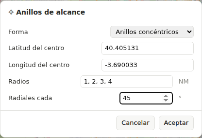
*Figura 47. «Anillos de alcance»: cuatro radios (1, 2, 3 y 4 NM, en la unidad elegida en Propiedades) y una radial cada 45°.*

- **«Anillos concéntricos»**: una lista de **radios** en la unidad de distancia de Propiedades, separados por comas o espacios y con punto decimal (`10, 20, 30`); se ordenan solos. Hasta 40 anillos, de hasta 10 000 km. Con **«Radiales cada»** (de 1° a 180°; 0 = ninguna) salen además líneas desde el centro hasta el anillo mayor, empezando por el norte.
- **«Sector»**: **azimut inicial y final** en grados (0° = norte, en sentido horario: de 330° a 30° es un sector de 60° que pasa por el norte), **radio exterior** y, si se quiere una corona en vez de una cuña, **radio interior** menor que el exterior.

Si algo no es válido, el diálogo lo dice debajo de los campos y «Aceptar» queda deshabilitado hasta corregirlo.

Al aceptar se añade al árbol, dentro de la sección «Polígonos»: una carpeta **«Anillos de alcance N»** con un polígono por radio (llamado como su radio: «10 NM») y, si se pidieron, una línea «Radiales cada 45°»; o un polígono **«Sector N»**. Son capas normales: se pueden renombrar, cambiar de color y de grosor, exportar a KML o GeoJSON y borrar como cualquier otra, y **deshacer** (`Ctrl + Z`) quita de una vez todo el conjunto. Cada vértice está exactamente a su radio del centro sobre la esfera terrestre, no es una aproximación de pantalla.

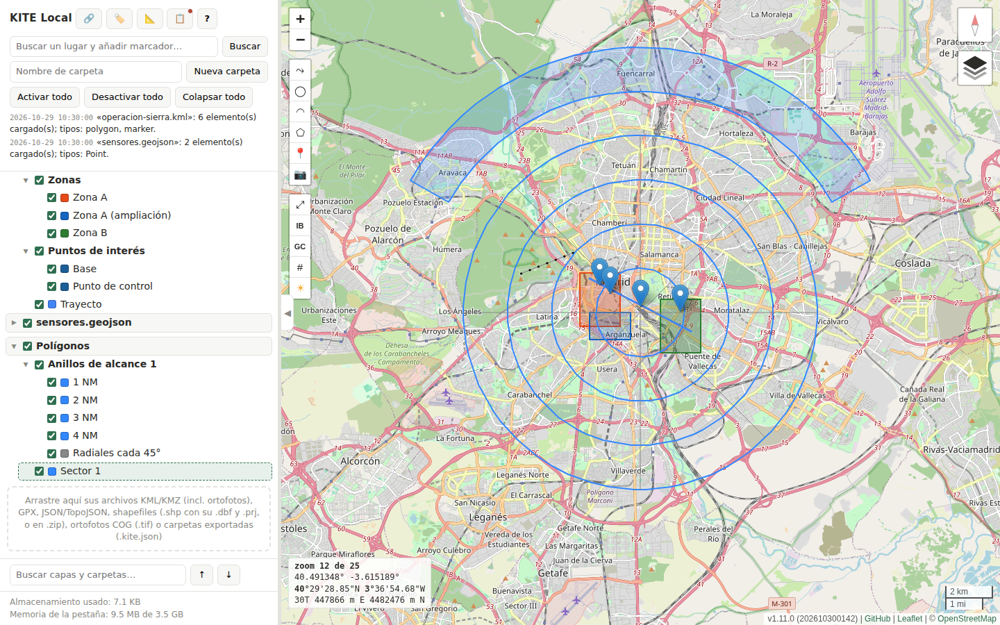
*Figura 48. Resultado: la carpeta «Anillos de alcance 1» con sus cuatro anillos y las radiales, y «Sector 1», una corona entre 5 y 6 NM de 300° a 60° por el norte.*

### 7.14 Compartir una vista con un enlace

Con el botón derecho sobre el mapa, **«Copiar» › «Enlace a esta vista»** copia al portapapeles una dirección como esta:

`https://…/kitelocal.min.html#map=14/40.4050/-3.6900/30&base=osm,pnoa`

Quien la abra (en otra pestaña, otro navegador u otro equipo con la misma aplicación) ve el mapa **exactamente donde estaba**: el centro y el zoom —los de la vista, no el punto donde se hizo el clic derecho—, el giro de la brújula si lo había (el `30` del ejemplo, en grados) y los **mapas base encendidos**. Esa vista **sustituye a la guardada** en ese navegador, y los mapas base del enlace a los que estuvieran encendidos. Pegarla en la barra de direcciones de una pestaña ya abierta con la aplicación hace lo mismo sin recargar.

Lo que **no** viaja en el enlace: el árbol de capas (cada navegador guarda el suyo y no sale de él), y los mapas base con dirección o credencial propia —«Custom Tile Map Service», «Custom Web Map Service», Copernicus DEM y el PNOA histórico—, que al otro lado llegarían sin poder usarse; si hay alguno encendido, el aviso al copiar lo dice. Una dirección que no cumpla el formato (números fuera de rango, texto raro) se ignora sin más, y el enlace se quita de la barra de direcciones al aplicarse, para que recargar la página no lo repita.

Si la aplicación se tiene abierta como archivo del disco (doble clic), el enlace apunta a ese archivo y **solo sirve en ese equipo**; el aviso también lo dice. Para compartirlo con otras personas hay que abrir la aplicación desde una dirección web (por ejemplo la de GitHub Pages).

### 7.15 Ver los atributos de una carpeta y exportarlos

Los archivos que se cargan suelen traer, además de la geometría, **atributos** de cada elemento: las propiedades de un GeoJSON o de un shapefile, y los datos extendidos (`ExtendedData`) de un KML. Al pasar el ratón por una carpeta o un archivo aparece el botón **▦**, que abre la **«Tabla de atributos»**: una fila por cada capa de dentro, con su nombre, y una columna por cada atributo que alguna tenga.

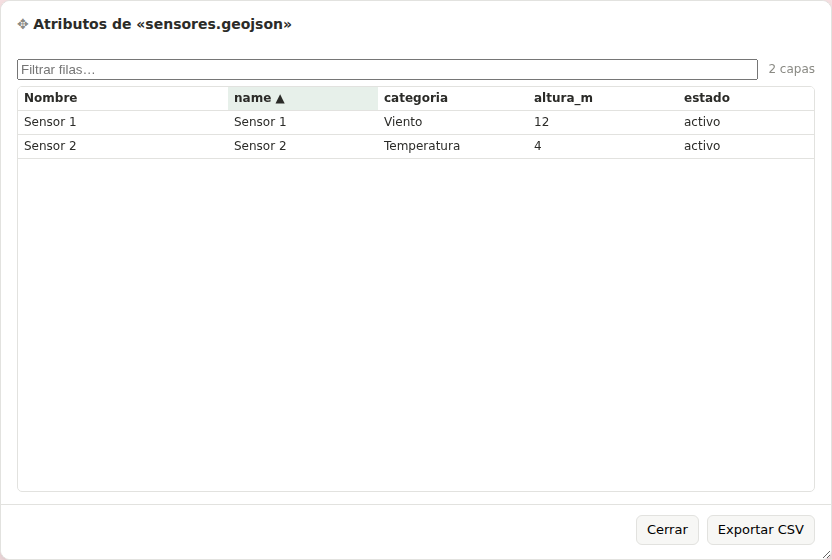
*Figura 49. La tabla de atributos de un GeoJSON de dos sensores: una fila por capa y una columna por atributo. La flecha junto a «name» indica que está ordenada por esa columna.*

- **Ordenar**: pulsar el encabezado de una columna ordena por ella, y pulsarlo otra vez invierte el sentido. Una columna de números se ordena como números (9 antes que 10) y una de texto sin distinguir mayúsculas y entendiendo las cifras («Zona 2» antes que «Zona 10»); las celdas vacías van siempre al final.
- **Filtrar**: el campo de arriba deja solo las filas cuyo nombre o cuyo valor de algún atributo contiene el texto, sin distinguir mayúsculas. El contador dice cuántas capas se ven de cuántas hay.
- **Ir a una capa**: pulsar una fila selecciona esa capa en el árbol —desplegando lo necesario— y la hace parpadear en el mapa, sin cambiar la vista; un doble clic además centra el mapa en ella. La tabla es una ventana flotante, no modal: se puede seguir usando el mapa con ella abierta.
- **Exportar CSV** descarga lo que se ve, con el filtro y el orden puestos, en un archivo con codificación UTF-8 que Excel abre bien, separado por comas y con el punto como separador decimal. Por seguridad, un valor que empiece por `=` o `@` (o por `+` o `-` sin que siga una cifra) lleva delante un apóstrofo, para que una hoja de cálculo no lo interprete como una fórmula que alguien haya escondido en un archivo ajeno.

- **«Estilo por atributo…»** colorea las capas de la carpeta según un atributo. En el diálogo se elige el atributo y el tipo: **«Categorías»** da un color a cada valor distinto (los más frecuentes primero; si hay más de doce, el resto se junta en «Otros», y las capas sin ese atributo van en gris como «(sin valor)»), y **«Graduado»**, solo con un atributo numérico, reparte las capas en 2 a 9 clases por **intervalos iguales** entre el mínimo y el máximo, o por **cuantiles** (las mismas capas en cada clase), con una escala de claro a oscuro. Cada clase muestra su color —que se puede cambiar pulsándolo—, su valor o tramo y cuántas capas tiene.

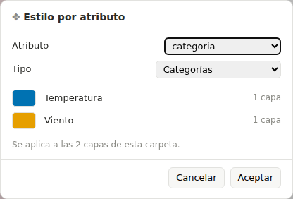
*Figura 50. «Estilo por atributo» de los dos sensores, por el atributo «categoria»: una clase por valor, con su color y su recuento.*

  El resultado se ve **al momento** en el mapa, y **«Cancelar»** (o `Escape`) devuelve cada capa a su estilo. Al **aceptar**, cada capa queda con su color como estilo normal —se puede cambiar después como cualquier otro (apartado 6), y `Ctrl + Z` deshace el conjunto entero—; la clasificación se hace una vez y no se actualiza si luego cambia un atributo. Los polígonos y las líneas toman el color en el trazo y en el relleno; los marcadores, en el icono: uno con la gota por defecto de Leaflet, que no se puede colorear, pasa a un punto del color de su clase, y uno con otro icono lo conserva y solo cambia de color.

La tabla es una **instantánea** de lo que había al abrirla: si se cambia el árbol con ella abierta, hay que cerrarla y volver a abrirla. Abrirla **no despliega** las carpetas, y funciona con carpetas de decenas de miles de capas porque solo dibuja las filas que se ven. Los atributos de un KML (`ExtendedData`) se leen como texto, tal cual vienen en el archivo, y quedan guardados con la capa; si el elemento tiene además una `description`, la ficha del elemento (ℹ) enseña esa, y los atributos se ven en la tabla.

## 8. Atajos de teclado

La misma información está disponible en cualquier momento con la tecla `?` o el botón de ayuda de la cabecera, organizada en pestañas («Navegación», «Actuar», «Visor», «Dibujar y editar») para no tener que scrollear una única tabla larga. Se cierra con la **×** de arriba a la derecha, con Escape o con la misma tecla `?`.

Esa × es la norma de toda ventana cuyo único botón sería «Cerrar» (la chuleta, los cálculos geodésicos y el perfil de una ruta): en vez de un pie con un solo botón, la × en la barra del título, que se ve siempre, y ese espacio para el contenido.

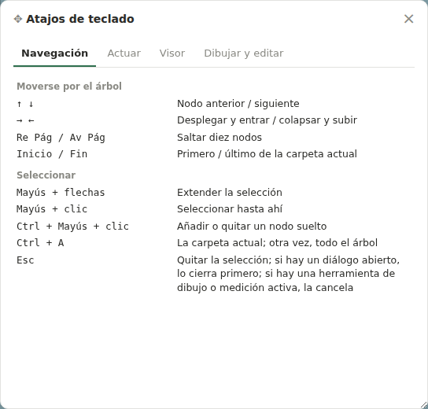
*Figura 51. Chuleta de atajos de teclado (tecla `?`), pestaña «Navegación». Las otras tres son «Actuar», «Visor» y «Dibujar y editar».*

**Moverse por el árbol**

| Tecla | Acción |
|---|---|
| ↑ ↓ | Nodo anterior / siguiente |
| → ← | Desplegar y entrar / colapsar y subir |
| Re Pág / Av Pág | Saltar diez nodos |
| Inicio / Fin | Primero / último de la carpeta actual |

**Seleccionar**

| Tecla | Acción |
|---|---|
| Mayús + flechas | Extender la selección |
| Mayús + clic | Seleccionar hasta ahí |
| Ctrl + Mayús + clic | Añadir o quitar un nodo suelto |
| Ctrl + A | La carpeta actual; otra vez, todo el árbol |
| Esc | Quitar la selección; si hay un diálogo abierto, lo cierra primero; si hay una herramienta de dibujo o medición activa, la cancela |

**Actuar**

| Tecla | Acción |
|---|---|
| Espacio | Activar o desactivar la capa |
| F2 | Renombrar (también en las propiedades) |
| Intro (renombrando) | Confirma el nuevo nombre |
| Esc (renombrando) | Cancela y restaura el nombre anterior |
| Supr | Borrar lo seleccionado |
| Ctrl + C / X / V | Copiar, cortar y pegar (también entre pestañas de KITE) |
| Ctrl + Z / Ctrl + Y | Deshacer y rehacer |
| Alt + Intro | Propiedades de lo seleccionado |
| Ctrl + F | Ir al buscador |
| ? o Mayús + / | Abrir esta ayuda |
| Arrastrar una fila por su nombre | Mover el nodo a otra carpeta o posición (Esc cancela) |

**En el visor**

| Gesto | Acción |
|---|---|
| Mayús + arrastrar | Zoom a un rectángulo |
| Arrastrar el centro o el borde de un círculo de medición (con su diálogo de propiedades abierto) | Moverlo o cambiar su radio |
| Doble clic en una fila | Ir a la capa; repetido, acercar |
| Flechas (con el mapa enfocado) | Desplazar el mapa; mantenida, se desliza sin pausa y acelera (Mayús: más rápido; dos a la vez: diagonal) |
| Re Pág / Av Pág (con el mapa enfocado) | Acercar / alejar un nivel de zoom hacia el puntero; mantenida, zoom continuo que al soltar se ajusta al nivel siguiente |
| Rueda del ratón | Zoom continuo hacia el puntero; al parar se ajusta al nivel siguiente |
| Arrastrar la brújula | Girar el mapa (el norte deja de apuntar arriba) |
| R (con el mapa enfocado) o clic en la brújula | Volver a poner el norte arriba |
| Botón central (rueda) pulsado + arrastrar a izquierda/derecha | Girar el mapa alrededor del punto pulsado |

**Gráfica del perfil de una ruta** (apartado 7.9)

| Gesto | Acción |
|---|---|
| Rueda del ratón sobre la gráfica | Acercar / alejar la distancia hacia el puntero (de la ruta entera a 0,1 m por píxel) |
| Mayús + rueda, o rueda sobre el eje de alturas | Acercar / alejar la altura (bloquea el eje Y) |
| Arrastrar la gráfica | Desplazarla en distancia y en altura (arrastrar en vertical bloquea el eje Y en lo que se ve) |

**Dibujar polígonos y rutas**

| Gesto | Acción |
|---|---|
| Clic | Fijar un vértice |
| Doble clic sobre el último vértice | Cerrar el polígono y terminar |
| Doble clic fuera de un vértice | Terminar la línea o la ruta sin cerrarla |
| Clic derecho sobre un vértice | Quitar ese vértice |
| Supr | Quitar el último vértice |

**Editar vértices de una ruta o un polígono ya creados**

| Gesto | Acción |
|---|---|
| Abrir sus propiedades (🎨 o Alt+Intro) | Activa mover/borrar/insertar vértices sobre el mapa |
| Clic en un vértice | Seleccionarlo |
| Arrastrar un vértice | Moverlo (no hace falta ninguna tecla) |
| Clic derecho sobre un vértice | Quitarlo (sin las propiedades abiertas, abre el menú contextual del mapa en su lugar) |
| Mayús + clic en el mapa, o tecla Insertar | Insertar un vértice tras el seleccionado (o al final, si no hay ninguno) |
| Mayús + clic sobre el primer vértice, con el último seleccionado | Cerrar una línea abierta (sin añadir ningún vértice) |
| Supr | Quitar el vértice seleccionado (antes que borrar el nodo) y dejar seleccionado el siguiente, para seguir quitando con Supr sin volver a hacer clic; en un contorno cerrado de exactamente 3 vértices, lo abre en línea en vez de bloquear el borrado |
| Doble clic en el mapa | No hace zoom mientras se edita así un polígono, una ruta o un círculo |

---

## 9. Qué se guarda y dónde

KITE Local guarda automáticamente, en el propio navegador y en el propio dispositivo (nunca en un servidor), el árbol completo de capas y la posición y el zoom del mapa (y, si se abre un enlace a una vista, lo que ese enlace trae), con un pequeño retardo tras cada cambio para no repetir el guardado en cada pulsación. Al volver a abrir la aplicación, el árbol y la vista se restauran tal como se dejaron. La geometría y la ficha de cada capa se guardan una sola vez, al cargarla o al cambiar su forma; desplegar, activar, mover o borrar solo vuelve a guardar la estructura del árbol, así que no frena la aplicación aunque lo guardado ocupe cientos de megas. Si al abrir faltara en el almacenamiento la información de alguna capa (por ejemplo, tras borrar a mano los datos del sitio), esa capa se quita del árbol y un aviso lo dice. Este guardado es local a cada navegador: para llevar el mismo contenido a otro dispositivo hace falta exportarlo (apartado 7.6) o copiarlo por el portapapeles del sistema (apartado 7.5).

Las **unidades de distancia y de altitud**, el **formato de latitud/longitud** y la **longitud máxima de un perfil**, elegidos en el panel 🏷️ Propiedades (apartado 2.1), sí se guardan y se restauran al volver a abrir la aplicación. También se guardan las **fuentes de elevación** elegidas en «Fuentes de datos». La cuadrícula de elevación no tiene unidad propia: usa la de altitud. Las capas de elevación y de perfil se guardan con el árbol, y la de un perfil guarda también sus curvas: «Mostrar perfil» las enseña sin volver a descargar.

La **copia de la aplicación para el uso sin conexión** (apartado 7.11) se guarda también en el navegador, aparte de los datos: solo contiene la propia aplicación y las librerías con versión fija que ya usa; nunca mapas, resultados de búsquedas ni nada de lo que descarga de servidores ajenos.

Las **ortofotos COG** (apartado 7.10) se guardan aparte, en un almacén propio del navegador: el árbol solo apunta a ellas. Es lo único del árbol que puede ocupar mucho espacio en el navegador. Una ortofoto borrada del árbol libera su espacio al volver a abrir la aplicación.
